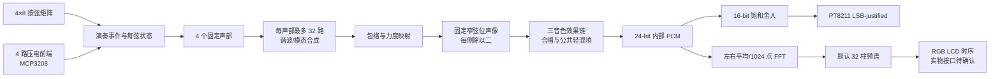

# 芯弦 FPGA 电子吉他

> 四弦实时电子乐器：双 PCB 输入、FPGA 音色合成与立体声音频输出

芯弦 FPGA 电子吉他是一套以 Sipeed Tang Mega 60K FPGA 为硬件核心的四弦实时电子乐器。系统通过琴颈按弦矩阵和桥位压电传感器采集演奏动作，由 FPGA 内部可综合 HDL 逻辑完成音高选择、力度分级、声部管理、谐波／模态加法合成、包络、数字音效、频谱分析和音频输出。演奏期间，音频生成主链路不依赖软核 CPU、外部 MCU 或上位机程序。

**当前版本（2026-10-05）：** 三音色 FULL 音频代码已进入 `master`，音频版本提交为 `6a790f8`。
当前音色为钢琴、明亮弦音和哇音；哇音 V4 延长自然衰减后的实物听感已获用户认可。
品位矩阵只选择音高，右手压电拨弦才触发发声。三个 USER_BUTTON 全部用于音色／音效控制，没有外部复位键。
LCD 尚未采购，四级力度实物标定尚未完成，当前上板默认固定力度 2。

**当前上板入口：** [neo_guitar_audio_full.gprj](gowin/neo_guitar_audio_full/neo_guitar_audio_full.gprj)，
Top=`neo_guitar_audio_full_top`，沿用现有双 PCB 和 NEO Dock 接线。
操作、构建及版本说明见 [上板工程 README](gowin/neo_guitar_audio_full/README.md)、
[哇音分析与实现](docs/WAH_REFERENCE_TIMBRE.md)、[V4 数字验收记录](docs/evidence/wah_long_decay_acceptance.txt)。

项目最终目标日期为 **2026-11-01**，计划以 Apache License 2.0 公开源码。

## 0. 当前实际进度与待验收项目

### 0.1 已完成

- **双 PCB 全链路已实物通过：** 4×8 矩阵与 MCP3208 CH0～CH3 同接 Mega 60K，支持空弦、最高品优先、真实拨弦触发、四声部并发、换品滑音及松品阻尼。只按品不发声，当前默认固定力度 2；四级力度判断逻辑及仿真保留。
- **三音色已接入当前音频 FULL：** 钢琴使用实测模态包络和短击弦起音，明亮弦音使用整数谐波，哇音使用新录音提取的半倍频模态与三个音区动态包络。旧重金属参考已退出当前第三音色。
- **哇音 V4 已获实物听感认可：** 空弦或不松品时，无效果自然尾音约 1.16 秒，延音约 4.50 秒；前 2048 样本（42.67 ms）与 V3 相同，音高不变。无效果下松品仍按原阻尼收声，包络不会无限维持。
- **三键控制已上板验证：** USER_BUTTON1 循环三音色；USER_BUTTON2 短按切换合唱、长按约一秒切换自动五度和声；USER_BUTTON3 循环无效果／延音／轻量混响。上电默认钢琴且音效关闭，内部自动初始化。
- **每声部最多 32／每帧最多 128 个分量已实现：** 四声部并行、声部内分时计算；128 个非零分量的预算测试通过，音源调度为 233／256 个 12.288 MHz 时钟。自动和声使用每声部 16 主音 + 16 五度分量，保持原预算。
- **当前立体声链已完成：** 固定窄弦位声像、每侧除以二留余量、合唱与公共轻混响、PCM24→PCM16→PT8211。普通音符之间功放保持开启。早期按音高硬声道分配和减拍频策略作为可选旧路径保留。
- **数字验收通过：** 完整 ModelSim 回归 80 项，212000 个独立整数参考样本一致；综合网表实际 DAC 输出 6528 帧与 RTL 逐位一致，包含 1597 帧半速哇音包络。输入、四声部生命周期、音效、PT8211、FFT/LCD 与实时耐久检查均有记录。
- **两种 FULL 布局布线通过：** 固定引脚音频工程与 FFT/LCD 逻辑工程 setup/hold 违例均为 0、Latch=0。FFT/LCD 数字链已接入 `full_guitar_top`，实物显示待 LCD 采购和接口确认。

当前资源及时序（Gowin V1.9.12.03，GW5AT-LV60PG484AC1/I0，Device B）：

| 项目 | 固定引脚音频 FULL | FFT/LCD FULL 逻辑构建 |
| --- | --- | --- |
| Logic / 59904 | 24433 | 31344 |
| Register / 60780 | 10788 | 13084 |
| BSRAM / 118 | 112 | 115 |
| DSP / 118 | 111 | 116 |
| 音频 Fmax（目标 12.288 MHz） | 20.356 MHz | 15.436 MHz |
| 像素 Fmax（目标 33.333 MHz） | 无 LCD | 101.292 MHz |
| Setup / Hold 违例 | 0 / 0 | 0 / 0 |

当前 RAM／DSP 已接近器件容量；布局布线通过不等于达到第 11.3 节的资源余量目标。
新增音色、显示或其它功能前需重新安排资源。

在仓库根目录构建和核对当前版本（相关工具需在 PATH，或传入本机路径）：

```powershell
# 可下载的固定引脚音频 FULL
gw_sh.exe gowin/neo_guitar_audio_full/build.tcl
# 数字回归；-ModelSimBin、-PythonExe 可指定本机安装路径
./sim/run_main_regression.ps1
# 构建后核对综合网表的实际 DAC 输出
./tools/run_piano_gate_check.ps1 -Full
# 可选：从 RTL PCM16 生成试听；需本地原录音及哇音分析结果
python tools/generate_wah_preview.py
```

下载文件为 `gowin/neo_guitar_audio_full/impl/pnr/neo_guitar_audio_full.fs`。
FFT/LCD 逻辑构建使用 `gw_sh.exe gowin/build_full.tcl`，其自动引脚位流不能下载到实物。
运行和构建直接读取仓库中的 `mem/*.mem`，不需要原始库乐队 WAV；重新拟合音色才需要原录音。
试听工具还会读取本地 `build/wah_reference/analysis.json` 和原 WAV 进行频谱对照，
这部分原始录音与分析产物需自行准备，不能仅凭新克隆的仓库执行。
`build/`、`impl/`、`sim/temp/` 中的位流、WAV 和报告为本地生成产物，不随 Git 提交。

详细证据见：

- [当前三键音频 FULL 上板说明](gowin/neo_guitar_audio_full/README.md)
- [哇音 V4 分析、实现及试听说明](docs/WAH_REFERENCE_TIMBRE.md)
- [当前 V4 资源、回归与门级 DAC 证据](docs/evidence/wah_long_decay_acceptance.txt)
- [钢琴／明亮弦音的 V2 音效基线](docs/FULL_EFFECTS_V2.md)
- [FULL 复位、时序与资源证据](docs/evidence/full_reset_timing_acceptance.txt)
- [FULL 实时耐久证据](docs/evidence/full_realtime_acceptance.txt)
- [输入覆盖与内部延迟证据](docs/evidence/full_input_latency_acceptance.txt)
- [NEO MINIMAL 仿真、实现与实物验收证据](docs/evidence/neo_minimal_audio_acceptance.txt)
- [NEO ROW0 单组触点仿真、实现与实物证据](docs/evidence/neo_row0_led_acceptance.txt)
- [四弦矩阵音频优化交接记录](docs/HANDOFF_NEO_MATRIX_AUDIO_OPTIMIZATION.md)
- [NEO 四弦矩阵音频测试说明](docs/NEO_FOUR_STRING_MATRIX_AUDIO_TEST.md)
- [双 PCB 全链路接线、参数与上板步骤](docs/NEO_FULL_CHAIN_AUDIO_TEST.md)
- [双 PCB 全链路仿真与固定引脚实现证据](docs/evidence/neo_full_chain_audio_acceptance.txt)
- [主工程同步、构建与可选功能说明](docs/MAIN_ENGINE_SYNC.md)
- [三音以上减拍频策略、参数及 A/B 试听](docs/ANTI_BEAT_AUDIO.md)
- [古典大钢琴参考录音分析与离线音色样音](docs/PIANO_REFERENCE_ANALYSIS.md)
- [钢琴音源、击弦起音与 FPGA 主工程试验](docs/PIANO_FPGA_TRIAL.md)
- [早期主工程同步数字验收证据](docs/evidence/main_engine_sync_acceptance.txt)
- [Tang Mega 60K / NEO Dock 板级集成审查](docs/BOARD_INTEGRATION_REVIEW.md)
- [NEO Dock 31005 / Mega 60K 板级连接矩阵](docs/NEO_31005_60K_PIN_MATRIX.md)

### 0.2 当前板级集成门槛

| 实物项目 | 当前状态 | 尚需完成 |
| --- | --- | --- |
| MS5351M CLK2 / 12.288 MHz | 已验证 | 已确认示波器频率、FPGA 音频链使用及完整断电自动恢复 |
| `MINIMAL` PT8211 音频 | 已验证 | E4 约 329.63 Hz、左右声道、连续发声及无明显周期性爆音/断音均已通过 |
| 三枚 USER_BUTTON | **音频 FULL 实物通过** | AA13 音色、AB13 合唱／五度和声、Y12 无效果／延音／轻混响；当前工程无外部复位键 |
| 品位板 ROW0 单组选音与发声 | **实物通过** | 已确认空弦及第1～8品选音、PT8211 实际发声和同组多品最高品优先；不代表完整矩阵通过 |
| 四弦矩阵音频优化版 | **实物通过** | 2026-10-02 已确认 4×8 扫描、四声部并行发声、和弦捕获、动态硬立体声、自然衰减和 PT8211 输出 |
| 品位板 ROW1～ROW3 | 已在四弦矩阵音频测试中覆盖 | 已随完整 4×8 扫描完成实物发声验证；早期 ROW0 单行记录仍作为独立诊断证据保留 |
| 完整 4×8 矩阵扫描 | **双板全链路实物通过** | 已与 MCP3208 拨弦和优化音频同接验证 |
| MCP3208 采集板 | **单板及双板集成实物通过** | 基线偏置/拨弦功能已验证；四级力度标定仍待完成 |
| 双 PCB 输入到优化音频链路 | **实物通过，用户确认结果理想** | 成功测试源码保留；当前主入口为三音色 `neo_guitar_audio_full` |
| 三音色音频 FULL | **已上板，哇音 V4 听感获认可** | 当前版本已进入 master；后续补充整机长时间、串扰和音频定量测试 |
| FFT/LCD FULL | **数字链、资源与时序通过** | LCD 未采购，显示接口与完整整机实物验收仍待完成 |
| LCD | 尚未购买/验证 | 面板、FPC、RGB666 时序、同步极性、像素时钟和背光均待确认 |

- 底板为 NEO Dock 31005，核心板仍标为 30353/30354 之一。当前 J13 矩阵接线已实物通过并包含 Bank 1；沿用其既有 LVCMOS33、电源与接线，本次没有修改供电或扩展其它 Bank 1 接口。早期连接矩阵中的通用禁用规则和 PMOD 候选分配由此实测方案取代。
- 50 MHz、PT8211、功放、三枚用户按键和 `USR_CLK_IN` 已由 31005 原理图、两版核心板共同部分及官方 60K CST 交叉核对。
- NEO Dock MS5351M 的 CLK2 已设置为 12.288 MHz；示波器及 MINIMAL 实物音频链均已确认 FPGA 可稳定使用该时钟，完整断电后会独立自动恢复，不需要电脑、MCU、BL616 运行时配置或软核 CPU。
- 当前三键音频 FULL CST 为 `constraints/neo_guitar_audio_full.cst`：矩阵 J13、ADC J8、音频、三枚 USER_BUTTON 和状态 LED 共 28 个固定且互不冲突的球位。早期 26 端口 KEY0 主工程与两组 PMOD 候选表用于历史基线和独立排错。
- LCD 尚未购买。31005 的 40-pin 连接器采用 RGB888 针脚排列，但 FPGA 实际只连接 R2-R7、G2-G7、B2-B7 共 18 bit，并与 CH569 HSPI 复用；面板及其时序确认前暂不约束 LCD。
- 当前 `USER_BUTTON1=AA13` 用于音色切换；USER_BUTTON2=AB13、USER_BUTTON3=Y12 用于音效。旧工程中的 AA13/KEY0 复位定义不适用于当前音频 FULL。`SW7/RECONFIG=N12` 是 FPGA 专用重配置按钮，SRAM 下载后按下会清除当前配置，需重新 Program/Configure；内部上电初始化不占用用户键。
- ROW0 LED 初测曾使用 PMOD1 的全部八根 GPIO 作为 COL0～COL7、PMOD0 的八根 GPIO 作为调试 LED。随后进行的 ROW0 音频闭环测试已移除 LED，只保留 PMOD1 八列输入，ROW0 直接接地、ROW1～ROW3 悬空，并通过 PT8211 输出判断所选音高。两种临时接法都与最终 12 线矩阵分配互斥，只能用于逐组诊断。

现有 **FULL 自动引脚** `.fs` 只能证明逻辑规模与时序可实现，**严禁烧录到实物板**。原始与复位修正后的 FULL 结果均已保留，不应覆盖。`neo_minimal_audio`、`neo_row0_led_test`、`neo_row0_audio_test` 与 `neo_four_string_matrix_audio_test` 是采用各自专用约束的独立实物测试构建，不属于这条自动引脚禁令，但仍应保留在各自工程中且不得混烧。

### 0.3 当前实物工作顺序

1. 以 master 的 `neo_guitar_audio_full` 三音色工程作为当前演奏与试听基线，保留成功的独立输入测试及历史位流用于排错。
2. 对四根弦分别进行压电阈值、串扰和四级力度标定；确认后再关闭 `BOARD_FIXED_VELOCITY_ENABLE`，回归并重新上板。
3. 继续检查空弦／按品、快速重拨、三／四音和弦以及音色、合唱、延音、混响和和声组合，补充长时间演奏记录。
4. 用逻辑分析仪检查 PT8211 帧，用示波器测量物理拨弦到模拟输出延迟。早期正弦／谐波链的内部延迟证据仍在 [输入延迟记录](docs/evidence/full_input_latency_acceptance.txt)，不作为当前三音色整机延迟值。
5. 先安排当前 FULL 的 RAM／DSP 余量，再扩展音色或显示功能；没有实测证据前不记录精确噪声、THD、SNR 等定量指标。
6. 采购兼容 LCD、确认 FPC、电平、像素时钟与同步极性，冻结显示 CST 后完成 FFT/LCD 实物验收和整机演示。

以下 0.4～0.10 为各阶段的历史验收记录；其中当时的工程入口、复位键、音色和待办状态不代表当前 master 配置。

### 0.4 历史：2026-09-27 板级交接记录

- 已完成 NEO Dock 31005、两版候选 60K 核心板原理图和官方 CST 的交叉核对，并建立完整连接矩阵；核心板版本继续标记为 30353/30354 未确认，Bank 1 禁用。
- 已记录 MS5351M CLK2 到 `USR_CLK_IN=V13` 的 12.288 MHz 示波器测量结果；该条目记录时尚待验证的 FPGA 音频链和完整断电恢复，随后已在 0.5 节的 MINIMAL 实物验收中完成。
- 已审查官方 138K `audio_i2s` 示例。其 PT8211 帧格式和共用底板网络可用于 MINIMAL 波形对照，但 138K 器件原语、PLL、CST、复位脚和工程顶层不得移植到 60K。
- 已发现首次 MINIMAL 上板需要单独处理功放极性：`minimal_top.pa_en` 是高有效请求，物理 `PA_EN=AB16` 为低有效；在保持现有音频 RTL 不变的前提下，由板级包装层输出复位安全的 `pa_en_n`。
- 本次只更新审查资料，没有修改 RTL、CST/SDC 或现有综合/布局布线结果；自动引脚 `.fs` 仍不可烧录。

### 0.5 历史：2026-09-27 NEO MINIMAL 实物验收

- 成功工程：`gowin/neo_minimal_audio/neo_minimal_audio`；顶层为 `neo_minimal_audio_top`，当前只通过 SRAM Program/Configure 下载，没有写入外部 Flash。
- 已把成功工程中的音频域异步复位/同步释放和低有效 `pa_en_n` 包装正式同步回 `rtl/top/neo_minimal_audio_top.v`；实物 CST/SDC 位于 `constraints/neo_minimal_audio.cst` 与 `constraints/neo_minimal_audio.sdc`。Gowin 工程平铺源码中的 include/readmemh 路径调整不反向带入仓库标准目录结构。
- 实物闭环为 12.288 MHz CLK2→E4 phase increment→`voice_audio_core`→PCM24/PCM16→`pt8211_tx`→PT8211→3.5 mm 左右声道；实测约 329.63 Hz，可持续发声，无明显周期性爆音或断音。
- KEY0/AA13 是 RTL 低有效复位：按住静音，松开后 E4 自动恢复。RECONFIG/N12 会清除 SRAM 配置，作用与 RTL reset 不同。
- 板级运行中复位 testbench 已通过：`PASS: MINIMAL runtime reset mutes and retriggers continuous E4`。EX3791 本轮未修改；在需要显式位宽清理前必须先后执行 PCM 黄金模型与相关 testbench。

### 0.6 历史：2026-09-27 ROW0 单组初步实物验收

- 独立工程：`gowin/neo_row0_led_test/neo_row0_led_test`；它与成功音频工程分开保存。工程启用 `CPU pins as regular I/O`，即 `process_config` 中 `"CPU": true`，只把 P19/R19/T21/U21 用作普通 FPGA GPIO，不使用任何 CPU。
- 临时接法为 ROW0 直接接地、ROW1～ROW3 不连接、PMOD1 全部八线输入 COL0～COL7、PMOD0 全部八线输出 LED0～LED7。ROW0 八个触点的对应测试未发现问题。
- 最新 P&R 中 PR2017=0、PR2028=0、setup/hold 违例均为 0；Pin Report 的 16 个 COL/LED 端口全部位于指定球位。详细结果见 `docs/evidence/neo_row0_led_acceptance.txt`。
- 仓库 testbench 按真实防抖周期通过：`PASS: ROW0 columns debounce, mapping, multi-press and reset`。
- 当时的验收边界：该 LED 测试不能证明 ROW1～ROW3、完整 4×8 扫描、未选中行高阻、多行防鬼键、四弦同时按键或选音/滑音/声部控制实物集成；后续 0.7 节已补充完成 ROW0 单组的最高品优先和选音到音频实物验证。

### 0.7 历史：2026-09-28 ROW0 选音到音频实物验收

- 独立工程：`gowin/neo_row0_audio_test/neo_row0_audio_test`；保留已经成功的 `neo_minimal_audio` 和 FULL 自动引脚 P&R 基线，不在原工程上覆盖修改。
- 实物接法为 ROW0 直接接地、ROW1～ROW3 不连接、PMOD1 全部八线输入 COL0～COL7；本阶段不再连接 PMOD0 LED。音频仍使用已验证的 12.288 MHz CLK2、PT8211 和 3.5 mm 输出链路。
- 选音链路为 COL 输入→两级同步→约 5 ms 的 8-bit 整体防抖→最高品优先编码→`note_phase_table`→`voice_audio_core`→PCM24/PCM16→`pt8211_tx`→PT8211。无按键对应第0品 E4，COL0～COL7 分别对应第1～8品 F4～C5。
- 实物测试已确认空弦及八个品位能够控制实际输出音高；同组多个品位同时按下时选择最高品，松开最高品但保留较低品时回到剩余按键中的最高品，全部松开后回到 E4 空弦音。
- 该工程使用 FPGA RTL 产生持续测试音，目的只是证明品位选择与音频链连接正确；不使用 MCU 或软核 CPU，也尚未接入 MCP3208 拨弦事件、滑音、Release 或四声部控制。
- 验收边界：ROW1～ROW3、4 ROW 的低电平/高阻逐行扫描、跨行多键、防鬼键、四弦同时发声及最终 `fret_note_event`/`four_string_voice_control` 集成仍需实物验证。

### 0.8 历史：2026-10-02 四弦矩阵音频优化版实物验收

- 当前四弦矩阵音频优化版已完成实物上板验证。独立工程为 `gowin/neo_four_string_matrix_audio_test/neo_four_string_matrix_audio_test.gprj`，顶层为 `neo_four_string_matrix_audio_test_top`；该结果补充了 0.7 节当时尚未完成的 ROW1～ROW3、真实 4×8 扫描和四声部实物发声验证，但不覆盖或替代此前各独立工程。
- 当前上板链路包括 4×8 品位矩阵扫描、四个独立 RTL 音频声部、约 30 ms 和弦捕获、PCM24→PCM16、`pt8211_tx`、NEO Dock PT8211 和左右声道输出。全部运行时处理由 FPGA RTL 完成，不使用 MCU 或软核 CPU。
- 拨弦测试包络参数为：约 2 ms Attack、约 200 ms 初始快速衰减、延长约 2 倍的慢速自然尾音以及松品时独立快速阻尼；不设置固定 Sustain 平台。通用 `voice_envelope`、`voice_audio_core` 和 `four_voice_audio_core` 的 `PLUCK_MODE` 默认仍为 0，只有该矩阵音频测试顶层显式设置为 1，因此当时 MINIMAL/FULL 的默认 ADSR 行为没有改变。2026-10-03 主工程同步后，当前主顶层显式启用拨弦模式，底层模块默认仍为 0 以兼容旧实验。
- `pa_en_n` 在复位期间关闭 PA，复位释放后保持 PA 开启，不再随普通 `note_on`/`note_off` 反复切换。KEY0 释放或 FPGA 刚配置时仍可能出现一次模拟启动瞬态，但普通音符之间不应重复产生 PA 启动爆破音。
- 声道策略为 note-on 时动态选择负载较小的声道，最先出现的两个声部优先分配到相反声道；声部生命周期内不换声道，不加入 crossfeed，每个声道的主声部和除以 2 以保留四声部余量。两个相近但不同的真实频率仍会产生物理拍频，后级合成单声道时拍频也可能重新出现。
- 主回归已覆盖连续四声部、相同 F4 phase increment、捕获窗口、首对声部硬分离、PA 常开和无 Sustain 的自然衰减；兼容性回归继续通过原 ADSR、四级力度、KEY3 延音及四声部独立生命周期。具体 PASS 信息与实现说明见 `docs/HANDOFF_NEO_MATRIX_AUDIO_OPTIMIZATION.md` 和 `docs/NEO_FOUR_STRING_MATRIX_AUDIO_TEST.md`。
- 本次实物验收只记录已观察到的功能结果，没有示波器截图、精确噪声、THD、SNR 或其他定量音频指标，不据此虚构数值结论。
- 约 30 ms 和弦捕获窗口只是没有接入真实拨弦传感器时的测试办法，不是最终产品方案。此条记录时 MCP3208 尚未实物测试，2026-10-03 已补充完成独立验证；最终产品仍应由矩阵负责音高、MCP3208 负责真实拨弦检测并产生 `note_on` 和 velocity，再驱动四个持续并行声部。

### 0.9 历史：2026-10-03 MCP3208 独立验证与双 PCB 集成工程

- 最新提交 `2cb7419` 与用户确认表明 `gowin/test3` 已实物通过：MCP3208 CH0～CH3 分别用压电拨弦触发 E4/B3/G3/D3，采用固定音量。
- 新增独立工程 `gowin/neo_full_chain_audio_test`：矩阵只选品，ADC 才触发起音；复用优化音频链，增加约 20 ms 平滑滑音与最后品位释放时的音高保持/阻尼。
- 两套最新实物 CST 共用的时钟、复位和音频引脚一致，其余引脚无冲突；合并后 26 个端口使用 26 个球位，实际 Pin Report 全部符合约束。
- 三组 ModelSim 回归均为 Errors=0、Warnings=0；最终固定引脚 Gowin 实现分析 4750 个端点，setup/hold 违例均为 0。用户随后确认双 PCB 同接测试结果理想；该功能验收来自用户实物反馈，没有新增定量声学测量。
- 当前集成工程保留固定力度 2，未宣称四级力度、谐波/音效或显示功能完成整机验收。详情见 [全链路说明](docs/NEO_FULL_CHAIN_AUDIO_TEST.md)。

### 0.10 历史：2026-10-03 正式主工程同步

- 主 `guitar_audio_top` 改用单一音频域输入处理；复用实测 ADC 偏置/迟滞和音频参数。
  新 `guitar_play_control` / `four_string_board_audio_chain` 管理真实拨弦、滑音、立即松品阻尼、
  自然声部结束及动态硬立体声。PA 在复位后常开。
- `xinxian_mega60k.gprj` 已从 LED 顶层改为标准 RTL 的 `neo_guitar_main_top`；
  使用当前 26 引脚 CST/SDC，不需要改现有线束。新主工程本身尚未替用户实际下载。
- 可选 FULL 保留谐波、音色切换、延音和独立双声道音效，FFT 读取最终左右平均 PCM；
  当前物理主入口默认正弦，不增加未接入的 LCD/效果键端口。
- 关闭新增减拍频混音时，主工程与成功验证工程在对齐复位释放后逐周期一致，覆盖 36 个音高、所有六种首对双弦、
  双向拨弦、重拨、松品/空弦和自然尾音。完整记录和复现命令见 [同步说明](docs/MAIN_ENGINE_SYNC.md)。
- 新减拍频混音保持四声部及原音高；优先把频差较大的组合放入同侧，必要时将较早起音的近邻声部平滑降至半幅。已完成实际 RTL PCM A/B 导出及针对性回归，默认开启，实际听感待用户复核。

## 1. 项目目标

首版整机需要完成以下闭环：

- 4 根弦、每弦 8 个有品触点，并支持无按键时的空弦音；
- 4 根弦可同时发声，每根弦固定对应一个独立声部；
- 每个声部最多包含 32 个逻辑谐波／模态分量，单个 48 kHz 样本内最多计算 128 个分量；
- 4 级拨弦力度，不采用 MIDI 0～127 力度精度；
- 支持持续音中的跨品滑音；
- 支持钢琴、明亮弦音和哇音三套实时合成音色；
- 支持合唱、延音、轻量混响和自动五度和声；
- 通过板载 PT8211 DAC 输出至 3.5 mm 耳机和 2×3 W 扬声器接口；
- 通过 5 寸 800×480 并行 RGB LCD 显示实时频谱；内部颜色保持 RGB888，采购面板须兼容 NEO Dock 31005 实际可控的 RGB666/18-bit DPI 输出；
- FPGA 内部数字链路最坏延迟不超过 5 ms，整机最坏延迟不超过 10 ms；
- `FULL` 配置下通过综合、时序、资源和整机演示验收。

### 1.1 非目标与扩展项

以下内容不属于首版强制验收：

- Karplus–Strong 弦模型；
- 无拨弦击弦、勾弦；
- 运行时 UART 在线调参；
- MIDI 0～127 连续力度；
- DDR3 图形帧缓存、图片或复杂 GUI；
- 外接 24-bit 标准 I²S DAC；
- 6 弦或更多品位；
- 软核 CPU、外部 MCU 参与运行时音频处理。

### 1.2 可选附加功能（不纳入首版 `FULL` 强制验收）

在首版 `FULL` 音频、显示、时序和板级接口稳定后，可增加以下两个 FPGA 原生扩展。扩展功能不得回退或破坏已有四声部音频主链路，运行期间仍必须由可综合 Verilog/SystemVerilog RTL 完成，不得引入软核 CPU、外部 MCU 或软件运行时算法。

#### 1.2.1 FM/PM Lite 音色模式

作为现有波表加法合成之外的可选音色模式，每个声部可以增加：

- 一个调制相位累加器；
- 一个调制频率比；
- 一个调制深度；
- 一条额外的正弦查表路径；
- 一个载波相位调制计算路径。

该模式应复用现有声部的包络、力度、滑音、PCM24 混音和 PT8211 输出链路，并通过模式选择或参数配置启用。它可以提供更明显的金属、铃声和合成器类音色，同时不要求大规模新增波表存储。

新增 FM/PM 逻辑必须验证调制深度边界、相位溢出、音量归一化、切换无爆音、样本截止时间和资源变化；不得因为增加该模式而降低现有三音色的验收结果。

#### 1.2.2 FPGA 原生节奏指导演奏模式

可增加类似节奏音游的简化四轨指导功能，但目标是预置谱面和硬件实时判定，不是完整手机游戏 GUI。建议功能包括：

- 四条轨道，对应四根弦；
- 由 `.mem`/ROM/片上 B-SRAM 保存的预编译音符时间表；
- 音符滚动、判定线和有限数量的视觉提示；
- 基于现有矩阵和拨弦事件的命中窗口判定；
- `Perfect/Good/Miss`、连击和分数计数；
- 复用现有 RGB 时序和坐标驱动显示，在频谱显示与指导模式之间切换或叠加。

该模式不得依赖运行时 CPU、MCU、联网谱面解析或完整帧缓存。若需要大量歌曲、复杂图片、触摸菜单或动态资源加载，应另行评审 Flash/DDR3 和板级接口，不自动纳入本扩展项。

两个附加功能均须满足以下条件后才能合入正式 `FULL` 分支：

- 原有音频链路仿真全部通过，且无 `deadline_miss`、FIFO underflow/overflow 或音频掉样；
- 所有目标时钟域 WNS ≥ 0；
- LUT、DSP、B-SRAM 和 CLS 仍保留 README 要求的资源余量；
- 新增独立 testbench、频谱/判定证据和综合/布局布线报告；
- 没有确认的板卡引脚不得写入正式 CST，新增显示或输入接口只能先以仿真和无引脚 RTL 形式验证。

## 2. “纯硬件音频主链路”的边界

运行期间，下列功能必须由 FPGA 内部可综合 HDL 逻辑实时完成：

1. 左手按弦状态扫描与最高品位判定；
2. 右手拨弦触发、峰值检测结果读取和 4 级力度判定；
3. 音高选择、滑音和四声部状态管理；
4. 谐波／模态加法合成、包络衰减和四声部混音；
5. 软削波、合唱、延音和轻量混响；
6. PCM 格式转换与 PT8211 串行音频输出；
7. FFT、频谱柱生成和并行 RGB 显示时序输出。

允许离线软件生成频率控制字、谐波系数、衰减系数、正弦表和 Hann 窗等 ROM 文件；允许使用 Gowin EDA 完成综合、烧录和一次性外设配置。外部 MCP3208 与 PT8211 只负责信号转换，不参与音符判断、音色生成或音效计算。

## 3. 硬件基线

### 3.1 FPGA 与底板

| 项目 | 固定配置 |
| --- | --- |
| 核心板 | Sipeed Tang Mega 60K SOM，实物为 30353/30354 之一，版本暂未确认 |
| 底板 | 官方 Tang Mega NEO Dock 31005，实物已确认 |
| FPGA | `GW5AT-LV60PG484AC1/I0` |
| Gowin 器件选择 | `GW5AT-60B`，封装 `PBG484A`，Device Version `B` |
| 逻辑资源 | 59,904 LUT4、59,904 FF |
| B-SRAM | 2,124 Kbit，118 块 |
| 18×18 DSP | 118 个 |
| 板载存储 | 512 MiB DDR3、64 Mbit Flash |
| 板载 DAC | PT8211-S，双声道 16-bit、LSB-justified |
| 主要供电 | 12 V DC5521，适配器额定电流至少 3 A |

当前外部 GPIO 按已实测的 J13 矩阵和 J8 ADC CST 分配，保留其 3.3 V 电平。三枚板载按键位于 1.5 V Bank 9，全部用于当前音频 FULL 的音色／音效控制；新的外设接线须核对球位、电压和复用关系。

### 3.2 左手琴颈

琴颈使用 32 个导电橡胶触点、PCB 电极和逐键二极管，构成 4×8 矩阵：

- 4 条扫描线对应 4 根弦；
- 8 条返回线对应第 1～8 品；
- 每次只激活一条扫描线，其余扫描线置高阻，避免输出冲突；
- 返回线使用约 10 kΩ 外部上拉，扫描线串联约 220 Ω～1 kΩ 保护电阻；
- 每个触点串联 1N4148 或同类小信号二极管，方向随最终有效电平统一；
- FPGA 内部执行双触发器同步、扫描、积分式去抖和最高品位优先编码；
- 同一根弦允许多品同时按下，但只用最高品位决定音高；
- 没有品位按下时，该弦的选音状态为第 0 品空弦。

长排线或外露琴颈接口应增加 ESD 防护。矩阵完整 8-bit 状态需保留为调试信号，不能只保留编码后的品位号。

### 3.3 右手拨弦结构

每根弦使用一条独立 TPU 弹性条：

- TPU 条建议初始尺寸：长 30～60 mm、宽 2～5 mm、高 2～6 mm、间距 8～12 mm；
- 两端夹持并施加轻微预张力，中间悬空供拨片或手指拨动；
- 每根 TPU 条的一端连接独立桥码；
- 桥码向贴有压电片的 FR-4 或薄金属弯曲梁传力；
- 四个桥码进行机械隔离，压电陶瓷不承受拨片直接冲击；
- 一端夹具应可调，以统一四根“弦”的张力和回弹手感。

尺寸、材料硬度、桥码质量和弯曲梁厚度均属于样机标定项，不能仅依靠理论值冻结。

### 3.4 压电模拟前端与 ADC

四路信号链如下：

```text
TPU 条 → 独立桥码 → 弯曲梁/压电片
      → 输入限流与双向限幅 → 高阻缓冲/增益
      → 包络检波与峰值保持 → MCP3208 → FPGA SPI
```

基线 ADC 为 3.3 V 供电的 MCP3208：12-bit、8 通道、SPI。首版使用 4 个通道，剩余通道可扩展旋钮或其他传感器。FPGA 读取的是处理后的包络／峰值，不是原始压电振动音频。

要求：

- ADC 总轮询速率不低于 40 kS/s，每根弦有效采样率不低于 10 kS/s；
- 四根弦分别配置静态偏置、噪声门限和 4 级力度阈值；
- 上电后先测基线，再开放触发；
- 使用迟滞、峰值保持释放时间和再触发死区抑制回弹连击；
- 使用短时峰值对比识别机械串扰，但不得吞掉真实快速扫弦；
- 原始 ADC、包络、峰值、力度级和时间戳均保留调试观测点。

力度接口不使用“0 表示未触发”的模糊约定，而采用独立有效位：

```verilog
pluck_valid
string_id[1:0]
velocity_level[1:0]   // 四级力度
event_timestamp
```

### 3.5 显示器

首版显示器目标为 **5 寸、800×480、支持 RGB666/18-bit DPI 输入**。NEO Dock 31005 的 J5 使用 RGB888 针脚排列，包含 R0-R7、G0-G7、B0-B7，但底板只把 R2-R7、G2-G7、B2-B7 共 18 根颜色数据连接到 FPGA/CH569 复用总线；六根低位针脚没有连接到 FPGA。该接口是并行 TTL/DPI RGB，不是 LVDS。

FULL 内部颜色继续保留每通道 8 bit，只在未来板级包装层截取 `lcd_r/g/b[7:2]` 输出，不重构内部颜色处理。LCD 数据与 CH569 HSPI 互斥。具体型号尚未采购，采购前必须取得并核对：

- LCD 模组和驱动 IC 型号；
- FPC 引脚定义及与 NEO Dock RGB 接口的兼容性；
- 逻辑电压、像素时钟、同步极性和完整 porch 时序；
- 是否需要 SPI／MCU 初始化；
- 背光电压、电流和恒流驱动方案。

面板至少应明确支持 RGB666/18-bit 输入、允许六根颜色低位不连接、属于 Sipeed 明确列出的 NEO Dock 兼容型号，或配合转接板把未连接低位固定为低电平。上述信息确认前不冻结 LCD CST，也不生成 LCD 可烧录版本。

此前候选的 540×960 MCU888/RGB888 屏不作为固定基线，除非卖家补齐上述资料，并确认其 RGB 模式、扫描方向、时序、电平和 FPC 与实际 NEO Dock／转接板兼容。

800×480×24-bit 完整帧缓存需要约 9.22 Mbit，超过片上 B-SRAM，因此首版采用坐标驱动的逐像素绘制，不使用完整帧缓存。需要复杂 GUI 时再评估 DDR3。

### 3.6 时钟与供电

音频参考当前使用 NEO Dock 31005 上 MS5351M 的 CLK2，经 `USR_CLK_IN` 进入 V13。CLK2 对 GND 已用示波器实测为 12.288 MHz：

- `12.288 MHz / 8 = 1.536 MHz` PT8211 位时钟；
- `12.288 MHz / 256 = 48 kHz` 音频采样节拍；
- 当前矩阵、ADC、声部计算、音效及 FFT 都使用 12.288 MHz，无需 100 MHz 计算 PLL；
- LCD 像素时钟在屏幕定型后由独立 PLL 输出；
- 音频到显示域用握手同步；未来效果键由 50 MHz 域处理并同步到音频域。

CLK2 的 FPGA 稳定接收和完整断电自动恢复已在 MINIMAL 实物验证中完成；当前双板主链继续使用同一时钟来源。

整机首版使用 12 V DC5521 供电，不把单 USB 或锂电池供电纳入验收。适配器、电源极性和底板版本必须在上电前复核。

## 4. 定音与演奏规则

### 4.1 标准调弦

采用十二平均律与 `A4 = 440 Hz`：

| 弦号 | 物理含义 | 空弦音 | 频率 |
| --- | --- | --- | ---: |
| 第 1 弦 | 最高音细弦 | E4 | 329.63 Hz |
| 第 2 弦 |  | B3 | 246.94 Hz |
| 第 3 弦 |  | G3 | 196.00 Hz |
| 第 4 弦 | 最低音弦 | D3 | 146.83 Hz |

每弦支持空弦和第 1～8 品，因此选音表覆盖 4×9 个状态。频率控制字由离线工具按实际采样率和相位累加器位宽生成。

### 4.2 状态机规则

1. 拨弦时读取该弦当前最高按下品位；没有按品时触发空弦。
2. 每根弦固定绑定一个声部，不需要跨弦抢占。
3. 同一弦再次拨动时重新激励该声部并重启包络。
4. 声部发声期间，只要仍有品位按下，最高品位变化就触发滑音，不重启起音包络。
5. 释放最高品后若较低品仍按住，则滑向新的最高品。
6. 释放最后一个按弦触点时，保持释放前音高并产生 `note_off`，不自动跳回空弦；无效果时进入阻尼，延音开启时继续自然衰减，关闭延音后恢复阻尼。
7. 无拨弦击弦与勾弦仅作为扩展功能。

滑音时间为集中配置参数；必须对相位增量进行逐样本平滑，不能直接跳变造成音高台阶或爆音。

## 5. 音频架构



### 5.1 四声部与 32 分量

系统包含 4 个并行声部，每声部最多 32 个逻辑谐波／模态通道。当前 `FULL` 已支持单个采样周期内最多 128 个分量的更新与累加；声部内分时计算的音源调度为 233／256 时钟。
开启自动五度和声后，在同一声部的 32 槽位内计算 16 个主音分量和 16 个五度分量，四声部总预算仍为 128。

“逻辑通道”不等于 128 套完全独立 DSP 乘法器。每个声部内部允许使用流水线和分时乘法，在 20.83 μs 的 48 kHz 样本截止时间内完成相位更新、查表、幅度衰减、加权与累加。综合报告必须分别说明逻辑分量数和实际 DSP 实例数。

每个分量至少包含：

- 模态频率比（可包含非整数倍）；
- 相位或由基频相位推导的相位地址；
- 初始幅度；
- 包络观察点或独立衰减系数；
- 音色与力度修正系数；
- 激活标志。

至少一个验收单音必须启用完整 32 个分量。其他音符允许根据音色、可听频段和资源预算关闭无贡献分量，但不得把“最多 32 路”误写成“所有音符始终 32 路”。

### 5.2 力度映射

当前板级默认启用 `BOARD_FIXED_VELOCITY_ENABLE=1`、`BOARD_FIXED_VELOCITY=2`，
保留成功实物基线的固定音量。MCP3208 峰值分档逻辑和四级力度仿真已实现，实物阈值尚需标定。

当前三音色核心的四级声部幅度增益为 Q8 的 112／160／208／256，
先改变声部总幅度；不能据此宣称已经实现随力度改变频谱或衰减时间的四套录音参数。
后续力度音色联动需另行拟合、验证资源和听感。

### 5.3 音色

`USER_BUTTON1` 每按一次循环 **钢琴 → 明亮弦音 → 哇音 → 钢琴**：

- **钢琴**：参考库乐队古典大钢琴录音，8 个主要实测模态包络加短击弦起音。
- **明亮弦音**：32 个整数谐波及各分量衰减，保留明亮的拨弦质感。
- **哇音**：参考无混响 C4/E4/G4 录音，三个音区各 32 个主要模态，包含半整数倍频率比和动态包络。V4 在前 42.67 ms 后半速推进哇音包络，无效果自然尾音约 1.16 秒，延音约 4.50 秒；DDS 相位仍以原采样率推进。

哇音时长适用于空弦或不松品，松品阻尼可提前结束无效果音符。
第三音色的 `rock_select`、`mem/rock_*` 名字保留以兼容原接口，实际音色已替换为哇音，
不再采用旧重金属 WAV、tanh 过驱动或旧版谐波滚降。

切换时使用参数平滑或短时交叉渐变。音符主体由 FPGA 实时模态／谐波合成，
钢琴击弦只读取短起音 ROM，不播放整段预录音频；演奏时不需要原始 WAV 或软件音源。

### 5.4 包络与音效

包络采用适合拨弦乐器的快速 Attack、自然 Decay 和可控 Release；Sustain 可保留为配置项，但默认不维持恒定电平。

| 按键 | 功能 | 当前行为 |
| --- | --- | --- |
| `USER_BUTTON1` / AA13 | 循环三音色 | 钢琴 → 明亮弦音 → 哇音；约 5.33 ms 交叉渐变 |
| `USER_BUTTON2` / AB13 短按松手 | 合唱开／关 | 15～23 ms 左右反向调制延迟，干湿渐变 |
| `USER_BUTTON2` / AB13 长按约 1 秒 | 自动五度和声开／关 | 下一次拨弦锁存；松手不额外切换合唱 |
| `USER_BUTTON3` / Y12 | 循环三种空间状态 | 无效果 → 延音 → 轻量混响；与合唱／和声独立 |

上电默认钢琴、合唱／和声关闭、无效果；没有外部复位键。
延音放慢自然包络并在松品后暂缓阻尼，轻混响使用公共片上 BSRAM 反馈延迟，
第三键的延音与轻混响互斥，合唱可叠加其中任一状态。
LED0 熄灭／常亮／2 Hz 闪烁对应钢琴／明亮弦音／哇音；LED1 表示合唱，LED2/3 表示延音／混响。
第三键无效果且和声启用时，LED2/3 同时亮。

首版不做卷积混响，不依赖 DDR3。反馈增益必须具有限幅和稳定性证明，旁路切换需淡入淡出。

### 5.5 定点与输出格式

- 声部内部建议使用至少 24-bit 有符号定点；
- 谐波累加器和四声部混音器必须增加保护位；
- 任意满幅组合不得发生二进制回绕，只允许饱和；
- 最终内部 PCM 保持 24-bit；
- 输出前执行饱和、舍入和可选 TPDF 抖动，转换为 16-bit；
- PT8211 输出为 48 kHz、双声道、16-bit、MSB-first、LSB-justified；当前三音色使用固定窄弦位声像，每个音在左右两侧均可听到；
- 板载 PT8211 不需要 24-bit 标准 I²S 数据，未来外接 DAC 通过独立适配层支持。

## 6. 实时频谱

频谱输入取最终效果后的内部 PCM，不回采模拟输出。基线配置为：

- 1024 点定点 FFT；
- Hann 窗；
- 约 30 FPS 刷新；
- `FULL` 默认 32 根近似对数频谱柱；
- 资源充足时可编译为 64 柱；
- 具备峰值缓降；
- LCD 使用逐像素绘制，不申请完整帧缓存。

FFT 可以使用 Gowin 硬件 IP，但必须置于 wrapper 中，并为 ModelSim 提供厂商模型或行为级替代。显示开启后不得造成音频掉样或时序失败。

## 7. 软件与工具链

| 工具 | 固定版本／用途 |
| --- | --- |
| 操作系统 | Windows 64-bit |
| 综合与布局布线 | Gowin EDA Commercial `V1.9.12.03 (64-bit)` |
| 烧录 | 上述 Gowin 安装附带的 Programmer |
| RTL 仿真 | ModelSim SE-64 10.6d，本机完整回归脚本见 `sim/run_main_regression.ps1` |
| 可综合 HDL | Verilog-2001 |
| 测试平台 | SystemVerilog |
| 离线查表 | Python 3 脚本，版本在实现时锁定 |

允许使用 Gowin PLL、异步 FIFO、B-SRAM 和 FFT 等基础硬件 IP。所有 IP 必须通过独立 wrapper 隔离，不允许核心演奏逻辑依赖软核程序或整套黑盒音频算法。

## 8. 当前工程结构

以下为当前源码与主要入口；独立实物测试工程和历史文档继续保留。

```text
xinxian-fpga-guitar/
├─ README.md
├─ docs/
│  ├─ README_答辩版.md
│  ├─ CONFIGURATION_PLAN.md
│  ├─ WAH_REFERENCE_TIMBRE.md
│  ├─ FULL_PIANO_EFFECTS.md
│  ├─ FULL_EFFECTS_V2.md
│  └─ evidence/
├─ gowin/
│  ├─ neo_guitar_audio_full/      # 当前三键、三音色上板工程
│  ├─ build_full.tcl             # FFT/LCD FULL 逻辑构建，自动引脚
│  ├─ xinxian_mega60k/           # 旧固定八模态钢琴主工程
│  ├─ neo_full_chain_audio_test/ # 双 PCB 全链路实物基线
│  ├─ neo_four_string_matrix_audio_test/
│  └─ test3/                    # MCP3208 单板实物测试
├─ constraints/
│  ├─ neo_guitar_audio_full.cst
│  ├─ neo_guitar_audio_full.sdc
│  └─ full_timing.sdc
├─ rtl/
│  ├─ top/
│  ├─ input/
│  ├─ control/
│  ├─ synth/
│  ├─ effects/
│  ├─ audio_io/
│  ├─ display/
│  ├─ common/
│  └─ config/                  # 公共配置及生成的音色系数
├─ ip/
│  ├─ gowin/
│  └─ wrappers/
├─ mem/
│  ├─ note_phase_inc.mem
│  ├─ sine_lut.mem
│  ├─ piano_*.mem              # 钢琴包络、模态、击弦和明亮弦音系数
│  ├─ rock_*.mem               # 当前哇音包络、模态、增益与相位
│  └─ hann1024_q15.mem
├─ sim/
│  ├─ tb/
│  ├─ models/
│  ├─ reference/
│  └─ run_main_regression.ps1
├─ tools/                     # 离线分析、ROM 生成、试听与门级核对
└─ build/                     # 本地生成产物，Git 忽略
```

`build/`、Gowin 中间产物、ModelSim 工作库和波形文件不得提交到版本库。

## 9. 配置策略

公共开关、时钟、输入阈值和滑音参数位于 `rtl/config/guitar_config.vh`；音色表位于 `mem/`，
部分系数函数位于 `rtl/config/piano_bright_coeffs.vh` 和 `rock_coeffs.vh`。
板级电平／引脚和时序分别在 CST／SDC 中。
哇音半速包络、声部分时调度等固定行为还位于 `piano_voice_core.v`，修改时需同步生成工具和数字验收。
修改编译配置后重新综合下载，首版不要求 UART 在线调参。

### 9.1 构建档位

| 档位 | 用途 | 主要功能 |
| --- | --- | --- |
| `MINIMAL` | 首次上板与音频闭环 | 单声部、少量谐波、无 FFT、无复杂音效、PT8211 输出 |
| 音频 `FULL` | 当前双 PCB 上板与演奏 | 四声部、每声部最多 32 分量、三音色、合唱／延音／轻混响／五度和声；固定引脚，无 LCD |
| FFT/LCD `FULL` | 完整逻辑与后续整机验收 | 相同音频核心加 1024 点 FFT 和 RGB 时序；当前自动引脚，仅逻辑构建 |
| `DEBUG` | 故障定位 | 在选定档位上增加调试 GPIO、计数器和 GAO 观测点 |

当前正式入口复用公共 RTL，通过顶层参数和板级包装选择功能。
早期独立测试工程中保留的平铺源码用于重现其已验证行为。

### 9.2 关键配置项

| 参数组 | 需要集中管理的内容 |
| --- | --- |
| 系统 | 构建档位、时钟频率、复位延时、功能开关 |
| 音频 | 48 kHz、内部位宽、输出位宽、饱和与舍入方式 |
| 乐器 | 4 声部、每声部最多 32 分量、4×9 音高表 |
| 输入 | 矩阵扫描率、去抖、ADC SPI 时钟、四弦基线和力度阈值 |
| 演奏 | 滑音时间、再触发死区、最后品位释放规则 |
| 音色 | 三音色的模态频率比、增益、相位、动态包络、衰减及 4 级幅度映射 |
| 音效 | 合唱延迟／调制、Release 延长、多抽头延迟和反馈增益 |
| FFT | 1024 点、Hann 窗、32／64 柱、刷新率和峰值下降速度 |
| LCD | 分辨率、porch、同步极性、像素时钟、颜色与布局 |

详细迁移步骤见 [配置修改计划](docs/CONFIGURATION_PLAN.md)。

## 10. 开发阶段与里程碑

| 日期 | 阶段 | 退出条件 |
| --- | --- | --- |
| 2026-09-04 | 需求冻结 | README、接口、风险和配置计划评审完成 |
| 2026-09-05～09-21 | 仿真与硬件准备 | 单元 testbench、查表、BOM、原理图和引脚冲突检查完成 |
| 2026-09-22 | 首次上板 | `MINIMAL` 输出稳定测试音，板载 DAC 无持续爆音 |
| 2026-09-28 | ROW0 选音闭环 | 空弦及第1～8品控制 PT8211 实际音高；同组多键最高品优先通过 |
| 2026-09-23～10-04 | 基础闭环 | 4×8 输入、拨弦触发、四声部、音高和基础包络已通过；力度实物标定延后 |
| 2026-10-05 | 当前音频基线 | 三音色、三键控制与哇音 V4 尾音已上板；代码进入 master；80 项回归和门级 DAC 核对通过 |
| 2026-10-05～10-18 | `FULL` 功能 | 完成四级力度实物标定与 FFT/LCD 实物验收，保持三音色和 128 分量实时预算 |
| 2026-10-19～10-25 | 整机优化 | 延迟、串扰、资源、WNS、长时间演奏和供电测试通过 |
| 2026-10-26～11-01 | 发布与答辩 | 回归、证据包、演示脚本、许可证和源码发布包完成 |

团队人数为 3 人，但本文不沿用旧 A/B/C 分工。实施启动时再为每个模块指定唯一负责人和不同的验证人。

## 11. 验收标准

### 11.1 功能验收

| 项目 | 通过门槛 | 主要证据 |
| --- | --- | --- |
| 4×8 琴颈 | 32 个位置映射正确；多键时最高品优先；无不可接受鬼键 | 矩阵测试日志、GAO 波形、演示视频 |
| 标准调弦 | 4×9 状态音高正确，建议频率误差 <0.5% | 仿真计数、频率计或频谱截图 |
| 四声部 | 四根弦同时发声且释放互不影响 | 四音和弦频谱、PCM 波形 |
| 四级力度 | 四弦均能稳定区分 4 级，映射方向正确 | 标定数据、重复拨弦统计、频谱对比 |
| 32 分量 | 至少一个单音启用 32 路，样本截止前完成计算 | 配置、调度计数、仿真日志、频谱 |
| 滑音 | 频率连续过渡，不重新触发 Attack，无明显阶梯或爆音 | phase increment 波形、录音 |
| 三种音色 | 钢琴、明亮弦音、哇音可循环切换，音高稳定、切换无明显爆音 | 同力度对照录音、频谱与参数表 |
| 音效 | 合唱独立开关，第三键循环无效果／延音／轻混响，不自激、不掉样 | 长时间波形、录音、溢出计数 |
| 自动和声 | USER_BUTTON2 长按开／关，下一次拨弦加入五度；不额外切换合唱，不超 128 分量预算 | 按键日志、频谱、实时调度计数 |
| PT8211 | 连续发送至少 10,000 帧无格式错误 | ModelSim 检查器、逻辑分析仪 |
| 频谱显示 | 1024 点 FFT、默认 32 柱、约 30 FPS，音频不断流 | LCD 视频、帧率计数、掉样计数 |

### 11.2 延迟验收

采用双层门槛：

- **内部数字链路 ≤5 ms**：从压电包络越过 FPGA 触发阈值，到首个有效 PCM 样本进入 PT8211 发送队列；
- **整机链路 ≤10 ms**：从物理拨弦形成有效传感信号，到耳机／扬声器模拟输出出现有效波形。

建议用 FPGA 调试 GPIO 标记 ADC 触发和样本提交，并用示波器同时观测压电前端、调试 GPIO、LRCK 和模拟音频输出。至少重复 30 次，报告最大值，不只报告平均值。

### 11.3 资源及时序验收

`FULL` 构建必须满足：

以下资源余量是整机优化目标。当前 V4 已满足器件容量、实时调度及 setup/hold 要求，
但完整 FFT/LCD 配置占用 115／118 BSRAM、116／118 DSP，尚未达到 85% 使用率与 10% 余量目标。
该项仍需资源优化，不能仅凭已成功布局布线宣称整机全部验收完成。

- 所有目标时钟域 WNS ≥ 0，无未处理时序违例；
- LUT、DSP、B-SRAM 各自目标使用率不超过 85%；
- 至少保留 10% LUT 与 B-SRAM 修正余量；
- 每个 48 kHz 样本的最坏计算调度小于 20.83 μs；
- FIFO 无 underflow／overflow，音频无掉样；
- 数值累加无回绕，反馈音效不自激；
- 若某项超过 85%，先优化分时复用、FFT 柱数或缓存结构，不能直接删除最终功能。

## 12. 最终演示流程

1. 展示系统上电、自检和默认静音释放；
2. 依次演奏四根空弦，核对 D3、G3、B3、E4；
3. 展示各弦逐品选音和同弦多品最高品优先；
4. 演奏四音和弦与快速扫弦，证明四声部独立；
5. 每根弦展示从轻到重的 4 级力度；
6. 在持续音中跨品，展示不重启包络的连续滑音；
7. 用 `USER_BUTTON1` 循环对比钢琴、明亮弦音和哇音；
8. 用 `USER_BUTTON2` 短按展示合唱、长按展示自动五度和声；用 `USER_BUTTON3` 循环展示无效果／延音／轻混响；
9. 展示 1024 点 FFT 频谱随演奏变化；
10. 展示单音 32 分量的配置、频谱和调度证据；
11. 用示波器展示内部 ≤5 ms、整机 ≤10 ms；
12. 连续演奏，确认无卡音、错误串音、明显爆音或系统复位。

面向评委的精简说明见 [答辩版 README](docs/README_答辩版.md)。

## 13. 风险与降级原则

| 风险 | 预防与处置 |
| --- | --- |
| TPU 回弹造成重复触发 | 峰值保持、迟滞、死区、机械阻尼和重复测试共同调节 |
| 四桥码机械串扰 | 独立弯曲梁、隔离材料、短时峰值对比；不得用过长死区吞掉扫弦 |
| RGB 屏不兼容 | 采购前取得数据手册和 FPC 定义；未知型号不得写入固定约束 |
| 128 分量资源过高 | 逻辑通道保持 128，增加声部内分时复用并优化系数存储 |
| FFT 挤占资源 | `FULL` 先用 32 柱；优化 FFT 调度和 wrapper，不降低 1024 点目标 |
| 音效反馈自激 | 限制反馈系数、加入饱和和静音保护，进行长时间仿真 |
| 时钟域导致掉样 | 异步 FIFO、Gray 指针、CDC 评审和溢出计数器 |
| 供电不足或噪声 | 使用 12 V/≥3 A 供电，模拟与数字布线分区，整机满载测试 |
| 压电高压尖峰损坏器件 | 先限流与双向钳位，再进入运放和 ADC；禁止直接接 FPGA |

任何降级只能用于 `MINIMAL` 或排错构建。最终 `FULL` 的需求变更必须经过书面评审并同步更新 README、配置和验收证据。

## 14. 开源与第三方来源

项目计划使用 Apache License 2.0 发布。正式开源前需新增 `LICENSE` 和 `NOTICE`，并在 `NOTICE` 中列明：

- Sipeed Tang Mega 60K 官方示例及其许可证；
- Gowin 生成的 IP、仿真库及其再分发限制；
- MCP3208、PT8211 和 LCD 数据手册来源；
- 任何复制或修改的第三方 HDL、脚本、图标和字体。

厂商 IP 与仿真库不应在未确认许可时直接打包发布；开源仓库可提供生成步骤和本地路径说明。

## 15. 参考资料

- [Sipeed Tang Mega 60K 官方硬件页](https://wiki.sipeed.com/hardware/en/tang/tang-mega-60k/mega-60k.html)
- [Sipeed Tang Mega 60K 官方示例仓库](https://github.com/sipeed/TangMega-60K-example)
- [Sipeed Tang Mega 138K 官方示例仓库（NEO Dock LCD 示例使用 RGB666 命名，供接口复核）](https://github.com/sipeed/TangMega-138K-example)
- [Gowin／Sipeed 器件选择说明](https://wiki.sipeed.com/hardware/en/tang/common-doc/get_started/install-the-ide.html)
- [MCP3208 官方产品页](https://www.microchip.com/en-us/product/MCP3208)
- [PT8211 官方产品页](https://www.princeton.com.tw/%E7%94%A2%E5%93%81%E5%B0%88%E5%8D%80/Multi-Media-Audio/Digital-to-Analog-Converter/DTAC-PT8211)
- [Gowin Arora V Clock User Guide 文档入口](https://www.gowinsemi.com/en/document/main/database/2913/)

---

需求基线日期：2026-09-04

当前进度更新：2026-10-05，master 三音色音频版本 `6a790f8`

状态：双 PCB 音频与三键已上板，哇音 V4 听感获认可；LCD、四级力度标定及整机定量验收待完成
