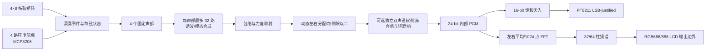

# 芯弦 FPGA 电子吉他

> 面向开发团队的设计与实施规格书

上一轮音频修改：主工程默认启用按音高声道分配和近邻音增益平滑，66 组回归通过，但用户反馈前后版本的和弦听感仍不理想。原成功全链路测试源码保留。[参数、试听与数字证据](docs/ANTI_BEAT_AUDIO.md)。

最新钢琴试验（2026-10-04，`feat/piano-hammer-voice`）：物理主工程默认启用 8 分音钢琴音源、短击弦起音、固定窄弦位声像与公共轻混响，基音表和双 PCB 接线保持原样。已生成实际 RTL 试听及固定引脚位流，仍需 SRAM 下载试听。[钢琴主工程说明](docs/PIANO_FPGA_TRIAL.md) / [录音分析与离线样音](docs/PIANO_REFERENCE_ANALYSIS.md)。

上板反馈修复：已复现“WAV 正常、上板单音嘈杂”的综合后包络计算偏移，改用等价的无符号插值。当前修正版保持原试听 WAV 不变，69 项回归及 6696 帧实际 DAC 引脚数据的综合后对照通过；`build/piano/neo_guitar_main_piano_interp_fix.fs` 等待再次上板试听。

**输入链验证基线（2026-10-03）：用户已确认双 PCB 全链路验证工程实物测试结果理想。正式主工程已同步为同一输入与优化音频行为，入口是 `gowin/xinxian_mega60k/xinxian_mega60k.gprj`、Top=`neo_guitar_main_top`；当时默认正弦、固定力度 2，接线与成功验证工程一致。** 主 RTL 已通过逐周期参考对比、完整回归和固定引脚布局布线；当前分支的钢琴主位流仍需 SRAM 下载复核。可选 32 分量谐波、双声道音效和 FFT/LCD 逻辑保留；四级力度实物标定、LCD 及效果按键接线仍待完成。详见 [主工程同步说明](docs/MAIN_ENGINE_SYNC.md)。下文同时保留最终需求和历史验收记录，以最新进度和当前源码为准。

芯弦 FPGA 电子吉他是一套以 Sipeed Tang Mega 60K FPGA 为硬件核心的四弦实时电子乐器。系统通过琴颈按弦矩阵和桥位压电传感器采集演奏动作，由 FPGA 内部可综合 HDL 逻辑完成音高选择、力度分级、声部管理、谐波／模态加法合成、包络、数字音效、频谱分析和音频输出。演奏期间，音频生成主链路不依赖软核 CPU、外部 MCU 或上位机程序。

项目最终目标日期为 **2026-11-01**，计划以 Apache License 2.0 公开源码。

## 0. 当前实际进度与停止点

### 0.1 已完成

- 全部运行时演奏和音频处理均由可综合 Verilog RTL 完成，不使用 MCU 或软核 CPU：4×8 琴颈矩阵、MCP3208 四路力度输入、四声部控制、连续滑音、32 分量谐波合成、包络、四路饱和混音、两套音色、软削波、合唱、延音/轻混响、24-bit 到 16-bit 转换、PT8211、1024 点 FFT、32 柱频谱和 RGB LCD 时序均已接入 `FULL` 顶层。
- ModelSim 已覆盖四声部完整生命周期与隔离、不同音高同时发声、错时 Release、重新激励、滑音不重触发 Attack、最后品位释放、混音饱和、sample tick 边界、输入控制到音频核集成、32 分量调度、效果链、PT8211、FFT/LCD、4×8 全组合、四弦四级力度、32 次内部延迟测量和 10,000 帧实时耐久测试。
- 当前主链的 32 次真实时钟仿真中，从 detector 事件到首个非零 PCM16 提交的最大延迟为：正弦 0.038815 ms、32 分量 0.041582 ms。这不是物理拨弦到模拟输出延迟，也不是完整模拟链的最坏值。
- 正式双板主工程固定引脚实现与可选 FULL 自动引脚实现均已重新生成，内部 setup/hold 违例为 0、Latch=0；具体端点、余量和资源见 [主工程验收记录](docs/evidence/main_engine_sync_acceptance.txt)。旧 FULL 的资源/时序证据作为历史记录保留。
- 多时钟域采用异步置位、各域三拍同步释放的复位结构，并已完成专门 testbench、主要功能回归和重新布局布线。
- NEO Dock 31005 `MINIMAL` 已通过实物验证：板载 MS5351M CLK2 完全断电后可独立恢复 12.288 MHz；PT8211 的 3.5 mm 左右声道连续输出 E4（约 329.63 Hz），无明显周期性爆音或断音；KEY0 按下静音、松开后自动重新发声，全链路不依赖 MCU、BL616 运行时服务或软核 CPU。
- 品位矩阵板已完成 ROW0 固定接地、八列输入映射和八路 LED 指示的初步实物测试；八个触点对应关系未发现问题。该结果只覆盖 ROW0 单组、PMOD 连接、两级同步和约 10 ms 防抖，不覆盖完整 4×8 扫描或后续选音链。
- ROW0 选音到音频的独立实物测试已通过：PMOD1 的 COL0～COL7 经同步和约 5 ms 整体防抖后编码为空弦/第1～8品，`note_phase_table` 为第1弦选择 E4～C5 的 phase increment，复用已验证的单声部音频链和 PT8211 输出；多品同时按下时最高品优先。该诊断工程使用持续测试音，不包含 MCP3208 拨弦触发，也不代表其余三弦或真实逐行扫描已通过。
- 当前四弦矩阵音频优化版已完成实物上板验证：独立工程 `neo_four_string_matrix_audio_test` 已实现真实 4×8 扫描、四个独立 RTL 音频声部、约 30 ms 和弦捕获、动态左右声道硬分离、无固定 Sustain 平台的拨弦包络以及 PCM24→PCM16→PT8211 输出。复位释放后 PA 保持开启，不再随普通音符反复开关；全部运行时逻辑均由 FPGA RTL 完成，不使用 MCU 或软核 CPU。

详细证据见：

- [FULL 复位、时序与资源证据](docs/evidence/full_reset_timing_acceptance.txt)
- [FULL 实时耐久证据](docs/evidence/full_realtime_acceptance.txt)
- [输入覆盖与内部延迟证据](docs/evidence/full_input_latency_acceptance.txt)
- [NEO MINIMAL 仿真、实现与实物验收证据](docs/evidence/neo_minimal_audio_acceptance.txt)
- [NEO ROW0 单组触点仿真、实现与实物证据](docs/evidence/neo_row0_led_acceptance.txt)
- [四弦矩阵音频优化交接记录](docs/HANDOFF_NEO_MATRIX_AUDIO_OPTIMIZATION.md)
- [NEO 四弦矩阵音频测试说明](docs/NEO_FOUR_STRING_MATRIX_AUDIO_TEST.md)
- [双 PCB 全链路接线、参数与上板步骤](docs/NEO_FULL_CHAIN_AUDIO_TEST.md)
- [双 PCB 全链路仿真与固定引脚实现证据](docs/evidence/neo_full_chain_audio_acceptance.txt)
- [主工程同步、构建与可选功能说明](docs/MAIN_ENGINE_SYNC.md)
- [三音以上减拍频策略、参数及 A/B 试听](docs/ANTI_BEAT_AUDIO.md)
- [古典大钢琴参考录音分析与离线音色样音](docs/PIANO_REFERENCE_ANALYSIS.md)
- [钢琴音源、击弦起音与 FPGA 主工程试验](docs/PIANO_FPGA_TRIAL.md)
- [当前主工程与 FULL 数字验收证据](docs/evidence/main_engine_sync_acceptance.txt)
- [Tang Mega 60K / NEO Dock 板级集成审查](docs/BOARD_INTEGRATION_REVIEW.md)
- [NEO Dock 31005 / Mega 60K 板级连接矩阵](docs/NEO_31005_60K_PIN_MATRIX.md)

### 0.2 当前板级集成门槛

| 实物项目 | 当前状态 | 尚需完成 |
| --- | --- | --- |
| MS5351M CLK2 / 12.288 MHz | 已验证 | 已确认示波器频率、FPGA 音频链使用及完整断电自动恢复 |
| `MINIMAL` PT8211 音频 | 已验证 | E4 约 329.63 Hz、左右声道、连续发声及无明显周期性爆音/断音均已通过 |
| KEY0 / S4 / AA13 RTL 复位 | 已验证 | 按住静音、松开后自动重新产生 E4；RECONFIG/N12 与此复位严格区分 |
| 品位板 ROW0 单组选音与发声 | **实物通过** | 已确认空弦及第1～8品选音、PT8211 实际发声和同组多品最高品优先；不代表完整矩阵通过 |
| 四弦矩阵音频优化版 | **实物通过** | 2026-10-02 已确认 4×8 扫描、四声部并行发声、和弦捕获、动态硬立体声、自然衰减和 PT8211 输出 |
| 品位板 ROW1～ROW3 | 已在四弦矩阵音频测试中覆盖 | 已随完整 4×8 扫描完成实物发声验证；早期 ROW0 单行记录仍作为独立诊断证据保留 |
| 完整 4×8 矩阵扫描 | **双板全链路实物通过** | 已与 MCP3208 拨弦和优化音频同接验证 |
| MCP3208 采集板 | **单板及双板集成实物通过** | 基线偏置/拨弦功能已验证；四级力度标定仍待完成 |
| 双 PCB 输入到优化音频链路 | **实物通过，用户确认结果理想** | 成功测试源码保留；标准主工程同步后已完成数字验证，新主位流需 SRAM 复核 |
| `FULL` 实物闭环 | 尚未验证 | 不得使用现有自动引脚 `.fs`；需在各输入外设分别通过后生成审核约束版本 |
| LCD | 尚未购买/验证 | 面板、FPC、RGB666 时序、同步极性、像素时钟和背光均待确认 |

- 底板为 NEO Dock 31005，核心板仍标为 30353/30354 之一。当前 J13 矩阵接线已实物通过并包含 Bank 1；沿用其既有 LVCMOS33、电源与接线，本次没有修改供电或扩展其它 Bank 1 接口。早期连接矩阵中的通用禁用规则和 PMOD 候选分配由此实测方案取代。
- 50 MHz、PT8211、功放、三枚用户按键和 `USR_CLK_IN` 已由 31005 原理图、两版核心板共同部分及官方 60K CST 交叉核对。
- NEO Dock MS5351M 的 CLK2 已设置为 12.288 MHz；示波器及 MINIMAL 实物音频链均已确认 FPGA 可稳定使用该时钟，完整断电后会独立自动恢复，不需要电脑、MCU、BL616 运行时配置或软核 CPU。
- 正式主 CST 已冻结为矩阵 J13、ADC J8、现有音频/KEY0/调试 LED 共 26 个端口，沿用双板实测方案；早期两组 PMOD 的候选表只作为历史备选。
- LCD 尚未购买。31005 的 40-pin 连接器采用 RGB888 针脚排列，但 FPGA 实际只连接 R2-R7、G2-G7、B2-B7 共 18 bit，并与 CH569 HSPI 复用；面板及其时序确认前暂不约束 LCD。
- `KEY0/S4/USER_BUTTON0=AA13` 已固定为本工程低有效 `rst_n`。`SW7/RECONFIG=N12` 是 FPGA 专用重配置按钮：SRAM 下载后按下会清除当前配置，必须重新 Program/Configure，不属于 RTL 复位。FULL 仍需解决其余两枚用户按键无法同时覆盖三个效果键的问题。
- ROW0 LED 初测曾使用 PMOD1 的全部八根 GPIO 作为 COL0～COL7、PMOD0 的八根 GPIO 作为调试 LED。随后进行的 ROW0 音频闭环测试已移除 LED，只保留 PMOD1 八列输入，ROW0 直接接地、ROW1～ROW3 悬空，并通过 PT8211 输出判断所选音高。两种临时接法都与最终 12 线矩阵分配互斥，只能用于逐组诊断。

现有 **FULL 自动引脚** `.fs` 只能证明逻辑规模与时序可实现，**严禁烧录到实物板**。原始与复位修正后的 FULL 结果均已保留，不应覆盖。`neo_minimal_audio`、`neo_row0_led_test`、`neo_row0_audio_test` 与 `neo_four_string_matrix_audio_test` 是采用各自专用约束的独立实物测试构建，不属于这条自动引脚禁令，但仍应保留在各自工程中且不得混烧。

### 0.3 当前实物工作顺序

1. 保留已经成功的 `neo_minimal_audio`、`neo_row0_led_test`、`neo_row0_audio_test`、`neo_four_string_matrix_audio_test` 工程及现有 FULL 自动引脚 P&R 基线；仓库 RTL/约束作为可复现源，不反向覆盖成功工程。
2. PA 常开策略和自然尾音参数继续沿用实测值。针对用户确认的三音以上难听拍频，在主工程增加可关闭的按音高分配和近邻增益策略，保留成功独立工程作为听感比较基线。
3. 已完成 `neo_full_chain_audio_test` 双板实物验证。下一步用同一接线下载同步后的 `gowin/xinxian_mega60k/impl/pnr/neo_guitar_main.fs`，复核正式主入口；成功独立测试继续保留。
4. 先验收只按品静音、真实拨弦触发、四弦并发、换品滑音和松品阻尼，再独立进行力度标定。最终职责保持为：品位矩阵选择音高，MCP3208 产生真实 `note_on` 和 velocity；旧的约 30 ms 品位捕获窗口仅用于独立矩阵测试。
5. 完成真实传感前端后，用逻辑分析仪检查 PT8211 帧，并用示波器重复测量物理拨弦到模拟输出延迟；没有测量证据前不记录精确噪声、THD、SNR 或其他定量音频指标。
6. 在选定兼容 LCD 并确认完整接口资料后，再完成 LCD 与正式 `FULL` 实机验收。

### 0.4 2026-09-27 板级交接记录

- 已完成 NEO Dock 31005、两版候选 60K 核心板原理图和官方 CST 的交叉核对，并建立完整连接矩阵；核心板版本继续标记为 30353/30354 未确认，Bank 1 禁用。
- 已记录 MS5351M CLK2 到 `USR_CLK_IN=V13` 的 12.288 MHz 示波器测量结果；该条目记录时尚待验证的 FPGA 音频链和完整断电恢复，随后已在 0.5 节的 MINIMAL 实物验收中完成。
- 已审查官方 138K `audio_i2s` 示例。其 PT8211 帧格式和共用底板网络可用于 MINIMAL 波形对照，但 138K 器件原语、PLL、CST、复位脚和工程顶层不得移植到 60K。
- 已发现首次 MINIMAL 上板需要单独处理功放极性：`minimal_top.pa_en` 是高有效请求，物理 `PA_EN=AB16` 为低有效；在保持现有音频 RTL 不变的前提下，由板级包装层输出复位安全的 `pa_en_n`。
- 本次只更新审查资料，没有修改 RTL、CST/SDC 或现有综合/布局布线结果；自动引脚 `.fs` 仍不可烧录。

### 0.5 2026-09-27 NEO MINIMAL 实物验收

- 成功工程：`gowin/neo_minimal_audio/neo_minimal_audio`；顶层为 `neo_minimal_audio_top`，当前只通过 SRAM Program/Configure 下载，没有写入外部 Flash。
- 已把成功工程中的音频域异步复位/同步释放和低有效 `pa_en_n` 包装正式同步回 `rtl/top/neo_minimal_audio_top.v`；实物 CST/SDC 位于 `constraints/neo_minimal_audio.cst` 与 `constraints/neo_minimal_audio.sdc`。Gowin 工程平铺源码中的 include/readmemh 路径调整不反向带入仓库标准目录结构。
- 实物闭环为 12.288 MHz CLK2→E4 phase increment→`voice_audio_core`→PCM24/PCM16→`pt8211_tx`→PT8211→3.5 mm 左右声道；实测约 329.63 Hz，可持续发声，无明显周期性爆音或断音。
- KEY0/AA13 是 RTL 低有效复位：按住静音，松开后 E4 自动恢复。RECONFIG/N12 会清除 SRAM 配置，作用与 RTL reset 不同。
- 板级运行中复位 testbench 已通过：`PASS: MINIMAL runtime reset mutes and retriggers continuous E4`。EX3791 本轮未修改；在需要显式位宽清理前必须先后执行 PCM 黄金模型与相关 testbench。

### 0.6 2026-09-27 ROW0 单组初步实物验收

- 独立工程：`gowin/neo_row0_led_test/neo_row0_led_test`；它与成功音频工程分开保存。工程启用 `CPU pins as regular I/O`，即 `process_config` 中 `"CPU": true`，只把 P19/R19/T21/U21 用作普通 FPGA GPIO，不使用任何 CPU。
- 临时接法为 ROW0 直接接地、ROW1～ROW3 不连接、PMOD1 全部八线输入 COL0～COL7、PMOD0 全部八线输出 LED0～LED7。ROW0 八个触点的对应测试未发现问题。
- 最新 P&R 中 PR2017=0、PR2028=0、setup/hold 违例均为 0；Pin Report 的 16 个 COL/LED 端口全部位于指定球位。详细结果见 `docs/evidence/neo_row0_led_acceptance.txt`。
- 仓库 testbench 按真实防抖周期通过：`PASS: ROW0 columns debounce, mapping, multi-press and reset`。
- 当时的验收边界：该 LED 测试不能证明 ROW1～ROW3、完整 4×8 扫描、未选中行高阻、多行防鬼键、四弦同时按键或选音/滑音/声部控制实物集成；后续 0.7 节已补充完成 ROW0 单组的最高品优先和选音到音频实物验证。

### 0.7 2026-09-28 ROW0 选音到音频实物验收

- 独立工程：`gowin/neo_row0_audio_test/neo_row0_audio_test`；保留已经成功的 `neo_minimal_audio` 和 FULL 自动引脚 P&R 基线，不在原工程上覆盖修改。
- 实物接法为 ROW0 直接接地、ROW1～ROW3 不连接、PMOD1 全部八线输入 COL0～COL7；本阶段不再连接 PMOD0 LED。音频仍使用已验证的 12.288 MHz CLK2、PT8211 和 3.5 mm 输出链路。
- 选音链路为 COL 输入→两级同步→约 5 ms 的 8-bit 整体防抖→最高品优先编码→`note_phase_table`→`voice_audio_core`→PCM24/PCM16→`pt8211_tx`→PT8211。无按键对应第0品 E4，COL0～COL7 分别对应第1～8品 F4～C5。
- 实物测试已确认空弦及八个品位能够控制实际输出音高；同组多个品位同时按下时选择最高品，松开最高品但保留较低品时回到剩余按键中的最高品，全部松开后回到 E4 空弦音。
- 该工程使用 FPGA RTL 产生持续测试音，目的只是证明品位选择与音频链连接正确；不使用 MCU 或软核 CPU，也尚未接入 MCP3208 拨弦事件、滑音、Release 或四声部控制。
- 验收边界：ROW1～ROW3、4 ROW 的低电平/高阻逐行扫描、跨行多键、防鬼键、四弦同时发声及最终 `fret_note_event`/`four_string_voice_control` 集成仍需实物验证。

### 0.8 2026-10-02 四弦矩阵音频优化版实物验收

- 当前四弦矩阵音频优化版已完成实物上板验证。独立工程为 `gowin/neo_four_string_matrix_audio_test/neo_four_string_matrix_audio_test.gprj`，顶层为 `neo_four_string_matrix_audio_test_top`；该结果补充了 0.7 节当时尚未完成的 ROW1～ROW3、真实 4×8 扫描和四声部实物发声验证，但不覆盖或替代此前各独立工程。
- 当前上板链路包括 4×8 品位矩阵扫描、四个独立 RTL 音频声部、约 30 ms 和弦捕获、PCM24→PCM16、`pt8211_tx`、NEO Dock PT8211 和左右声道输出。全部运行时处理由 FPGA RTL 完成，不使用 MCU 或软核 CPU。
- 拨弦测试包络参数为：约 2 ms Attack、约 200 ms 初始快速衰减、延长约 2 倍的慢速自然尾音以及松品时独立快速阻尼；不设置固定 Sustain 平台。通用 `voice_envelope`、`voice_audio_core` 和 `four_voice_audio_core` 的 `PLUCK_MODE` 默认仍为 0，只有该矩阵音频测试顶层显式设置为 1，因此当时 MINIMAL/FULL 的默认 ADSR 行为没有改变。2026-10-03 主工程同步后，当前主顶层显式启用拨弦模式，底层模块默认仍为 0 以兼容旧实验。
- `pa_en_n` 在复位期间关闭 PA，复位释放后保持 PA 开启，不再随普通 `note_on`/`note_off` 反复切换。KEY0 释放或 FPGA 刚配置时仍可能出现一次模拟启动瞬态，但普通音符之间不应重复产生 PA 启动爆破音。
- 声道策略为 note-on 时动态选择负载较小的声道，最先出现的两个声部优先分配到相反声道；声部生命周期内不换声道，不加入 crossfeed，每个声道的主声部和除以 2 以保留四声部余量。两个相近但不同的真实频率仍会产生物理拍频，后级合成单声道时拍频也可能重新出现。
- 主回归已覆盖连续四声部、相同 F4 phase increment、捕获窗口、首对声部硬分离、PA 常开和无 Sustain 的自然衰减；兼容性回归继续通过原 ADSR、四级力度、KEY3 延音及四声部独立生命周期。具体 PASS 信息与实现说明见 `docs/HANDOFF_NEO_MATRIX_AUDIO_OPTIMIZATION.md` 和 `docs/NEO_FOUR_STRING_MATRIX_AUDIO_TEST.md`。
- 本次实物验收只记录已观察到的功能结果，没有示波器截图、精确噪声、THD、SNR 或其他定量音频指标，不据此虚构数值结论。
- 约 30 ms 和弦捕获窗口只是没有接入真实拨弦传感器时的测试办法，不是最终产品方案。此条记录时 MCP3208 尚未实物测试，2026-10-03 已补充完成独立验证；最终产品仍应由矩阵负责音高、MCP3208 负责真实拨弦检测并产生 `note_on` 和 velocity，再驱动四个持续并行声部。

### 0.9 2026-10-03 MCP3208 独立验证与双 PCB 集成工程

- 最新提交 `2cb7419` 与用户确认表明 `gowin/test3` 已实物通过：MCP3208 CH0～CH3 分别用压电拨弦触发 E4/B3/G3/D3，采用固定音量。
- 新增独立工程 `gowin/neo_full_chain_audio_test`：矩阵只选品，ADC 才触发起音；复用优化音频链，增加约 20 ms 平滑滑音与最后品位释放时的音高保持/阻尼。
- 两套最新实物 CST 共用的时钟、复位和音频引脚一致，其余引脚无冲突；合并后 26 个端口使用 26 个球位，实际 Pin Report 全部符合约束。
- 三组 ModelSim 回归均为 Errors=0、Warnings=0；最终固定引脚 Gowin 实现分析 4750 个端点，setup/hold 违例均为 0。用户随后确认双 PCB 同接测试结果理想；该功能验收来自用户实物反馈，没有新增定量声学测量。
- 当前集成工程保留固定力度 2，未宣称四级力度、谐波/音效或显示功能完成整机验收。详情见 [全链路说明](docs/NEO_FULL_CHAIN_AUDIO_TEST.md)。

### 0.10 2026-10-03 正式主工程同步

- 主 `guitar_audio_top` 改用单一音频域输入处理；复用实测 ADC 偏置/迟滞和音频参数。
  新 `guitar_play_control` / `four_string_board_audio_chain` 管理真实拨弦、滑音、立即松品阻尼、
  自然声部结束及动态硬立体声。PA 在复位后常开。
- `xinxian_mega60k.gprj` 已从 LED 顶层改为标准 RTL 的 `neo_guitar_main_top`；
  使用当前 26 引脚 CST/SDC，不需要改现有线束。新主工程本身尚未替用户实际下载。
- 可选 FULL 保留谐波、音色切换、延音和独立双声道音效，FFT 读取最终左右平均 PCM；
  当前物理主入口默认正弦，不增加未接入的 LCD/效果键端口。
- 关闭新增减拍频混音时，主工程与成功验证工程在对齐复位释放后逐周期一致，覆盖 36 个音高、所有六种首对双弦、
  双向拨弦、重拨、松品/空弦和自然尾音。完整记录和复现命令见 [同步说明](docs/MAIN_ENGINE_SYNC.md)。
- 新减拍频混音保持四声部及原音高；优先把频差较大的组合放入同侧，必要时将较早起音的近邻声部平滑降至半幅。已完成实际 RTL PCM A/B 导出及针对性回归，默认开启，实际听感待用户复核。

## 1. 项目目标

首版整机需要完成以下闭环：

- 4 根弦、每弦 8 个有品触点，并支持无按键时的空弦音；
- 4 根弦可同时发声，每根弦固定对应一个独立声部；
- 每个声部最多包含 32 个逻辑谐波／模态分量，单个 48 kHz 样本内最多计算 128 个分量；
- 4 级拨弦力度，不采用 MIDI 0～127 力度精度；
- 支持持续音中的跨品滑音；
- 支持“经典”和“摇滚”两套实时合成音色；
- 支持合唱、延音和轻量混响；
- 通过板载 PT8211 DAC 输出至 3.5 mm 耳机和 2×3 W 扬声器接口；
- 通过 5 寸 800×480 并行 RGB LCD 显示实时频谱；内部颜色保持 RGB888，采购面板须兼容 NEO Dock 31005 实际可控的 RGB666/18-bit DPI 输出；
- FPGA 内部数字链路最坏延迟不超过 5 ms，整机最坏延迟不超过 10 ms；
- `FULL` 配置下通过综合、时序、资源和整机演示验收。

### 1.1 非目标与扩展项

以下内容不属于首版强制验收：

- Karplus–Strong 弦模型；
- 无拨弦击弦、勾弦；
- 运行时 UART 在线调参；
- MIDI 0～127 连续力度；
- DDR3 图形帧缓存、图片或复杂 GUI；
- 外接 24-bit 标准 I²S DAC；
- 6 弦或更多品位；
- 软核 CPU、外部 MCU 参与运行时音频处理。

### 1.2 可选附加功能（不纳入首版 `FULL` 强制验收）

在首版 `FULL` 音频、显示、时序和板级接口稳定后，可增加以下两个 FPGA 原生扩展。扩展功能不得回退或破坏已有四声部音频主链路，运行期间仍必须由可综合 Verilog/SystemVerilog RTL 完成，不得引入软核 CPU、外部 MCU 或软件运行时算法。

#### 1.2.1 FM/PM Lite 音色模式

作为现有波表加法合成之外的可选音色模式，每个声部可以增加：

- 一个调制相位累加器；
- 一个调制频率比；
- 一个调制深度；
- 一条额外的正弦查表路径；
- 一个载波相位调制计算路径。

该模式应复用现有声部的包络、力度、滑音、PCM24 混音和 PT8211 输出链路，并通过模式选择或参数配置启用。它可以提供更明显的金属、铃声和合成器类音色，同时不要求大规模新增波表存储。

新增 FM/PM 逻辑必须验证调制深度边界、相位溢出、音量归一化、切换无爆音、样本截止时间和资源变化；不得因为增加该模式而降低原有经典/摇滚音色的验收结果。

#### 1.2.2 FPGA 原生节奏指导演奏模式

可增加类似节奏音游的简化四轨指导功能，但目标是预置谱面和硬件实时判定，不是完整手机游戏 GUI。建议功能包括：

- 四条轨道，对应四根弦；
- 由 `.mem`/ROM/片上 B-SRAM 保存的预编译音符时间表；
- 音符滚动、判定线和有限数量的视觉提示；
- 基于现有矩阵和拨弦事件的命中窗口判定；
- `Perfect/Good/Miss`、连击和分数计数；
- 复用现有 RGB 时序和坐标驱动显示，在频谱显示与指导模式之间切换或叠加。

该模式不得依赖运行时 CPU、MCU、联网谱面解析或完整帧缓存。若需要大量歌曲、复杂图片、触摸菜单或动态资源加载，应另行评审 Flash/DDR3 和板级接口，不自动纳入本扩展项。

两个附加功能均须满足以下条件后才能合入正式 `FULL` 分支：

- 原有音频链路仿真全部通过，且无 `deadline_miss`、FIFO underflow/overflow 或音频掉样；
- 所有目标时钟域 WNS ≥ 0；
- LUT、DSP、B-SRAM 和 CLS 仍保留 README 要求的资源余量；
- 新增独立 testbench、频谱/判定证据和综合/布局布线报告；
- 没有确认的板卡引脚不得写入正式 CST，新增显示或输入接口只能先以仿真和无引脚 RTL 形式验证。

## 2. “纯硬件音频主链路”的边界

运行期间，下列功能必须由 FPGA 内部可综合 HDL 逻辑实时完成：

1. 左手按弦状态扫描与最高品位判定；
2. 右手拨弦触发、峰值检测结果读取和 4 级力度判定；
3. 音高选择、滑音和四声部状态管理；
4. 谐波／模态加法合成、包络衰减和四声部混音；
5. 软削波、合唱、延音和轻量混响；
6. PCM 格式转换与 PT8211 串行音频输出；
7. FFT、频谱柱生成和并行 RGB 显示时序输出。

允许离线软件生成频率控制字、谐波系数、衰减系数、正弦表和 Hann 窗等 ROM 文件；允许使用 Gowin EDA 完成综合、烧录和一次性外设配置。外部 MCP3208 与 PT8211 只负责信号转换，不参与音符判断、音色生成或音效计算。

## 3. 硬件基线

### 3.1 FPGA 与底板

| 项目 | 固定配置 |
| --- | --- |
| 核心板 | Sipeed Tang Mega 60K SOM，实物为 30353/30354 之一，版本暂未确认 |
| 底板 | 官方 Tang Mega NEO Dock 31005，实物已确认 |
| FPGA | `GW5AT-LV60PG484AC1/I0` |
| Gowin 器件选择 | `GW5AT-60B`，封装 `PBG484A`，Device Version `B` |
| 逻辑资源 | 59,904 LUT4、59,904 FF |
| B-SRAM | 2,124 Kbit，118 块 |
| 18×18 DSP | 118 个 |
| 板载存储 | 512 MiB DDR3、64 Mbit Flash |
| 板载 DAC | PT8211-S，双声道 16-bit、LSB-justified |
| 主要供电 | 12 V DC5521，适配器额定电流至少 3 A |

当前外部 GPIO 按已实测的 J13 矩阵和 J8 ADC CST 分配，保留其 3.3 V 电平。三枚板载按键位于 1.5 V Bank 9；新的外设接线仍须单独核对球位、电压和复用关系。当前主入口只使用 KEY0 复位。

### 3.2 左手琴颈

琴颈使用 32 个导电橡胶触点、PCB 电极和逐键二极管，构成 4×8 矩阵：

- 4 条扫描线对应 4 根弦；
- 8 条返回线对应第 1～8 品；
- 每次只激活一条扫描线，其余扫描线置高阻，避免输出冲突；
- 返回线使用约 10 kΩ 外部上拉，扫描线串联约 220 Ω～1 kΩ 保护电阻；
- 每个触点串联 1N4148 或同类小信号二极管，方向随最终有效电平统一；
- FPGA 内部执行双触发器同步、扫描、积分式去抖和最高品位优先编码；
- 同一根弦允许多品同时按下，但只用最高品位决定音高；
- 没有品位按下时，该弦的选音状态为第 0 品空弦。

长排线或外露琴颈接口应增加 ESD 防护。矩阵完整 8-bit 状态需保留为调试信号，不能只保留编码后的品位号。

### 3.3 右手拨弦结构

每根弦使用一条独立 TPU 弹性条：

- TPU 条建议初始尺寸：长 30～60 mm、宽 2～5 mm、高 2～6 mm、间距 8～12 mm；
- 两端夹持并施加轻微预张力，中间悬空供拨片或手指拨动；
- 每根 TPU 条的一端连接独立桥码；
- 桥码向贴有压电片的 FR-4 或薄金属弯曲梁传力；
- 四个桥码进行机械隔离，压电陶瓷不承受拨片直接冲击；
- 一端夹具应可调，以统一四根“弦”的张力和回弹手感。

尺寸、材料硬度、桥码质量和弯曲梁厚度均属于样机标定项，不能仅依靠理论值冻结。

### 3.4 压电模拟前端与 ADC

四路信号链如下：

```text
TPU 条 → 独立桥码 → 弯曲梁/压电片
      → 输入限流与双向限幅 → 高阻缓冲/增益
      → 包络检波与峰值保持 → MCP3208 → FPGA SPI
```

基线 ADC 为 3.3 V 供电的 MCP3208：12-bit、8 通道、SPI。首版使用 4 个通道，剩余通道可扩展旋钮或其他传感器。FPGA 读取的是处理后的包络／峰值，不是原始压电振动音频。

要求：

- ADC 总轮询速率不低于 40 kS/s，每根弦有效采样率不低于 10 kS/s；
- 四根弦分别配置静态偏置、噪声门限和 4 级力度阈值；
- 上电后先测基线，再开放触发；
- 使用迟滞、峰值保持释放时间和再触发死区抑制回弹连击；
- 使用短时峰值对比识别机械串扰，但不得吞掉真实快速扫弦；
- 原始 ADC、包络、峰值、力度级和时间戳均保留调试观测点。

力度接口不使用“0 表示未触发”的模糊约定，而采用独立有效位：

```verilog
pluck_valid
string_id[1:0]
velocity_level[1:0]   // 四级力度
event_timestamp
```

### 3.5 显示器

首版显示器目标为 **5 寸、800×480、支持 RGB666/18-bit DPI 输入**。NEO Dock 31005 的 J5 使用 RGB888 针脚排列，包含 R0-R7、G0-G7、B0-B7，但底板只把 R2-R7、G2-G7、B2-B7 共 18 根颜色数据连接到 FPGA/CH569 复用总线；六根低位针脚没有连接到 FPGA。该接口是并行 TTL/DPI RGB，不是 LVDS。

FULL 内部颜色继续保留每通道 8 bit，只在未来板级包装层截取 `lcd_r/g/b[7:2]` 输出，不重构内部颜色处理。LCD 数据与 CH569 HSPI 互斥。具体型号尚未采购，采购前必须取得并核对：

- LCD 模组和驱动 IC 型号；
- FPC 引脚定义及与 NEO Dock RGB 接口的兼容性；
- 逻辑电压、像素时钟、同步极性和完整 porch 时序；
- 是否需要 SPI／MCU 初始化；
- 背光电压、电流和恒流驱动方案。

面板至少应明确支持 RGB666/18-bit 输入、允许六根颜色低位不连接、属于 Sipeed 明确列出的 NEO Dock 兼容型号，或配合转接板把未连接低位固定为低电平。上述信息确认前不冻结 LCD CST，也不生成 LCD 可烧录版本。

此前候选的 540×960 MCU888/RGB888 屏不作为固定基线，除非卖家补齐上述资料，并确认其 RGB 模式、扫描方向、时序、电平和 FPC 与实际 NEO Dock／转接板兼容。

800×480×24-bit 完整帧缓存需要约 9.22 Mbit，超过片上 B-SRAM，因此首版采用坐标驱动的逐像素绘制，不使用完整帧缓存。需要复杂 GUI 时再评估 DDR3。

### 3.6 时钟与供电

音频参考当前使用 NEO Dock 31005 上 MS5351M 的 CLK2，经 `USR_CLK_IN` 进入 V13。CLK2 对 GND 已用示波器实测为 12.288 MHz：

- `12.288 MHz / 8 = 1.536 MHz` PT8211 位时钟；
- `12.288 MHz / 256 = 48 kHz` 音频采样节拍；
- 当前矩阵、ADC、声部计算、音效及 FFT 都使用 12.288 MHz，无需 100 MHz 计算 PLL；
- LCD 像素时钟在屏幕定型后由独立 PLL 输出；
- 音频到显示域用握手同步；未来效果键由 50 MHz 域处理并同步到音频域。

CLK2 的 FPGA 稳定接收和完整断电自动恢复已在 MINIMAL 实物验证中完成；当前双板主链继续使用同一时钟来源。

整机首版使用 12 V DC5521 供电，不把单 USB 或锂电池供电纳入验收。适配器、电源极性和底板版本必须在上电前复核。

## 4. 定音与演奏规则

### 4.1 标准调弦

采用十二平均律与 `A4 = 440 Hz`：

| 弦号 | 物理含义 | 空弦音 | 频率 |
| --- | --- | --- | ---: |
| 第 1 弦 | 最高音细弦 | E4 | 329.63 Hz |
| 第 2 弦 |  | B3 | 246.94 Hz |
| 第 3 弦 |  | G3 | 196.00 Hz |
| 第 4 弦 | 最低音弦 | D3 | 146.83 Hz |

每弦支持空弦和第 1～8 品，因此选音表覆盖 4×9 个状态。频率控制字由离线工具按实际采样率和相位累加器位宽生成。

### 4.2 状态机规则

1. 拨弦时读取该弦当前最高按下品位；没有按品时触发空弦。
2. 每根弦固定绑定一个声部，不需要跨弦抢占。
3. 同一弦再次拨动时重新激励该声部并重启包络。
4. 声部发声期间，只要仍有品位按下，最高品位变化就触发滑音，不重启起音包络。
5. 释放最高品后若较低品仍按住，则滑向新的最高品。
6. 释放最后一个按弦触点时，保持释放前音高并立即进入 Release，不自动跳回空弦。
7. 无拨弦击弦与勾弦仅作为扩展功能。

滑音时间为集中配置参数；必须对相位增量进行逐样本平滑，不能直接跳变造成音高台阶或爆音。

## 5. 音频架构



### 5.1 四声部与 32 分量

系统包含 4 个并行声部，每个正在发声的音符独占最多 32 个逻辑谐波／模态通道。`FULL` 配置必须支持单个采样周期内最多 128 个分量的更新与累加。

“逻辑通道”不等于 128 套完全独立 DSP 乘法器。每个声部内部允许使用流水线和分时乘法，在 20.83 μs 的 48 kHz 样本截止时间内完成相位更新、查表、幅度衰减、加权与累加。综合报告必须分别说明逻辑分量数和实际 DSP 实例数。

每个分量至少包含：

- 谐波序号；
- 相位或由基频相位推导的相位地址；
- 初始幅度；
- 独立衰减系数；
- 音色与力度修正系数；
- 激活标志。

至少一个验收单音必须启用完整 32 个分量。其他音符允许根据音色、可听频段和资源预算关闭无贡献分量，但不得把“最多 32 路”误写成“所有音符始终 32 路”。

### 5.2 力度映射

四级力度同时影响：

- 声部初始总幅度；
- 高频与低频谐波的相对激励；
- 自然衰减时间；
- 摇滚音色下软削波的驱动程度。

力度越大，声音通常更响、高阶谐波更强、衰减略慢；力度较轻时声音更柔和、衰减略快。经典与摇滚音色分别保存四套力度参数。

### 5.3 音色

`KEY1` 在两套参数组之间切换：

- **经典**：偏尼龙弦，起音柔和，以基频和低阶谐波为主，自然衰减；
- **摇滚**：偏钢弦亮音，起音锐利，高阶和奇次谐波更强，混音后加入可控软削波。

切换时使用参数平滑或短时交叉渐变，严禁系数瞬间跳变造成爆音。所有声音均实时生成，不读取预录 PCM。

### 5.4 包络与音效

包络采用适合拨弦乐器的快速 Attack、自然 Decay 和可控 Release；Sustain 可保留为配置项，但默认不维持恒定电平。

| 按键 | 功能 | 实现要求 |
| --- | --- | --- |
| `KEY1` | 经典／摇滚切换 | 参数平滑或交叉渐变 |
| `KEY2` | 合唱开关 | 短延迟线、低频调制、干湿混合 |
| `KEY3` | 延音／轻混响开关 | 延长 Release，并启用片上 B-SRAM 多抽头反馈延迟网络 |

首版不做卷积混响，不依赖 DDR3。反馈增益必须具有限幅和稳定性证明，旁路切换需淡入淡出。

### 5.5 定点与输出格式

- 声部内部建议使用至少 24-bit 有符号定点；
- 谐波累加器和四声部混音器必须增加保护位；
- 任意满幅组合不得发生二进制回绕，只允许饱和；
- 最终内部 PCM 保持 24-bit；
- 输出前执行饱和、舍入和可选 TPDF 抖动，转换为 16-bit；
- PT8211 输出为 48 kHz、双声道、16-bit、MSB-first、LSB-justified，四声部动态分配到左右声道，活跃生命周期内保持声道；
- 板载 PT8211 不需要 24-bit 标准 I²S 数据，未来外接 DAC 通过独立适配层支持。

## 6. 实时频谱

频谱输入取最终效果后的内部 PCM，不回采模拟输出。基线配置为：

- 1024 点定点 FFT；
- Hann 窗；
- 约 30 FPS 刷新；
- `FULL` 默认 32 根近似对数频谱柱；
- 资源充足时可编译为 64 柱；
- 具备峰值缓降；
- LCD 使用逐像素绘制，不申请完整帧缓存。

FFT 可以使用 Gowin 硬件 IP，但必须置于 wrapper 中，并为 ModelSim 提供厂商模型或行为级替代。显示开启后不得造成音频掉样或时序失败。

## 7. 软件与工具链

| 工具 | 固定版本／用途 |
| --- | --- |
| 操作系统 | Windows 64-bit |
| 综合与布局布线 | Gowin EDA Commercial `V1.9.12.03 (64-bit)` |
| 烧录 | 上述 Gowin 安装附带的 Programmer |
| RTL 仿真 | ModelSim SE-64 10.6d，本机完整回归脚本见 `sim/run_main_regression.ps1` |
| 可综合 HDL | Verilog-2001 |
| 测试平台 | SystemVerilog |
| 离线查表 | Python 3 脚本，版本在实现时锁定 |

允许使用 Gowin PLL、异步 FIFO、B-SRAM 和 FFT 等基础硬件 IP。所有 IP 必须通过独立 wrapper 隔离，不允许核心演奏逻辑依赖软核程序或整套黑盒音频算法。

## 8. 计划中的工程结构

> 本轮只交付文档。以下目录和文件将在实施阶段创建。

```text
xinxian-fpga-guitar/
├─ README.md
├─ LICENSE
├─ NOTICE
├─ docs/
│  ├─ README_答辩版.md
│  ├─ CONFIGURATION_PLAN.md
│  ├─ architecture/
│  ├─ hardware/
│  └─ evidence/
├─ gowin/
│  └─ xinxian_mega60k.gprj
├─ constraints/
│  ├─ tang_mega_60k_neo.cst
│  └─ timing.sdc
├─ rtl/
│  ├─ top/
│  ├─ input/
│  ├─ control/
│  ├─ synth/
│  ├─ effects/
│  ├─ audio_io/
│  ├─ display/
│  ├─ common/
│  └─ config/guitar_config.vh
├─ ip/
│  ├─ gowin/
│  └─ wrappers/
├─ mem/
│  ├─ note_phase_inc.mem
│  ├─ sine_lut.mem
│  ├─ harmonics_classic.mem
│  ├─ harmonics_rock.mem
│  └─ hann_1024.mem
├─ sim/
│  ├─ tb/
│  ├─ models/
│  ├─ vectors/
│  └─ modelsim/
├─ tools/
└─ build/
```

`build/`、Gowin 中间产物、ModelSim 工作库和波形文件不得提交到版本库。

## 9. 配置策略

所有可变参数集中在 `rtl/config/guitar_config.vh`、`mem/*.mem` 和板级约束中，修改后重新综合烧录。首版不要求 UART 在线调参。

### 9.1 构建档位

| 档位 | 用途 | 主要功能 |
| --- | --- | --- |
| `MINIMAL` | 首次上板与音频闭环 | 单声部、少量谐波、无 FFT、无复杂音效、PT8211 输出 |
| `FULL` | 最终演示和唯一正式验收 | 四声部、最多 32 分量、两音色、全部音效、FFT 与 LCD |
| `DEBUG` | 故障定位 | 在选定档位上增加调试 GPIO、计数器和 GAO 观测点 |

各档位通过宏和参数选择，不复制 RTL 源码分支。

### 9.2 关键配置项

| 参数组 | 需要集中管理的内容 |
| --- | --- |
| 系统 | 构建档位、时钟频率、复位延时、功能开关 |
| 音频 | 48 kHz、内部位宽、输出位宽、饱和与舍入方式 |
| 乐器 | 4 声部、每声部最多 32 分量、4×9 音高表 |
| 输入 | 矩阵扫描率、去抖、ADC SPI 时钟、四弦基线和力度阈值 |
| 演奏 | 滑音时间、再触发死区、最后品位释放规则 |
| 音色 | 两套谐波幅度、各阶衰减、4 级力度映射、软削波参数 |
| 音效 | 合唱延迟／调制、Release 延长、多抽头延迟和反馈增益 |
| FFT | 1024 点、Hann 窗、32／64 柱、刷新率和峰值下降速度 |
| LCD | 分辨率、porch、同步极性、像素时钟、颜色与布局 |

详细迁移步骤见 [配置修改计划](docs/CONFIGURATION_PLAN.md)。

## 10. 开发阶段与里程碑

| 日期 | 阶段 | 退出条件 |
| --- | --- | --- |
| 2026-09-04 | 需求冻结 | README、接口、风险和配置计划评审完成 |
| 2026-09-05～09-21 | 仿真与硬件准备 | 单元 testbench、查表、BOM、原理图和引脚冲突检查完成 |
| 2026-09-22 | 首次上板 | `MINIMAL` 输出稳定测试音，板载 DAC 无持续爆音 |
| 2026-09-28 | ROW0 选音闭环 | 空弦及第1～8品控制 PT8211 实际音高；同组多键最高品优先通过 |
| 2026-09-23～10-04 | 基础闭环 | 4×8 输入、四声部、4 级力度、音高和基础包络通过 |
| 2026-10-05～10-18 | `FULL` 功能 | 32 分量、两音色、滑音、合唱、延音／混响、FFT 与 LCD 完成 |
| 2026-10-19～10-25 | 整机优化 | 延迟、串扰、资源、WNS、长时间演奏和供电测试通过 |
| 2026-10-26～11-01 | 发布与答辩 | 回归、证据包、演示脚本、许可证和源码发布包完成 |

团队人数为 3 人，但本文不沿用旧 A/B/C 分工。实施启动时再为每个模块指定唯一负责人和不同的验证人。

## 11. 验收标准

### 11.1 功能验收

| 项目 | 通过门槛 | 主要证据 |
| --- | --- | --- |
| 4×8 琴颈 | 32 个位置映射正确；多键时最高品优先；无不可接受鬼键 | 矩阵测试日志、GAO 波形、演示视频 |
| 标准调弦 | 4×9 状态音高正确，建议频率误差 <0.5% | 仿真计数、频率计或频谱截图 |
| 四声部 | 四根弦同时发声且释放互不影响 | 四音和弦频谱、PCM 波形 |
| 四级力度 | 四弦均能稳定区分 4 级，映射方向正确 | 标定数据、重复拨弦统计、频谱对比 |
| 32 分量 | 至少一个单音启用 32 路，样本截止前完成计算 | 配置、调度计数、仿真日志、频谱 |
| 滑音 | 频率连续过渡，不重新触发 Attack，无明显阶梯或爆音 | phase increment 波形、录音 |
| 两种音色 | 经典与摇滚听感及谐波谱明显不同，切换无爆音 | A/B 录音、频谱与参数表 |
| 音效 | 合唱与延音／轻混响可独立开关，不自激、不掉样 | 长时间波形、录音、溢出计数 |
| PT8211 | 连续发送至少 10,000 帧无格式错误 | ModelSim 检查器、逻辑分析仪 |
| 频谱显示 | 1024 点 FFT、默认 32 柱、约 30 FPS，音频不断流 | LCD 视频、帧率计数、掉样计数 |

### 11.2 延迟验收

采用双层门槛：

- **内部数字链路 ≤5 ms**：从压电包络越过 FPGA 触发阈值，到首个有效 PCM 样本进入 PT8211 发送队列；
- **整机链路 ≤10 ms**：从物理拨弦形成有效传感信号，到耳机／扬声器模拟输出出现有效波形。

建议用 FPGA 调试 GPIO 标记 ADC 触发和样本提交，并用示波器同时观测压电前端、调试 GPIO、LRCK 和模拟音频输出。至少重复 30 次，报告最大值，不只报告平均值。

### 11.3 资源及时序验收

`FULL` 构建必须满足：

- 所有目标时钟域 WNS ≥ 0，无未处理时序违例；
- LUT、DSP、B-SRAM 各自目标使用率不超过 85%；
- 至少保留 10% LUT 与 B-SRAM 修正余量；
- 每个 48 kHz 样本的最坏计算调度小于 20.83 μs；
- FIFO 无 underflow／overflow，音频无掉样；
- 数值累加无回绕，反馈音效不自激；
- 若某项超过 85%，先优化分时复用、FFT 柱数或缓存结构，不能直接删除最终功能。

## 12. 最终演示流程

1. 展示系统上电、自检和默认静音释放；
2. 依次演奏四根空弦，核对 D3、G3、B3、E4；
3. 展示各弦逐品选音和同弦多品最高品优先；
4. 演奏四音和弦与快速扫弦，证明四声部独立；
5. 每根弦展示从轻到重的 4 级力度；
6. 在持续音中跨品，展示不重启包络的连续滑音；
7. 用 `KEY1` 对比经典与摇滚音色；
8. 用 `KEY2`、`KEY3` 展示合唱和延音／轻混响；
9. 展示 1024 点 FFT 频谱随演奏变化；
10. 展示单音 32 分量的配置、频谱和调度证据；
11. 用示波器展示内部 ≤5 ms、整机 ≤10 ms；
12. 连续演奏，确认无卡音、错误串音、明显爆音或系统复位。

面向评委的精简说明见 [答辩版 README](docs/README_答辩版.md)。

## 13. 风险与降级原则

| 风险 | 预防与处置 |
| --- | --- |
| TPU 回弹造成重复触发 | 峰值保持、迟滞、死区、机械阻尼和重复测试共同调节 |
| 四桥码机械串扰 | 独立弯曲梁、隔离材料、短时峰值对比；不得用过长死区吞掉扫弦 |
| RGB 屏不兼容 | 采购前取得数据手册和 FPC 定义；未知型号不得写入固定约束 |
| 128 分量资源过高 | 逻辑通道保持 128，增加声部内分时复用并优化系数存储 |
| FFT 挤占资源 | `FULL` 先用 32 柱；优化 FFT 调度和 wrapper，不降低 1024 点目标 |
| 音效反馈自激 | 限制反馈系数、加入饱和和静音保护，进行长时间仿真 |
| 时钟域导致掉样 | 异步 FIFO、Gray 指针、CDC 评审和溢出计数器 |
| 供电不足或噪声 | 使用 12 V/≥3 A 供电，模拟与数字布线分区，整机满载测试 |
| 压电高压尖峰损坏器件 | 先限流与双向钳位，再进入运放和 ADC；禁止直接接 FPGA |

任何降级只能用于 `MINIMAL` 或排错构建。最终 `FULL` 的需求变更必须经过书面评审并同步更新 README、配置和验收证据。

## 14. 开源与第三方来源

项目计划使用 Apache License 2.0 发布。正式开源前需新增 `LICENSE` 和 `NOTICE`，并在 `NOTICE` 中列明：

- Sipeed Tang Mega 60K 官方示例及其许可证；
- Gowin 生成的 IP、仿真库及其再分发限制；
- MCP3208、PT8211 和 LCD 数据手册来源；
- 任何复制或修改的第三方 HDL、脚本、图标和字体。

厂商 IP 与仿真库不应在未确认许可时直接打包发布；开源仓库可提供生成步骤和本地路径说明。

## 15. 参考资料

- [Sipeed Tang Mega 60K 官方硬件页](https://wiki.sipeed.com/hardware/en/tang/tang-mega-60k/mega-60k.html)
- [Sipeed Tang Mega 60K 官方示例仓库](https://github.com/sipeed/TangMega-60K-example)
- [Sipeed Tang Mega 138K 官方示例仓库（NEO Dock LCD 示例使用 RGB666 命名，供接口复核）](https://github.com/sipeed/TangMega-138K-example)
- [Gowin／Sipeed 器件选择说明](https://wiki.sipeed.com/hardware/en/tang/common-doc/get_started/install-the-ide.html)
- [MCP3208 官方产品页](https://www.microchip.com/en-us/product/MCP3208)
- [PT8211 官方产品页](https://www.princeton.com.tw/%E7%94%A2%E5%93%81%E5%B0%88%E5%8D%80/Multi-Media-Audio/Digital-to-Analog-Converter/DTAC-PT8211)
- [Gowin Arora V Clock User Guide 文档入口](https://www.gowinsemi.com/en/document/main/database/2913/)

---

文档基线日期：2026-09-04  
需求状态：访谈冻结，等待实施与验证
