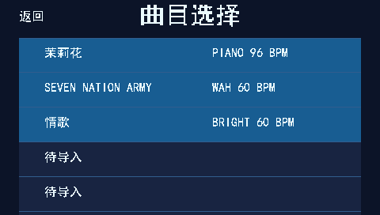
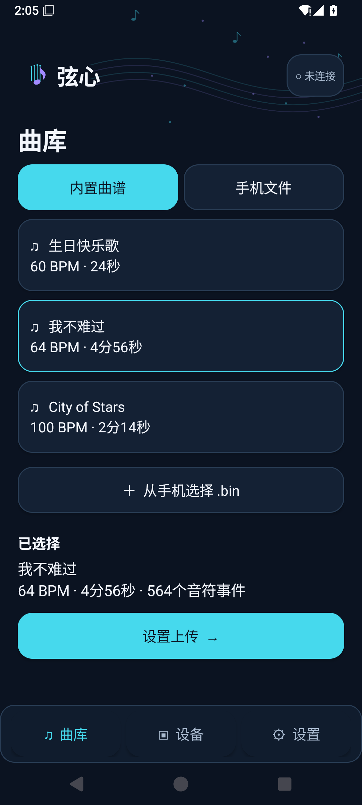
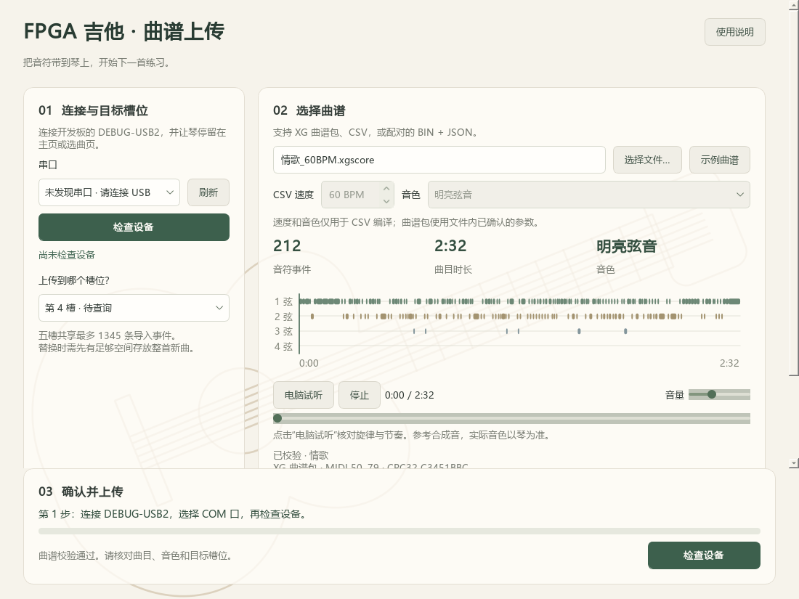
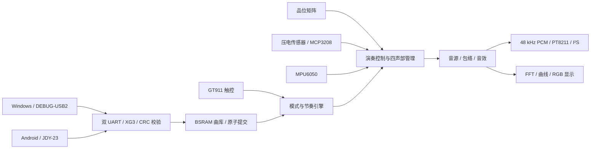
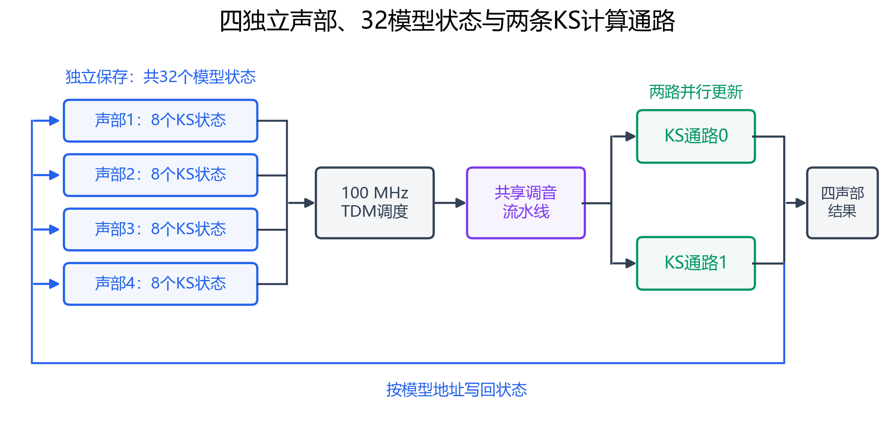

# 芯弦 · FPGA 四弦电子吉他

**把按弦、拨弦、音色合成和节奏练习放进一块 FPGA。**

芯弦是一台基于 Tang Mega 60K 的四弦电子乐器。左手通过品位矩阵选择音高，右手拨动琴弦触发压电传感器；FPGA 根据演奏动作逐音、逐样本生成声音，并同步绘制频谱和节奏界面。Windows 和 Android 客户端用于管理、导入曲谱，离开电脑和手机后仍可独立演奏。

[下载与上板](#下载与上板) · [演奏与传谱](#演奏与传谱) · [代码组织](#代码组织) · [开发与构建](#开发与构建)



*板端选曲页，来自真实 RTL 像素输出。显示和触控已一起适配屏幕倒置安装。*

## 能做什么

- **四根弦独立发声。** 四个声部可同时演奏，支持四档拨弦力度、滑音、尾音音高保持和颤音手势。
- **三种实时音色。** 钢琴、明亮弦音、哇音；明亮弦音使用 Karplus–Strong 物理建模，四声部共保存 32 个独立模型状态。五度和声使用独立延迟线和滤波状态，保留根音主体。
- **并行与流水结合。** KS 在 100 MHz 时钟下用两条并行滤波通路配合 TDM 调度和调音流水线，持续输出 48 kHz 音频。
- **一边演奏，一边看见声音。** 480×272 触控屏显示四弦反馈、莉萨如曲线、64 根环形频谱柱；节奏模式提供落点判定、计分、连击和曲目试听。
- **两种传谱方式。** Windows 通过开发板 DEBUG-USB2 串口，Android 通过 JDY-23 蓝牙。两端可同时连接，各自保留独立会话；上传写入由 FPGA 仲裁。
- **姿态切换音色。** MPU6050 校准后可在平放与持琴姿态间自动切换钢琴、明亮弦音，保留手动控制优先级。

> 32 指物理模型状态总数：每声部 8 个，共 4 声部。实际计算硬件是两条并行 KS 通路按时分调度更新这些状态。所有板端音频均由 FPGA 生成，手机和电脑传送的是音符事件。

## 下载与上板

当前配套版本为 **2026-11-02 双接口位流、Android 0.3.0、Windows 1.2.0**。用户已于 2026-11-04 确认蓝牙与 USB 串口传谱均通过实物验收。

| 文件 | 用途 |
| --- | --- |
| [FPGA 位流 `.fs`](releases/fpga/neo_guitar_touch_game.fs) | 可直接下载到板上 |
| [FPGA 完整发布包](releases/fpga/verified_release_20261102.zip) | 同一位流及构建、资源、时序报告 |
| [Android APK 0.3.0](releases/android/xinxian_jdy23_0.3.0.apk) | Android 8.0 及以上，JDY-23 蓝牙传谱 |
| [Windows 便携版 1.2.0](releases/windows/FPGA_Guitar_Uploader_1.2.0.zip) | 解压后运行 `FPGA_Guitar_Uploader/FPGA_Guitar_Uploader.exe` |
| [FPGA 140 文件纯源码包](releases/fpga/source_code_140_files.zip) | 最终综合所用源码与约束，不含报告、位流和测试 |
| [SHA256 校验表](releases/SHA256SUMS) | 核对下载文件完整性 |

### 1. 准备硬件

已验收组合：**Sipeed Tang Mega 60K（GW5AT-LV60PG484AC1/I0，Device B）+ NEO Dock 31005**，以及四弦品位矩阵、压电拾音前端与 MCP3208、480×272 RGB666 屏、GT911 触控、MPU6050、JDY-23 模块。

| 模块 | 接口与配置 |
| --- | --- |
| 琴颈矩阵 | J13，4 行 × 8 列；逐球位连接见[接线说明](docs/HARDWARE.md) |
| 拨弦 ADC | MCP3208，J8-5～8 SPI，CH0～CH3 对应四弦 |
| 显示屏 | J5，480×272 RGB666；J17 的 1–2 针保持牢固连接 |
| GT911 | J6 六针直连，RST=T15、INT=T16、SDA=U16、SCL=W16 |
| MPU6050 | 3.3 V，共地；SCL=J8-11/Y21，SDA=J8-12/Y22，AD0 接 GND |
| JDY-23 | 3.3 V，共地；TXD→J8-10/AB22，RXD→J8-9/AB21；9600/8N1 |
| Windows 串口 | 开发板 DEBUG-USB2，115200/8N1，使用原板 USB-UART 桥 |
| 音频输出 | 板载 PT8211 / 3.5 mm；另提供 J9 标准 I²S 输出 |

断电接线，外设使用 3.3 V 逻辑。详细针脚和时钟依赖见[硬件连接与启动](docs/HARDWARE.md)。本工程的音频参考时钟来自板上 MS5351 的 **CLK2=12.288 MHz**；保留已正常工作的板端时钟初始化配置。蓝牙使用外接 JDY-23，不需要刷入历史 BL616 蓝牙实验固件。

### 2. 下载位流

1. 给开发板正常供电，连接原下载接口，打开 **Gowin Programmer**，扫描选择 **GW5AT-60B**。
2. 临时运行选择 `SRAM Mode / SRAM Program`，文件选择上表的 `neo_guitar_touch_game.fs`，执行下载。
3. 如需断电保留，选择 `External Flash Mode Arora V`，操作选择 `exFlash Erase,Program thru GAO-Bridge Arora V`（也可选带 Verify 的操作），Flash 选择 `Generic Flash`，起始地址 `0x000000`，下载同一 `.fs`。
4. 下载成功后完全断电再上电，确认进入吉他界面。SRAM 下载只临时生效，重新上电会加载 Flash 中的程序。

位流同时包含演奏、节奏、显示、触控、姿态和两路传谱接口。直接使用发布文件无需先编译源码。

## 演奏与传谱

### 自由演奏

进入演奏模式，按品选音、拨弦起音。按品本身不会触发声音；松品后尾音保留最后按住的音高，新一次拨弦再读取当前品位。

| 控制 | 操作 |
| --- | --- |
| USER_BUTTON1，AA13 | 循环切换钢琴 → 明亮弦音 → 哇音 |
| USER_BUTTON2，AB13 | 短按切换合唱，长按约 1 秒切换五度和声 |
| USER_BUTTON3，Y12 | 循环切换原声 → 延音 → 轻混响 |
| 同品连续三次松按 | 发声期间触发该弦颤音；换品、重拨等操作会清除 |
| `CALIBRATE` / `AUTO` | 水平静置校准后开启姿态音色切换 |

姿态校准时保持传感器原安装方向、正 Z 向上水平静置，点击一次 `CALIBRATE`，等待约 4 秒完成 256 份有效样本采集，再开启 `AUTO`。平放显示 `FLAT`；抬起琴颈约 45～55° 并保持后应进入 `GUITAR`。切换会等待声部空闲，避免截断正在发声的尾音；上电默认 `AUTO OFF`。

### 节奏练习

在选曲页选曲并试听或开始练习。色块到达判定线时拨对应颜色的弦，曲谱提供音高，无需按品；屏幕显示分数、连击和 Miss，支持双击退出。

| 板端槽位 | 上电默认内容 |
| --- | --- |
| 1 | 茉莉花 |
| 2 | Seven Nation Army 短 riff 练习片段 |
| 3 | 情歌，38 小节主旋律练习版 |
| 4、5 | 待导入 |

### Windows / Android 导入曲谱

<p>
  
  
</p>

*左：Android API35 模拟器截图。右：Windows 冻结发布版截图。*

1. 让琴停留在主页或选曲页并保持供电。
2. **Windows：** 连接开发板 DEBUG-USB2，打开软件、刷新并选择对应 COM 口，点击“检查设备”。**Android：** 安装 APK、允许蓝牙权限，在设备页连接 JDY-23，等待 XG3 握手与五槽查询完成。
3. 选择内置曲谱或导入文件，设置目标槽位和音色，开始上传。两端都附带生日快乐歌、我不难过、City of Stars；Android 支持手机 `.bin`，Windows 支持 `.xgscore`、CSV 以及配套 `.bin + .json`。
4. 等到 FPGA 确认提交、客户端核对目录后，在琴上选择对应 `USER` 槽演奏。

两路接口可同时保持连接，一次只允许一路上传，另一端写入会返回 `BUSY`。五槽共享 **1345 条导入事件**；替换曲目时，新旧数据在提交前同时占用空间。导入曲谱保存在运行时 RAM，**断电、复位或重新配置后恢复默认曲库**。出现“提交结果未知”时，先在琴上查询、试听并核对结果，再按软件提示解除待核对状态。

更多格式、容量与错误处理见[传谱说明](docs/TRANSFER.md)和[Windows 使用说明](docs/WINDOWS_SCORE_UPLOADER.md)。

## 实现方式



明亮弦音的 KS 内核用短激励启动反馈延迟线，经低通和损耗形成自然衰减。每个模型拥有自己的延迟线、滤波及直流抑制状态；五度和声单独保存状态，根音与五度分别计算后混音。



内部逻辑分为 **50 MHz 系统域、12.288 MHz 音频域、PLL 产生的 100 MHz KS 计算域**。独立状态放入 BSRAM，TDM 调度在每个音频样本预算内更新四个声部，计算通路内部再做流水。详细原理见[音频与 KS 架构](docs/ARCHITECTURE.md)。

## 代码组织

最终使用的代码直接展开在以下目录；查阅、修改或构建当前作品，从这些目录开始。

```text
.
├── rtl/                         # 最终 Gowin 工程使用的 RTL 与配置头文件
├── constraints/                 # 最终 CST 引脚约束、SDC 时序约束
├── mem/                         # 音色、相位、FFT、字库及曲谱初始化数据
├── gowin/neo_guitar_touch_game/  # 正式 .gprj、原 IDE 配置与构建输出位置
├── mobile/android/              # Android Java 源码、资源、Gradle 工程
├── tools/
│   ├── windows_score_uploader/  # Windows PyQt5 软件源码与界面资源
│   ├── build_*                  # 当前 Android / Windows 构建入口
│   └── game_*、compile_* 等     # 曲谱格式、编谱与传谱工具
├── scores/                      # 当前曲谱数据与示例
├── releases/                    # 已验收 .fs、APK、Windows ZIP 与校验表
├── docs/                        # 当前硬件、使用、构建和架构说明、图片
└── verification/                # 测试平台、旧工程、实验代码与冻结验证记录
```

正式工程的 **140 份综合输入保持已验收版本的原路径和字节**，可对照[源码清单](releases/fpga/source_manifest.json)。`verification/` 内的历史材料保留原始内容与版本边界；[归档说明](verification/README.md)提供验证入口和迁移索引。`build/`、`impl/` 等本地生成目录不属于发布源码。

## 开发与构建

### 撰写、编译和仿真平台

当前工程在 **Windows 11 x64** 上开发和验证。RTL、Python、Java 均为文本源码，可使用 Gowin IDE、VS Code 或 Android Studio 编辑；编辑器不参与板端运行。实际构建和仿真工具如下。

| 对象 | 语言 / 平台 | 已使用工具 |
| --- | --- | --- |
| FPGA 综合、布局布线 | Verilog HDL，GW5AT-60B | **Gowin EDA V1.9.12.03 x64**，GowinSynthesis / Place & Route / STA |
| HDL 功能与网表仿真 | Verilog / SystemVerilog testbench | **ModelSim SE-64 10.6d**，配套 Gowin `gw5a/prim_sim.v` 原语库 |
| Android | 原生 Java 17，Android 8.0+ | **JDK 17、SDK Platform 35、Build Tools 35.0.1**；aapt2 / javac / D8 / zipalign / apksigner |
| Android 界面检查 | Android 系统模拟器 | API35，普通、小屏、大字体、横屏、挖孔五种场景 |
| Windows | Python 3.12 x64 / PyQt5 | PyQt5 **5.15.10**、Qt **5.15.2**、pyserial **3.5**、PyInstaller **6.16.0** |
| 曲谱、自动检查 | Python | Python 3.12；Windows 依赖锁定文件位于软件源码目录 |

Android 同时保留 AGP **8.7.3** 的 Gradle 工程；当前交付 APK 实际使用 SDK 命令行工具链构建。仓库没有 Gradle Wrapper，Gradle 离线缓存未完整验证。可复现的入口、环境变量和仿真步骤见[构建与仿真指南](docs/BUILDING.md)。

### FPGA

用 Gowin IDE 打开 **`gowin/neo_guitar_touch_game/neo_guitar_touch_game.gprj`**，确认器件 `GW5AT-LV60PG484AC1/I0 / Device B`、顶层 `neo_guitar_touch_game_top`，依次运行 **Synthesize → Place & Route**。

保持现有 CST、SDC 和工程设置；输出为 `gowin/neo_guitar_touch_game/impl/pnr/neo_guitar_touch_game.fs`。新构建需检查自己的布线、STA 和功能结果，发布包中的旧报告仅对应已验收位流。

### Windows

在仓库根目录执行：

```powershell
py -3.12 -m venv .venv
.venv\Scripts\python -m pip install -r tools/windows_score_uploader/requirements-build.txt
.venv\Scripts\python tools/run_windows_score_uploader.py
# 生成新的便携包
.venv\Scripts\python tools/build_windows_score_uploader.py
```

### Android

安装 JDK 17、Android SDK Platform 35 和 Build Tools 35.0.1，设置本机路径后，在仓库根目录执行：

```powershell
$env:JAVA_HOME = 'C:\path\to\jdk-17'
$env:ANDROID_SDK_ROOT = 'C:\path\to\Android\Sdk'
python tools/build_android_jdy23.py
```

输出位于 `build/releases/android/xinxian_jdy23_0.3.0/`。签名密钥留在本地，仓库不分发密钥；重新构建的开发签名 APK 与已发布 APK 可能不能直接覆盖安装，详见构建指南。

### 检查与仿真

```powershell
python verification/check_repository.py
.venv\Scripts\python verification/run_client_checks.py
```

前者检查工程依赖、冻结源码及发布文件哈希；后者运行曲谱协议和 Windows 客户端回归，不打开实体串口或蓝牙。ModelSim 的 RTL / 实际网表测试平台、冻结日志和试听材料均保留在 `verification/`，入口与适用版本见[验证说明](verification/README.md)。

## 已验收版本的实现结果

| 项目 | 结果 |
| --- | --- |
| Logic / FF | 50,937 / 23,686 |
| CLS | 28,807 / 29,952 |
| BSRAM / DSP | 118 / 118；106.5 / 118 |
| 运行时钟：系统 / 音频 / KS | 50 / 12.288 / 100 MHz |
| STA Fmax：系统 / 音频 / KS | 52.375 / 18.044 / 109.368 MHz |
| Setup / Hold / Latch / 未布通 | 均为 0 |
| 音频 | 48 kHz，16 bit，立体声；四独立声部 |

已完成生产 RTL、实际综合网表与完整 P&R/STA 验证；网表功能仿真未回标 SDF，时序依据实际布线 STA。客户端已有 Android 五场景 195 项检查、Windows 34 项回归及发布包校验，双接口实物传谱由用户确认通过。[版本与验证边界](docs/VALIDATION.md)记录具体范围和对应哈希。

## 参考

- KS 调度设计曾参考 [vdalex 的 synth8 项目说明](https://deepwiki.com/vdalex/tangmega-138k-fpga-projects/5.2.2-synth8-wavetable-synthesizer-and-ping-pong-delay)：将音源计算与状态调度分开，结合并行通路和时分复用。这里的明亮弦音计算内核为 KS 反馈模型。
- 仓库中的曲谱用于作品演示和练习，歌曲名称及原作权利属于各自权利人。第三方软件说明随 Windows 源码及便携包保留。
