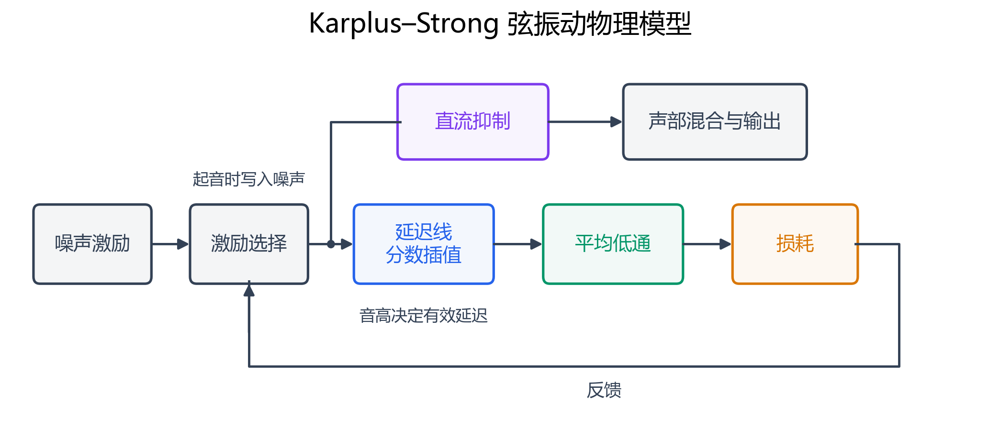
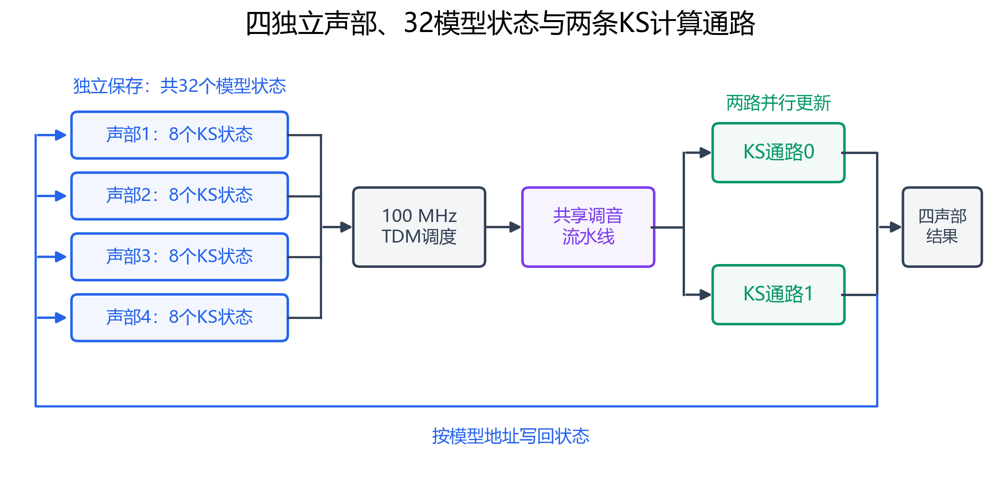

# 音频与 KS 架构

本作品的音频主链为可综合 RTL。电脑、手机与板载 USB 桥只参与曲谱传输或板级配置，演奏期间音高、激励、包络、效果和 PCM 都由 FPGA 计算。

## 四声部与物理模型计数

四弦对应四个独立声部，能够同时发声。明亮弦音每声部保存 8 组独立 KS 延迟线、低通滤波和直流抑制状态，共 **32 个模型状态**。一条 KS 弦产生的多个泛音不另外计为模型；32 也不表示 32 复音或 32 套同周期硬件计算通路。

KS 延迟线由短时激励初始化，每次更新读取延迟值，进行低通、损耗和状态更新，再写回对应模型。反馈形成准周期振荡，并随损耗自然衰减。有限精度调音用于细化延迟对应的音高。

## 并行、TDM 与流水

- 系统域：50 MHz，处理触控、ADC、姿态、曲库与两路 UART。
- 音频域：12.288 MHz，产生 48 kHz 样本节拍及数字音频接口。
- KS 域：PLL 从 50 MHz 产生 100 MHz，轮询四声部状态，以两条并行滤波通路更新模型；共享调音计算采用 II=1 流水。

`rtl/synth/ks_tdm_bank.v` 管理跨域请求与声部状态；`karplus_strong_voice.v` 是计算内核；`ks_compute_pll.v` 提供内部计算时钟。独立模型状态经 DPB 保存，硬件通路按调度复用；这使 32 个模型能够与显示、FFT、曲库等逻辑共同放入 Mega60K。

## 五度和声与存储

五度开启时，每声部现有 8 个模型分配为 4 个根音模型和 4 个五度模型。五度基频约为根音的 1.4983 倍，拥有独立延迟及滤波状态，经独立混合增益与根音合奏。

五度开启模式的延迟容量为 `[336,168,68,50,224,76,56,46]`，合计 **1024 字/声部**。第五个模型用 224 字容纳较低的五度基频，重新分配现有空间，未增加 BSRAM 数量。关闭五度保持原有频率、容量和增益布局，布局切换会重新激励。当前资源已用满 118 块 BSRAM，扩展低音或增加模型需要重新设计存储预算。

推荐版在相同激励年龄下进行过“根音单独 → 五度单独 → 合奏”的真实 RTL 试听；关闭五度输出与此前成功版本逐 PCM 比对保持一致。相关测试和冻结报告见 `verification/sim/tb/tb_ks_fifth_audition.sv`、`verification/build/ks_fifth/`。历史采样数据和试听 WAV 属于本地忽略产物，不保证包含在 Git 克隆中。

## 周边链路

钢琴与哇音保持原有实时合成路径。四声部经包络、力度、合唱、延音/混响等处理后输出立体声，板载 PT8211 与 J9 标准 I²S 分别发送。

显示域从 PCM 与声部遥测跨域取数，完成 FFT、频带柱与曲线渲染。曲谱导入使用 BSRAM 读回 CRC 及目录原子提交，避免正在读取的曲库看到半首新曲。两路 UART 的接收器并行工作，完整帧共用协议计算核，但保留独立会话上下文。
