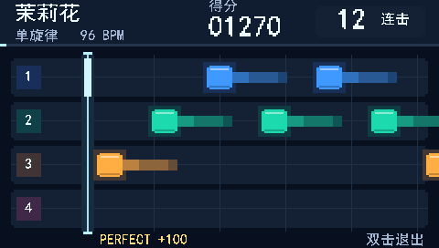

# 全宽舞台四轨游戏

2026-10-15：根据用户审核选择，将最初的“全宽舞台”预览接入 `neo_guitar_touch_game`。本版继续采用无需按品的四轨游戏；4×9 指板矩阵和后续预览里的折线／弦波动效留待以后。

工程入口：`gowin/neo_guitar_touch_game/neo_guitar_touch_game.gprj`，顶层 `neo_guitar_touch_game_top`。接线沿用原生 J6 六针触控、J5 显示、J17 1–2 牢固连接、J8 ADC、J13 品位矩阵和既有两路音频。

## 画面

- 顶部显示 24 像素《茉莉花》标题、96 BPM、五位得分和连击；进度线对应实际曲谱时间。
- 四轨中心为 y=85、133、181、229；蓝、绿、橙、红分别对应第 1～4 弦。没有左侧大计分栏。
- 色块仍从右向左移动，**中心到 x=96 时拨对应弦**；圆角用少量边界裁切表示，保留高光、暗边、局部辉光和四级尾迹色。
- 中性参考网格是位置辅助线，不把它冒充精确节拍线。曲谱速度仍由既有每 250 个音频样本一像素的绝对时间布局决定。
- 底部显示本次判定及“双击退出”。每次实际判定触发短暂反馈，约 15 帧后清除；连续 Perfect 即使判定码相同也能重新触发。不会因色块经过判定线而自动判为命中。
- 模式菜单、选曲、试听、结果和演奏模式保持原入口；演奏模式继续使用原莉萨如／环形频谱。

24 像素标题被切为十二个 16×16 字形块，装入原字库的空余槽，字库仍为 2048×16 bit。消息索引扩为 2048×7 bit，新增得分、连击和底部提示；没有帧缓冲或模糊运算。

## 分弦

`tools/game_fingering.py` 在电脑端生成曲谱时完成分配，FPGA 只读确定的音符事件。

硬约束：保持原音高、起音时刻和谱面时长；同时或需要重叠保持的音符不能使用同一弦；候选位置限定为当前 E4／B3／G3／D3 调弦、空弦至八品。软目标是临近音优先换弦，同时考虑高品位和手位跨度。

先用 128 状态束搜索比较候选；束搜索若陷入死路，使用带占用状态缓存的完整可行性搜索复核，不把搜索剪枝误报为曲谱无解。真正无解则报错，不能静默移调、删音或错开拍点。

《茉莉花》仍为 67 音、96 BPM、33.75 秒、27 小节 2/4。对比修复基线 `a13fd79`，ROM 每个事件除弦号外的所有位一致，音高和时间没有修改。相邻事件同弦次数从 35 降为 8；遇到唯一候选的低音或较长间隔时仍允许顺序重用。四弦的事件数现在为 9／27／21／10。

旧的“某音高固定映射到某行”不再适用。`scores/jasmine.json` 记录每个事件的弦号和对应物理品位，供后续矩阵模式复用；当前游戏依然只要求拨对弦，不检查实际品位。现有 16 字节 BIN 和 80 bit ROM 的结构不变，未新增矩阵判定或 UART 协议。

## 实现与验证边界

像素链使用四级流水线：相对坐标、图形分类、调色／字模、输出，保持 50 MHz／6 的原 LCD 时序。布局已有的 67～500 坐标范围允许省去八路像素比较中的无效高位。进度用消隐期常量累加追赶，尾迹用分段强度，避免逐像素除法和新 DSP。

为缓解满载布线，布局和 UI 复用 `game_snapshot_cdc` 的目的端帧快照，不在布局中再复制两份统计数据。跨时钟握手和源端锁存不变；目的快照只在帧消隐请求后更新，保持至下一帧。得分和四个计数器也改为共用一套 20 bit 移位加三转换器，一轮 105 个系统时钟，输入变化后最多 125 时钟全部稳定，早于有效视频开始。回归检查快照在 update 之外保持、99999 分、五位溢出和 255 等计数边界。

原游戏快照的保留位 `[245:238]` 新增四路 2 bit 判定事件代号，各弦每次 Perfect／Good／Bad／Wrong／Miss 均更新；原字段位置不变。代号只用于显示反馈，不参与合成或判定。实际采集的拨弦冷却时间和现有谱面密度下，每显示帧内不会同弦更新四次而绕回同一代号。

- Python 回归覆盖同弦重叠、四音和弦、范围边界、相邻换弦、束搜索回退，另用 200 个小规模随机谱对照完整枚举。
- 九项 RTL 回归包括真实像素输出、全曲布局、渐变、进度、反馈过期／重复触发及原触控、游戏和音频检查。
- 原演奏音频的 8192 样本／2,097,153 参考时钟与已验收 master 一致，三音色及全部音效保留。
- 新增综合网表整机显示检查：使用真实 LCD 扫描，以显示专用快照依次驱动主页、倒计时、三帧游戏和结果页，比较 783,360 个有效像素、触控 GPIO 和静音音频引脚。另保留整首 364 次连续布局检查。该显示快照注入不是实物触控或实物演奏验收。

最终资源、时序、网表及位流哈希以工程 `verification.json` 为准。`hardware_acceptance.json` 分别保存 `a13fd79` 修复基线与本次全宽舞台的用户反馈，旧归档位流继续保留。

## 本次可烧录发布

源代码提交为 `246b146`（舞台与离线分弦）及 `98ba437`（快照／格式化复用）。Gowin V1.9.12.03、Device B 完整构建及结果校验通过，归档位流：

`build/releases/touch_game/neo_guitar_touch_game_full_width.fs`

SHA256：`9c161ac673cd1c081831075f4f84d4ff2067f6a20797119b9a65d9623b770883`。
对应记录：`build/releases/touch_game/full_width_verification.json`，工程内保存同份 `gowin/neo_guitar_touch_game/verification.json`。

| 最终实现结果 | 数值 |
| --- | --- |
| Logic / Register | 58178 / 22239 |
| CLS | 29842 / 29952，99.63% |
| BSRAM / DSP | 95 / 115.5，与修复基线相同 |
| 系统 Fmax，要求 50 MHz | 54.636 MHz |
| 音频 Fmax，要求 12.288 MHz | 13.441 MHz |
| 未布通 / setup / hold / latch | 0 / 0 / 0 / 0 |
| 综合网表整机显示 | 5,556,339 时钟，783,360 有效像素 |
| 综合网表连续布局 | 364 次更新 |
| 原演奏音频对照 | 8192 样本一致 |

初次舞台实现曾剩 3 条未布通网络；复用显示快照和计分转换后重新完整构建通过。相比首轮综合少用 305 个寄存器，但最终 CLS 没有下降，不能据此宣称已完成总体面积优化。当前仍接近满载，P1 的 CLS≤95%、系统≥55 MHz、音频≥13.5 MHz 余量目标尚未达到。保留的 PR1014 通用时钟路由提示已结合本次实际 STA 审查；后续变更仍需重新布线与检查时序。

后续回归仍应检查四轨色块从右向左移动、在 x=96 拨弦的判定、连续命中的反馈／计分、Miss 提示、完整试听及双击退出；再对照演奏模式的三音色、音效和原图形。接线保持原样。

2026-10-15 用户反馈“现在效果还可以”，并明确授权 push 到 GitHub、合入 master。本次状态更新为**数字验证通过，用户认可当前效果并批准发布**；现场烧录文件的哈希未另行采集，没有新增定量声学、长期稳定性或严格比赛配置的实测记录。更详细的测量范围不能从这次反馈推断。

发布复核时，本机 IDE 已重新生成不同的 `impl` 网表与位流，完整结果校验按预期在网表哈希绑定处拒绝旧门级日志。上表仍对应已归档的 `9c161ac6…b770883` 发布：其原验证记录与 `4bf7e0c` 保存的记录一致，归档位流、当前生产源码、原 RTL／门级日志均已复核哈希。该复核不认证后来重建的 IDE 产物；若要另行发布它们，需重新运行对应网表验证和结果检查。
