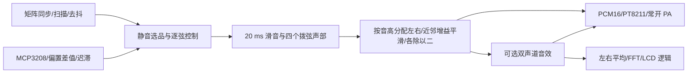

# 主工程同步：双 PCB 实测链路

最新 `feat/full-piano-effects` 已同步成功钢琴到 32 分量 FULL，并加入无复位三键控制和自动五度和声。
本轮下载入口与完整数字验收以 [FULL_PIANO_EFFECTS.md](FULL_PIANO_EFFECTS.md) 为准。
下面保留原正弦／固定钢琴主工程同步记录。

当前分支更新：`feat/piano-hammer-voice` 已将物理主入口默认音源改为钢琴模态与击弦起音，
输入链和接线沿用本文的同步基线。钢琴版本以 [PIANO_FPGA_TRIAL.md](PIANO_FPGA_TRIAL.md) 为准；
下文保留正弦/谐波主工程同步时的参数和验证记录。

更新：2026-10-04。用户已确认 `neo_full_chain_audio_test` 双 PCB 实物测试结果理想。
本次把该行为同步到标准 `rtl/` 与主 Gowin 工程。成功的独立测试工程源码保留原样。
新主工程位流已通过仿真和固定引脚实现；它本身仍需用同一接线进行 SRAM 下载复核。
在此基础上，根据用户反馈的三音及以上拍频问题，主入口默认开启新的减拍频混音策略。
该策略已完成数字 A/B 验证，实际听感等待复核，详见 [减拍频修改说明](ANTI_BEAT_AUDIO.md)。

## 使用哪个工程

| 用途 | 入口 | 当前默认 |
| --- | --- | --- |
| 现有双板整机主工程 | `gowin/xinxian_mega60k/xinxian_mega60k.gprj`，Top=`neo_guitar_main_top` | 实测正弦声部，固定力度 2，新增减拍频混音，无 LCD/效果按键端口 |
| 已成功的独立验证基线 | `gowin/neo_full_chain_audio_test/neo_full_chain_audio_test.gprj` | 自包含平铺源码，继续保留 |
| 谐波/效果/频谱逻辑集成 | `rtl/top/full_guitar_top.v` | 32 分量谐波；沿用新控制、拨弦包络、立体声和 PA 策略 |
| 未来带 LCD/效果键的 NEO 包装 | `rtl/top/neo_full_guitar_top.v` | 三态矩阵、按钮同步、FULL 和 LCD 电气边界；完整接线尚未冻结 |

主工程直接引用标准 RTL，避免后续只改平铺测试副本、产品代码却继续停在旧版本。
原 `xinxian_top` 是 LED/时钟诊断，保留源文件但不再作为主工程顶层。
主工程的 26 个端口和球位与成功全链路 CST 一致，矩阵 J13、ADC J8、音频与 KEY0 接法均沿用。
以 `constraints/neo_guitar_main.cst` 和 [全链路接线表](NEO_FULL_CHAIN_AUDIO_TEST.md) 为准。
此前 PMOD 矩阵候选和“一概禁用 Bank 1”的文档是早期记录，不适用于已实测的 J13 接线；
本次没有更改板卡供电、电压标准或扩展其它 Bank 1 接口。

## 核查发现和修改

| 原主工程的问题 | 本次处理 |
| --- | --- |
| ADC 零基线、1000/800 阈值与实测偏置输入不符 | 同步实际 SPI/reader，使用基线 2053、绝对偏差触发 100/重新武装 30 |
| ADC/矩阵仍在 50 MHz 域运行，分频和去抖周期不等于实测 | 统一到 12.288 MHz；矩阵列输入两级同步；复位三拍同步释放 |
| 输入事件跨时钟域且旧控制存在延迟松手、过时声部占用 | `guitar_play_control` 用真实音频 `voice_active`，保存事件到采样边界；最后松品快速阻尼 |
| 主链仍为 ADSR/单声道复制，PA 随声部活动切换 | 显式使用自然拨弦包络、动态硬立体声、每侧除以二，PA 仅随复位关闭 |
| 松品之后重新拨空弦可能保留旧音高 | 每次真实拨弦按当时选品重新取 ROM；旧 `fret_note_event` 兼容路径也补上此修复 |
| 固定音量测试与产品四级力度混用 | 板级默认固定力度 2；四级幅度分档保留为显式可选并等待物理标定 |
| 音效原为一套单声道状态 | 左右声道各自独立软削波/chorus/reverb；FFT 接最终两声道的平均值 |
| FULL 直接沿用旧包络与 PA 策略 | FULL/NEO FULL 接入同一新主链；可选延音在 note_off 时锁存，使拨弦 Release 更长 |
| 主 gprj 仍只包含 LED 测试，XML 版本和路径过时 | 修复 XML，采用相对路径引用主 RTL、当前 CST/SDC 和 ROM |
| 构建依赖调用目录，部分老测试/黄金向量未跟进 | 固定构建工作目录；修正真实 SPI null/B11 时序、Release 假设、PCM24 缩放与测试端口 |
| 三音以上同声道近邻音叠加出现难听的起伏 | 优先选择频差较大的声道；同声道非同音近邻中较早起音的声部平滑降至半幅 |
| FULL 滑音常数除法组合路径过长 | 精确限制到当前 ROM 的 26 位取值范围，再移位除奇数因子；与原 32 位模块逐周期比较 |

默认链路：



## 保持的实测参数

- 12.288 MHz；采样分频 256，即 48 kHz；PT8211 分频 4。
- ADC 分频 4，即 1.536 MHz SCLK；每弦死区 400 次本通道采样，稳定回落 80 次。
  两项按 ADC 通道采样计数，不能当作 48 kHz 音频采样数。
- 矩阵 CLK_DIV=768、SETTLE_CYCLES=3、DEBOUNCE_FRAMES=5，约 1 ms/帧。
- Attack=96 样本、初始衰减 9600 样本；FAST_SHIFT=13、SLOW_SHIFT=16、RELEASE_SHIFT=10，
  IDLE_LEVEL=64；滑音 960 样本。固定正弦主工程没有固定 Sustain 平台。
- 当前 36 个相位增量最高为 `0x02CA6987`，上六位均为零。共享主链滑音器使用
  `NOTE_PHASE_VALUE_BITS=26` 的精确取值范围；DDS 累加器和接口仍为 32 位，没有删除有效相位位。
  通用滑音器默认仍支持完整 32 位值；以后扩大 ROM 音高范围时须同步增大该宏。
- 按品不会产生 Attack；四弦保持并行发声；Release 再按品不会无拨弦重启；
  同采样松品和拨弦时拨弦优先；新拨弦使用当前稳定品位；没有 30 ms 捕获窗口。
- 空闲 PA 保持开启。启动/复位释放的模拟瞬态与普通音符间的 PA 开关行为分别处理。

SPI 保留实物通过的 18 个上升沿传输及 `{spi_sample_data[10:0],1'b1}`。
它移去采到的 null、恢复高 11 位并把最低位固定为 1，ADC 码因此为奇数，
不代表完整的 12 位转换结果。若以后修改 SPI 获取真实 B0，需要重新做独立 ADC 标定和实测，
本轮不改变这个已通过的硬件行为。

## 可选功能和边界

- `neo_guitar_main_top.USE_HARMONIC=0` 默认保持实测正弦声部。
  `full_guitar_top` / `neo_full_guitar_top` 默认为 1；高级路径通过数字回归与独立实现。
- `BOARD_ANTI_BEAT_ENABLE=1` 默认启用新的减拍频混音；设为 0 后重新构建可恢复原动态硬立体声混音。
  它不改变声部内部音高、自然包络和起音控制，但三音以上的声道分配及部分音量会不同。
  80 Hz 频差与半幅增益是可调的工程参数，不能据此宣称消除所有和弦的拍频。
- `FIXED_VELOCITY_ENABLE=0` 启用触发样本幅值的四档逻辑；150/300/600 是暂定幅值边界。
  `raw_adc` 是 ADC 码，`peak_adc` 是距基线的偏差峰值；这些诊断可用于标定。
  主工程不会为等待峰值而增加起音捕获窗口，四级力度还没有新的实物验收。
- 高级路径的延音开关在进入 Release 时锁存，拨弦阻尼速度约减为四分之一；
  左右轻混响仍独立处理。它不改变默认实测正弦路径。
- 旧 ADSR/揉弦实验模块仍保留并做兼容性回归。当前主链采用已实测的立即松品阻尼，
  没有接回等待揉弦识别的 250 ms 松品窗口。
- LCD 面板、像素时钟来源和三效果键的物理分配仍须确认。
  `full_main_build` 的自动引脚位流仅用于逻辑规模/时序，不作为当前双板的下载入口。
  当前可下载入口仅暴露已确认的矩阵、ADC、音频、KEY0 和可选调试 LED。
- 最终可选 FULL 自动引脚实现虽无 setup/hold 违例，但音频最差余量仅 0.036 ns。
  该结果没有为新增功能预留时序空间；正式冻结 LCD、像素时钟及引脚后须再次实现并收敛。

## 构建和回归

在 PowerShell 中从仓库执行，工具不在 PATH 时填入本机安装路径：

```powershell
& '<Gowin IDE bin>\gw_sh.exe' gowin/xinxian_mega60k/build.tcl
& ./sim/run_main_regression.ps1 -ModelSimBin '<ModelSim win64>'
```

主位流：`gowin/xinxian_mega60k/impl/pnr/neo_guitar_main.fs`。
IDE 打开 gprj 后，核对 Top=`neo_guitar_main_top`；源码和 ROM 仍保留相对路径目录结构。
不要把标准 RTL 单独平铺而不调整 include/readmemh 路径。

可选完整逻辑实现：`gw_sh.exe gowin/build_full.tcl`，输出至 `gowin/full_main_build`。
`synth_full.tcl` 和 `synth_neo_full.tcl` 也使用独立工作目录，不覆盖旧 FULL/MINIMAL 的实现基线。

回归脚本从成功的独立验证源码生成模块名带 `ref_` 的临时副本，
避免误绑定到修改后的主模块。对齐 2 拍/3 拍复位释放之后，逐周期比较矩阵、SPI、
逐弦 PCM/音高/生命周期、DAC 串行位、PA 和 LED；原验证源码没有为对比而改写。
该逐周期基线对比显式使用 `ANTI_BEAT_ENABLE=0`；新增的策略使用单独 A/B 测试，
验证同一演奏输入下逐弦 PCM、采样节奏及生命周期相同，同时导出实际混音结果供试听。
其余回归覆盖原 ADSR、力度、生命周期、谐波、音效、FFT、LCD 和复位。
日志及生成库位于 Git 忽略的 `sim/temp`；详细数值与实现证据见
[主工程验收记录](evidence/main_engine_sync_acceptance.txt)。
