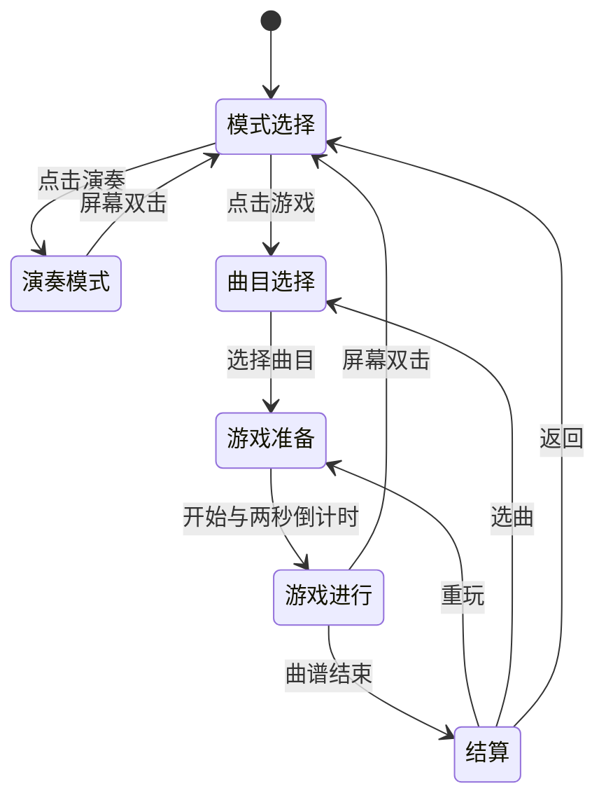

# 下一版：松品续音、四档力度、曲线渐暗与触控四轨游戏

日期：2026-10-12。状态：**A1 松品续音已获用户授权并进入实施，其余仍为待实施方案**。

后续执行记录：用户要求先修改松品续空弦。现已单独修改 `guitar_play_control`，
去除松品 `note_off`，保留原音源与自然包络；四档力度、曲线渐暗、触控/游戏均未在本次实施。
新位流及最新验证状态以 `gowin/neo_guitar_radial/README.md` 为准。

用户已确认当前 `neo_guitar_radial` 新布局通过实物验收、音频与 LCD 同时运行正常。
初版评估仅记录设计与验收状态。随后用户单独授权实施 A1；下述基线指实施前的原版本，
新控制行为不改变阈值、音色、显示布局或接线。
实施源码基线为提交 `a2b8696`。历史自动构建的数字验证见
[`verification.json`](../gowin/neo_guitar_radial/verification.json)，对应位流 SHA-256 为
`a8de7094b081f80dcef6ef74ff67dd46729f4fa9d90883f8ef0e3692a86c2c6e`。
本轮只读核对当前本地 `.fs` 的 SHA-256 为
`71629a8d242f99c2bf7d8f1e2ea60fa0e24c903dfccb8665d16093bec77a047c`；
其指纹与历史自动构建记录不同，而 40 项实现源码及29项音源/ROM指纹仍与该记录一致。
本轮不重编译或替换此文件，也不把历史位流指纹认定为用户实物验收时所烧录文件的指纹。
用户反馈属于功能实物验收，不替代四档力度、触控和延迟的专项测量。

## 1. 评估结论与实施顺序

四项需求均合理。前三项可以沿现有演奏链改进；第四项需要增加触控、曲谱调度和游戏控制，
但仍可共用原四声部音源、音效与 LCD 扫描，不需要第二套音源或全屏帧缓存。

| 需求 | 当前原因或缺口 | 下一版决定 |
| --- | --- | --- |
| 松品变为空弦并继续衰减 | `guitar_play_control` 明确把最后松品解释为阻尼，并冻结释放音高 | 改成包括品位 0 在内的持续音高跟随；只在真实拨弦时重新起音 |
| 四档力度与条带长度 | 上板默认固定力度编码 2；动态映射按首次越阈值采样分档，尚未标定 | 每弦短窗取峰、每弦独立标定；同一拨弦事件的力度同时用于响度与长度 |
| 莉萨如缓慢变暗 | 现有亮度含常数底亮度，且 `voice_active=0` 直接撤掉曲线 | 每声部独立显示包络，移除底亮度；声音结束后保留短暂图形淡出 |
| 触控模式选择与四轨游戏 | GT911 未接入工程；缺曲谱存储、事件调度、节奏判定 | 触控菜单 → 曲目选择 → 倒计时 → 四轨游戏；音频与界面共享明确的模式状态 |

建议按三个可独立验收的阶段实施，最终组成同一个下一版：

1. **A：演奏改进。** 松品续音 → 力度采集与标定 → 条带长度 → 曲线渐暗。
2. **B：触控游戏。** 资源预验证 → GT911 → 模式菜单 → 五曲目槽位与短谱演示 → 四轨判定和发声。
3. **C：完整曲谱导入。** 外部存储与有线传输 → 五首实际曲谱 → 蓝牙传输适配。

旧的音频、居中莉萨如、环形频谱工程和已验收位流保留。未来建立独立上板工程；
本轮不创建该工程。原三枚按键继续控制音色、合唱/和声、延音/混响。

## 2. 保持现有音质的边界

- 保留四声部、每声部 32 分量、三音色及哇音 V4 的 ROM、定点精度、包络和相位计算。
- 保留立体声、PT8211、合唱、五度和声、延音、轻混响及正常音符之间的功放状态。
- 四档力度优先启用已有增益表，不以减少模态或降低 PCM 位宽实现动态响度。
- FFT、触摸读取、文件导入和屏幕渲染不得向音频施加背压，不得用屏幕帧率调度发声。
- 修改后的松品策略、实际力度、游戏选音是**预期行为变化**，不能继续要求这些场景与旧程序输出相同。
  应把同样的新控制事件送给未简化的 FULL 音源，逐样本比对；未变更场景仍与旧基线比对。

演奏模式的矩阵决定音高、拨弦决定起音。游戏模式由谱面与拨弦决定音高，矩阵扫描仍可运行，
其结果不进入游戏音高与阻尼控制。菜单模式停止接受新的发声事件，已有尾音平滑结束。

## 3. 松品续音

### 3.1 用户期望的统一规则

| 当前状态与动作 | 结果 |
| --- | --- |
| 静音，只按品或松品 | 更新准备音高，不发声 |
| 空弦拨弦后按第 1 品 | 在现有衰减过程中滑向第 1 品，不重置包络 |
| 按第 1 品拨弦后松开 | 滑向本弦空弦音，继续原衰减，不生成松品 `note_off` |
| 第 3 品 → 第 1 品 → 空弦 | 三个音高连续跟随，沿用 960 样本、约 20 ms 的滑音 |
| 同一音频采样边界同时松品与拨弦 | 新拨弦优先，以稳定后的空弦音重新起音 |
| 四根弦同时动作 | 各弦独立处理；一根弦松品不影响其他弦 |
| 已自然衰减结束后再换品 | 保持静音，等下一次真实拨弦 |

### 3.2 控制逻辑修改范围

未来调整 `guitar_play_control`：解除“品位必须非零才能持续更新目标”和“松品进入 damped”的限制；
稳定矩阵更新应选出本弦当前音高，包括品位 0。活动声部由现有 smoother 跟随目标，
品位变化不产生 `note_on`，也不重置模态年龄、力度、DDS 相位或音色包络。

`note_off` 仍保留给明确的停音命令、游戏音符结束和模式退出；不再由普通松品触发。
延音键仍延长自然包络，轻混响仍处理既有 PCM。若保留兼容开关，旧工程继续选旧策略，
下一版默认选择用户要求的空弦续音策略。

验收必须覆盖按品顺序、矩阵防抖边界、同采样拨弦优先、快速重拨与四弦并发。
原 `tb_guitar_play_control` 中“松品阻尼、释放中禁止跟随”的断言需要按新规格更换，
不能为通过旧测试而把新行为恢复成旧策略。

## 4. 四档力度：先测量，再冻结阈值

### 4.1 当前可复用项与实际缺口

当前配置：固定力度开关为 1，编码为 2，即人机界面中的第 3 档。
触发阈值 100、重装阈值 30，预留分档阈值 150/300/600；这些都是 ADC 码值，
不是已标定的力度标准。基线码值为 2053。

当前动态分档使用**首次越过触发阈值的采样值**，不等于一次拨弦的峰值；
`peak_adc` 也尚未形成带事件编号的完整拨弦测量记录。
仅关闭固定力度开关，不能证明已经有可靠的四档力度。

保留已在板上验证的 ADC 采样拼接：读取有效高 11 位并固定最低位为 1。
不要在力度标定的同一阶段同时改 ADC 位对齐或宣称得到完整 12 位有效分辨率。
四个力度等级并不要求增加 ADC 位数。

### 4.2 推荐的事件测量

每弦状态为 `ARMED → CAPTURE_PEAK → EMIT → DEAD/REARM`：

1. 在安静且已重装时，第一次超过本弦触发阈值，保存 `t_origin`。
2. 收集约 **2 ms** 的峰值 `P=max(abs(adc-baseline_i))`，窗口长度可在 1–2 ms 范围标定。
3. 用本弦三道阈值把 P 分为编码 0/1/2/3，发布一次原子事件：弦号、力度、峰值、原始起点时间。
4. 音频只接受这次事件，在下一个采样边界起音并锁存力度；本次力度不随振铃反复改变。
5. 保留死区、低阈值重装和连续安静样本确认，抑制振铃重触发。

选择等待短峰值窗，是为了不在声音开始后再跳变增益，也不产生二次 `note_on`。
它会增加约 2 ms 起音延迟，必须纳入整机延迟测试；游戏判定使用 `t_origin`，
不能使用窗口结束时间或 LCD 收到事件的时间。

ADC 四通道轮询与音频 48 kHz 采样是两件事。按现有 1.536 MHz SPI、18 周期转换和控制开销，
每弦更新间隔约 48 μs，须用实际采样计数确认。
现有死区 400、重装 80 都是**本弦 ADC 样本数**，约对应 19 ms、3.8 ms，
不能按 48 kHz 音频采样数直接换算。另需验证快速连拨是否被死区吞掉。

### 4.3 标定与验收流程

| 阶段 | 采集内容 | 输出 |
| --- | --- | --- |
| 安静基线 | 每弦 15–30 秒，正常供电与音箱状态 | baseline、噪声分布、离群值、饱和次数 |
| 单弦力度 | 每弦轻/中轻/中强/强各至少 30 次，固定安装方式 | 每次原始起点、2 ms 峰值、事件间隔 |
| 串扰 | 逐弦拨弦，记录另外三路；另测四弦同时拨 | 串扰峰值与误触发次数 |
| 留出验证 | 另采一批四档拨弦，不用训练数据验证自己 | 分档混淆矩阵、漏触发、重复触发、延迟 |

触发阈值与重装阈值应依据噪声/串扰分布分别确定，且 `rearm < trigger < T1 < T2 < T3`。
三道力度阈值依据相邻力度峰值分布选取；四根弦独立保存，不强行共用一套数值。
每弦基线只在安静/重装期间缓慢跟踪，拨弦和振铃期间冻结，防止吞掉有效信号。

四档留出分类准确率的初始验收目标为 ≥85%，同时报告每弦结果及相邻档误判。
若分布严重重叠或强拨频繁饱和，应先改善传感器固定/前端动态范围，再确定阈值，
不把软件分成四区等同于真实四档分辨率。标定参数和测试条件应作为配置版本保存。

### 4.4 同一力度驱动声音与左侧长度

优先沿用 `piano_voice_core.gain_for_velocity`，不新增音频乘法器：

| 人机档位 | 编码 | 现有 Q8 增益 | 相对幅度 | 彩条亮区初始最大长度 |
| --- | --- | --- | --- | --- |
| 轻 | 0 | 112/256 | 0.4375 | 52 px |
| 中轻 | 1 | 160/256 | 0.625 | 104 px |
| 中强 | 2 | 208/256 | 0.8125 | 156 px |
| 强 | 3 | 256/256 | 1.0 | 200 px |

长度在左侧 208 像素区内留出边距，从左向右铺开；亮区内部保留对应蓝/绿/橙/红渐变。
该长度锁存到下一次拨弦；随后只渐暗，不用每个音频波峰来回改变长度。
品位变化不改力度或重新点亮。重拨立即换成本次力度长度；文字位置保持固定可读。

拓展现有跨域快照，传递与**已接受的拨弦计数**绑定的力度，避免计数和力度来自不同拨弦。
四弦同时事件不能用单一“最后弦号/时间戳”覆盖；若增加完整事件邮箱，应支持四弦事件批次，
并有溢出诊断。长度用四项查表和坐标比较实现，不做逐像素除法或动态缩放乘法。
四弦最强力度叠加和声、合唱/混响时，另核对混音保护位、削顶次数和增益单调性，
不能仅用单弦测试证明四档响度在全部音效组合下正确。

## 5. 莉萨如亮度跟随与消失前淡出

当前 `guitar_visual_telemetry` 已提供逐声部 PCM 峰值，每 256 样本（约 5.33 ms）更新，
可以复用。当前 palette 中 `22 + 2*level + flash` 的底亮度和 `voice_active` 硬门控
使低幅度仍保持可见，最后突然撤掉。

下一版为每个声部增加独立的 8 位 `curve_gain`，颜色、150×150 几何、抗锯齿与光晕保持：

- 接受新拨弦：1–2 帧内快速提亮，兼顾本次力度。
- 持续发声：由本声部 PCM 峰值的压缩映射产生亮度目标，快升慢降；去掉固定底亮度。
- 换品：图形比例继续跟随，亮度不重启、不闪回满亮。
- `voice_active` 结束：转为独立的显示淡出状态，初始尾长 **150–250 ms**；降至零再停画。
- 重拨：立即结束旧淡出，以新事件更新音高、力度与亮度。

尾部绘图需要保留最后可听音高与相位连续性，不能继续用已静音后更新的准备音高画旧尾巴。
`render_active` 应依据声音活动或尚未归零的显示包络，而非直接复制 `voice_active`。
曲线包络与音频包络分开，显示淡出不延长实际声音。四声部独立衰减后再做原有叠色。

显示包络下降初值可采用 `g -= max(1,g>>5)`，由分帧步进或计数控制到期时间；
具体参数以实际屏幕的弱光可见性和三音色自然衰减调试。
逐像素用已计算的 6 位颜色强度和现有抗锯齿移位权重，不额外复制四套 RGB 乘法器。
整个画面状态在帧消隐时提交，避免一条曲线在一帧中途改变亮度。

验收：单音、四音、三个音色、延音/混响、长尾、重拨、松品续音；
控制输入固定时，检查包络递减至零及清除时的可见亮度阈值，不将 hue 动画造成的单色变化误判成衰减失败。
静音/硬结束均不得由明亮曲线直接跳成全黑。

## 6. 触控与模式选择

### 6.1 电容触摸是独立接口

到货资料标注 GT911 与单独 6 针接口：RST、VCC、GND、INT、SDA、SCL。
LCD 40 针接口中的 37–40 是电阻触摸版本定义，不能当作当前 GT911 的数字接口。
实施前核对实际 6 针 FPC 方向、供电、电平、板上拉电阻、空闲 GPIO 和 Bank；
现有 J5、矩阵、ADC、音频接线及 J17 1–2 均保留。新球位现在保持 TBD，不写进 CST。

GT911 用 I²C 读取触点，存在 7 位地址 0x5D/0x14；RESET 与 INT 参与初始化选址，
选址后 INT 转回输入。参考 [Goodix 官方移植指南](https://github.com/goodix/gt9xx_driver_android/blob/master/documents/Potring_Guide.md)。

建议先在 50 MHz 域实现 100 kHz 开漏 I²C 主机：读产品 ID、固件版本、实际坐标范围；
正常模式从 0x814E 检查数据就绪，读取触点后清除就绪标志。
界面双击由连续触点 DOWN/UP 在 FPGA 内识别，避免依赖另一种手势固件/低功耗模式。
相关寄存器与正常模式读取流程见 [GT911 原厂编程指南（NXP 托管副本）](https://community.nxp.com/pwmxy87654/attachments/pwmxy87654/imx-processors/177678/1/GT911%20Programming%20Guide_v0.1%20%281%29.pdf)。
首版只使用单触点，保留触点 ID、抬起和多触点检测；菜单操作时多触点取消本次手势。

坐标先验证四角、中心、旋转/镜像和原始范围，再映射为屏幕 x=0..479、y=0..271。
初期读现有配置，不直接覆盖整块触控配置表。I²C 超时/恢复仅作用于触摸模块，不能复位音源。
触摸未就绪时显示状态提示并提供自动进入演奏模式的降级路径，不能让现有乐器因触摸故障无法发声。

### 6.2 界面布局

| 页面 | 480×272 内的布局 | 动画与交互 |
| --- | --- | --- |
| 模式选择 | y=16..64 大字“模式选择”；卡片一 x=24..227、卡片二 x=252..455，y=94..227 | 演奏蓝绿、游戏橙紫；缓慢流动背景、描边呼吸光、触下提亮、抬起确认 |
| 演奏模式 | 保留已验收的左 208×272、右 272×272 | 加入力度长度、曲线渐暗；屏幕双击返回主页 |
| 曲目选择 | 顶部标题；y=48..267 五行，每行 44 px | 显示五个曲目、难度/时长、选中高亮；进入准备页再开始 |
| 游戏准备 | 曲名、四轨颜色说明、开始按钮 | 两秒倒计时，音频端确认开始时刻后同步启动 |
| 游戏进行 | 四条横轨，各 68 px；左侧留状态区；判定线 x=96 | 滑块右到左，命中同色爆光、Perfect/Good/Bad、连击与得分 |
| 结算 | 得分、命中率、最大连击；重玩/选曲/主页 | 回顾本次，不自动开始下一首 |

不设置全屏帧缓存。背景、圆角卡片、渐变、边框与滑块按坐标绘制。
中文使用固定 16×16 字形，可放大到 32×32；只纳入界面和五首标题需要的字符，
不用整套中文字库。导入的未知字符用曲目编号或 ASCII 别名显示，不使字库无限增长。



### 6.3 双击与模式切换

双击要求两次完整短触摸且中间抬起，初始间隔 80–350 ms、位置相距不超过 32 px，
单次按住不超过约 180 ms；拖动、长按、多指不能被误认成双击。
菜单用抬起确认点击；进入新页面时清空旧手势，等所有手指抬起后再使能新页面，
避免选择演奏后的第二次触摸被算成退出。

模式命令经请求/应答进入音频域，在采样边界执行。退出时先禁止新起音，
发送专用 `stop_all`，用原释放运算通路平滑结束四声部，并处理延音不响应普通 note_off 的情形。
可给退出专用释放选约 30–40 ms 的收尾参数，混响尾声自然回落；
不得直接复位音源或拉低功放制造断点。清空事件后返回菜单，再保存/恢复原按键的音色与音效状态。

## 7. 曲谱、相对音高与四轨分配

### 7.1 首版曲谱范围

初步设置五个曲目槽位。用户尚未指定五首曲名和谱文件，不能把槽位或短演示谱称为完整五首已完成。
功能验证先覆盖单音旋律、音阶、跨轨跳音、双音、四音和弦五类；实际曲目随后离线导入。

首版沿用目前已演奏覆盖的 D3..C5 音高区间（MIDI 50..72）。
现有 smoother 有 26 位有效相位范围，不能直接宣称支持任意 MIDI 0..127。
导入越界时整体移调或明确拒绝；不把每个音独立夹紧成另一个音。
需要更大音域时另行扩展相位位宽、音色适用范围与时序，并先试听验证。

最多四声部。同一根物理弦的新拨弦会重新使用本弦声部，沿用当前连续性处理。
曲谱超过四个同时音时，导入端须要求选择主旋律/最多四声部版本并列出变化，不能默默删除谱音。
长音块首版只判定起音；声音仍按原音色自然衰减，不把长谱音改成无限持续音。

### 7.2 相对音高分配

建议离线根据全曲/明确分段的音高分布把音分成四组：低音靠下、高音靠上。
低到高对应 **第四弦红 → 第三弦橙 → 第二弦绿 → 第一弦蓝**。
尽量保持同一个音高落在同一轨，并减少连续音跨越过远的轨道；使用分布分位点与有限优化，
不要简单 `MIDI % 4`，也不要在实时游戏中临时改变规则。

同时音按音高从低到高分配到不同轨道；同一分组冲突时，离线以保持音高顺序和最小偏移重新安排，
并把最终 lane 写入谱面。需要保证的约束是每个时刻每轨至多一个待起音事件，
同轨连续音符合传感器的实测连拨能力。轨道只是交互映射，实际 DDS 音高来自谱音，
不是用该物理弦空弦音代替旋律。

### 7.3 曲谱事件格式 v1

首版定义小型二进制曲谱，不在 FPGA 内解析完整 MIDI、MusicXML 或蓝牙应用协议。
离线工具处理速度变化、音符开始/结束、和弦分组、移调与四轨分配。
可先输入 CSV；支持其他谱文件时，同样在离线端转换。

每个事件 16 字节，小端、按起音时间排序：

| 字段 | 字节数 | 含义 |
| --- | --- | --- |
| `t_on_ms` | 4 | 相对于歌曲开始的绝对起音毫秒 |
| `duration_ms` | 2 | 谱面时值；用于尾条及正常结束，不重新定义原音色的自然衰减 |
| `lane` | 1 | 0..3 对应第一..第四弦 |
| `flags` | 1 | 普通/长音/和弦等格式标志 |
| `phase_inc` | 4 | 48 kHz 下的 32 位 DDS 增量，导入时检验范围 |
| `midi_note` | 1 | 音名与映射检查，不由 FPGA 做浮点转频率 |
| `velocity_hint` | 1 | 0..3 教学目标/演示元数据；正常游戏响度使用实际拨弦力度 |
| `group_id` | 2 | 同时音组，0 表示非和弦 |

文件头包含 magic、版本、事件数、总时长、采样率、音域、标题/别名、数据长度与 CRC32。
导入校验 lane、时间排序、数量、音域、同时音数量、密度与地址边界。
毫秒转换为采样时间是乘以 48，可用移位加法完成；不增加音高转换浮点单元。

## 8. 游戏判定、错误音与发声

### 8.1 同一个音频时间基准

游戏以 48 kHz `sample_tick` 的 32 位计数为基准，倒计时结束后锁存 epoch。
曲谱调度和命中判定在音频域进行；屏幕只读取时间与状态快照，不能决定 note_on。
拨弦用短峰值窗保存的原始起点计时；显示更新、I²C 读取和跨域延迟不计入节奏偏差。

默认歌曲时间连续前进：不拨弦则记 Miss，不自动补奏，不把后续谱面推迟来等待玩家。
初始判定窗为建议值，先用人工事件和实际拨弦标定：

| 时间误差绝对值 | 判定 | 初始得分与连击 |
| --- | --- | --- |
| ≤35 ms | Perfect | 100，连击 +1 |
| >35..90 ms | Good | 70，连击 +1 |
| >90..150 ms | Bad | 25，连击清零 |
| 超过 +150 ms 未命中 | Miss | 0，连击清零 |

匹配本轨最接近且尚未消费的事件，一次拨弦最多消费一个事件，一个事件最多被命中一次。
正确但偏早的命中也立即发声，不等滑块到线后才补发，保持乐器响应。
同一和弦的四轨独立判定，可记录组完成情况；最终得分以各实际命中音计。
计时偏移校准保存一个统一的输入偏移量，避免修改每首谱的时间来遮掩系统延迟。

### 8.2 正确拨弦

弦号正确且在窗口内：消费事件，以实际力度在该弦声部触发谱面的 `phase_inc`。
该声部音高锁存到下一个游戏音符，矩阵的按品/松品不会改变它。
按谱时值结束生成正常释放；重拨同轨新音时新事件优先，保持现有防爆音连续性。
KEY0/1/2 仍可改变音色与音效，谱面指示的音高是主音，和声附加音保持其既有功能。

### 8.3 误拨与空拨

用户提出“误拨时发被拨弦下一音”可实现，推荐定义为：

1. 在被拨轨道中选择最近的尚未到期谱音，候选前瞻不超过约 1 秒；没有候选时用该弦空弦音。
2. 使用实际力度播放反馈声，并记录 Wrong；反馈声可能仍是协和音，错误判断以轨道与时间为准。
3. **不消费候选事件，不提前点亮它，不推进单轨索引，更不改变全局歌曲时间。**
4. 有其他轨道事件处于判定窗时，标成错轨；没有待判定事件时，标成空拨，连击清零。
5. 若候选就是本轨尚未进入窗口的下一音，反馈播放后，该音仍在原时刻等待正确拨弦。

游戏音源输入统一为事件：`note_on[3:0]`、每弦 `phase_inc/velocity`、正常 `note_off`、`stop_all`。
演奏/游戏控制器在音频采样边界通过唯一仲裁入口接到同一 FULL 音源，
不能让两套控制器同时写声部，也不能只替换矩阵品位、仍被原松品阻尼误关闭。

## 9. 四轨滑块的准确运动与视觉反馈

四轨 y=0..67、68..135、136..203、204..271，沿用蓝、绿、橙、红。
判定线 **x=96**，x=0..79 放弦号、连击/得分等状态，滑块从右侧向左。
前瞻 **2 秒**，速度 **192 px/s**。以滑块中心与判定线重合为起音时刻：

```text
x_center = 96 + round((t_note_samples - t_now_samples) / 250)
```

因为 48,000/192=250，2 秒前的中心在 x=480，命中时在 x=96。
位置从绝对谱时与音频时钟计算，不用每帧固定减几个像素，避免演奏时间越长越偏拍。
帧率保持当前约 53.745 Hz；判定精度仍是音频时间精度，不是约 18.6 ms 的屏幕更新间隔。

起音块建议宽 40、高 40、圆角与同色描边；长音用细尾条表达 duration。
命中后块淡出，判定线产生本轨短促光波；Wrong/Miss 有短红色边框提示，保持原轨颜色可识别。
空轨仍保留低亮背景和弦号，不依靠轨道位置变化增加难度。

首版每轨同时可见最多 8 个块、总 32 个，2 秒前瞻下先限制每轨平均/突发密度为可验证范围
（初始编谱上限约 4 次/秒/轨，另核对死区与重装）。超出容量的谱面在导入端报告，
可缩短前瞻或安排更疏的教学谱，不能在显示中悄悄丢块。

可见块 x、尾长与状态在帧消隐中预计算，除以 250 用一套串行常数除法器分时完成。
像素阶段先按 y 选轨，再对该轨最多 8 个区间比较并流水输出，
不为 32 个滑块在关键路径上串起大组合循环。复用原 LCD 扫描及颜色通路，菜单/演奏/游戏仅切换渲染源。

## 10. RAM、时序与五首曲谱存储

### 10.1 当前真实预算

| 资源 | 已验收环形版本 |
| --- | --- |
| Logic | 41475 / 59904 |
| Register | 16280 / 60780 |
| CLS | 24478 / 29952 |
| BSRAM | 118 / 118：音频 112，显示/FFT 6 |
| DSP | 115.5 / 118 |
| Fmax | 音频 14.683 MHz，显示 50.184 MHz |
| Setup / Hold | 0 / 0 |

RAM 没有空余，显示时序余量较小。当前预算不支持直接新增曲库 RAM、触控字库 RAM或帧缓存。
各模式运行时互斥，也不意味着综合会自动让它们共用物理 RAM/DSP；共用必须显式设计。

### 10.2 首选资源调整：只动显示侧

已只读核对 `hann1024_q15.mem`：1024 项、16 位，**逐项满足 n 与 1023-n 对称**。
候选方案是用半表逻辑查表，并保留同样的输出寄存器延迟，释放现有一个窗函数 BSRAM。
这不改变 FFT 系数，也不改音源 ROM。原始半表数据量 8192 bit，实际 LUT/CLS 成本以综合为准。

释放的一个 BSRAM用于 32 位字宽共享缓冲：

| 用途 | 32 位字数 | 说明 |
| --- | --- | --- |
| 64 个曲谱事件 | 256 | 每个 16 字节、4 次字读取，预取后用于游戏控制 |
| 导入块暂存 | 32 | 128 字节；只在非演奏/游戏状态导入 |
| 五曲目录/元数据缓存 | 80 | 每槽 64 字节，含长度/地址/CRC等 |
| 余量 | 144 | 在 512×32 配置内保留；不假定可存整首曲谱 |

可见的最多 32 个块使用寄存器保存位置与状态，中文固定字形、菜单小表用逻辑 ROM。
像素路径不新增通用乘法器；力度增益复用音源已有乘法，除法只在消隐中分时。
总 BSRAM 目标仍为 ≤118，DSP 不超过118；优先保持显示新增 DSP 为 0。

在加功能前验证这项资源调整：FFT 全频点整数结果与现版一致、音频逐样本相同、BSRAM 确实降至117。
必要时给共享 FFT 操作数选择再加寄存器/计算状态，以解除当前乘法器输入和状态选择路径压力。
FFT 计算仍应在约 2 ms 内完成，PCM 交接无背压，无掉样；增加计算周期可接受，降低音频完整性不可接受。
显示域最低仍为 50 MHz 零违例，优化目标是争取 ≥55 MHz 余量，不能在实施前承诺已经达到。
最终还须检查 CLS/路由，而不只看 LUT 数；若预算失败，先调整显示查表与流水线，再确定外部缓存方案。

### 10.3 曲库不会全部放进片上 RAM

16 字节/事件时，单曲 2048 事件约 32 KiB，五曲约 160 KiB（另加目录）；
新增一个 BSRAM只能做工作缓存，不能装下完整曲库。
初步可用少量短演示事件的逻辑 ROM验证五曲选择，但那不是完整曲库。

完整方案采用可读取的外部存储：优先核对已有板载 Flash 是否有独立可访问的接口和安全曲谱分区；
若不能确认，选择独立 SPI 存储作为候选。板载“有 Flash/DDR3”不等于当前 RTL 已能访问它们，
尤其不能假定可以覆盖 FPGA 配置映像。接口、容量、分区和球位核实前不冻结该硬件方案。
首版不为这项功能引入 DDR3 控制器或软核 CPU。

存储保存五个有版本/CRC 的曲目槽位，按需预取到64事件缓存，再传给音频域的少量事件队列。
播放前缓存至少当前判定窗与可见前瞻；后台用低水位补充，明确读失败、CRC失败与队列欠载诊断。
密度上限、最坏读延迟、缓存深度一起计算；缓存欠载时暂停谱时、平滑停音并提示，
不得用旧缓存或随机音继续游戏，也不能只停动画而继续音频判定。

## 11. 有线与蓝牙导入

先实现 PC 离线编谱 + 可验证的 UART 传输，再接蓝牙传输模块，保持同一曲谱格式。
蓝牙设备作为导入时的传输桥，演奏过程不依赖手机持续发送每个音符。
具体板载无线芯片是否可用、固件/UART暴露情况、外接模块、手机端协议目前未核实，
不能把“支持蓝牙导入”视为仅加一个 FPGA UART就已经完成。

推荐应用层协议：包头、版本、命令、slot、序号、长度、payload、包 CRC；
支持 `LIST/BEGIN/DATA/END/ABORT`、ACK/NACK、超时重传与重复包识别。
`END` 后核对整谱 CRC、结构与音域，通过才提交目录；断线/掉电不替换旧曲。
在外部存储中预留暂存区或双份槽位，通过有效标记和目录提交保证旧谱仍可用。

导入只在菜单/维护状态开启，禁止在正在演奏或游戏时擦写曲库。
以 115200 波特、8N1 为示例，160 KiB 纯串行有效数据理论下限约14.2秒；
分包、重传、无线桥与 Flash 写入会更慢。这是设计估算，不是现有硬件测得速度。
导入成功后无需重新下载 FPGA 位流；断电后的曲库持久性须单独验收。

## 12. 模块划分与接口

以下名称为待实施建议，本轮不新增 RTL：

| 模块 | 时钟域 | 职责及边界 |
| --- | --- | --- |
| 改进的拨弦检测器 | 12.288 MHz | 每弦基线、短窗峰值、四档力度、批次时间戳与重装 |
| 演奏控制器 | 12.288 MHz | 按品/空弦连续跟随，只由真实拨弦起音 |
| `game_note_scheduler/judge` | 12.288 MHz | audio epoch、谱事件、命中、错音、正常释放 |
| `audio_mode_router` | 12.288 MHz | 单一 note_on/phase/velocity/note_off入口、模式切换与 stop_all |
| 既有 FULL 音源及音效 | 12.288 MHz | 4×32、三音色、立体声和原效果完整保留 |
| 扩展显示观察器/CDC | 两域交接 | 接受事件与力度一致快照、峰值、图形淡出、游戏状态 |
| `gt911_touch/i2c_master` | 50 MHz | 电容触点读取、坐标变换、超时恢复 |
| `touch_gesture/ui_mode` | 50 MHz | 点击/双击、状态机、跨域切换握手 |
| `score_loader/score_cache` | 50 MHz | 存储读取、CRC、缓存、原子曲目提交 |
| `score_event_cdc` | 两域交接 | 保持数据的事件交接、小队列、欠载/溢出诊断 |
| `menu/song/game_renderer` | 50 MHz | 无帧缓存界面与滑块、帧消隐预计算 |
| 既有 LCD/曲线/FFT | 50 MHz | 演奏画面与频谱；游戏时按明确使能暂停无需的分析/绘图，返回时预热再显示 |

音频域控制与屏幕状态之间使用带版本/序号的原子交接，禁止跨域直接采样多位时间或模式。
游戏进入前完成队列预热；退出清理待发事件与手势，下一首使用新 epoch。
保持同一实例的音源与 LCD 输出引脚，不能通过另一个顶层同时驱动现有接线。

## 13. 分阶段验收清单

| 阶段 | 仿真/数字验收 | 实物验收 |
| --- | --- | --- |
| A1 松品 | 空弦↔各品、无拨弦不发声、同时松品/拨弦、四弦、延音/混响；音色核心独立黄金参考 | 两种按品顺序都自然续音，无突然静音或重攻击 |
| A2 力度 | 每弦阈值等号、基线偏移、峰值延迟、饱和、振铃、串扰、快速连拨、四弦原子事件 | 留出集四档、响度单调、误触发/漏触发统计、整机延迟 |
| A3 画面 | 接受事件与长度同档、独立曲线包络至零、尾部保持音高、复音叠色、无撕裂/丢行 | 四档长度明显可辨、三音色均快亮慢暗、重拨无卡顿 |
| B0 资源 | Hann 查表改造逐值/FFT参考一致，RAM117后再缓存回118，固定音源逐样本一致 | 当前演奏/频谱回归确认 |
| B1 触控 | I²C仿真、NAK/超时、手势边界、多指、重复触点、跨域切换 | 冷启动、四角/中心、单击双击、触摸故障降级 |
| B2 游戏 | 合法与坏谱、所有时间窗边界、重复命中、四音组、误拨不消耗、结束/退出/重启、计时长跑与队列欠载 | 五槽位、倒计时、滑块到线准确、真实拨弦与音高/节奏反馈一致 |
| C 导入 | 断包、重包、CRC错、越界、断电前后提交、无曲库损坏 | 五首实际曲谱持久保存、蓝牙断线恢复、独立运行 |
| 最终整合 | 相同音源输入逐样本一致、全模式关键路径、原 KEY0/1/2、PT8211、无 deadline/CDC/缓存异常；门级 LCD/DAC核对 | 音箱与 LCD 同接、四音与所有音效、模式反复切换、长时间无复位/白屏 |

最终构建必须资源不超限、50 MHz与12.288 MHz两域 setup/hold零违例、Latch=0，
并绑定最终网表/位流/源码哈希。触控/存储新引脚在球位、Bank、电压与复用核对后才进入约束。

## 14. 后续实施前的输入项

不需要本轮立即作答；开始相应阶段时补齐：

- 四弦原始 ADC/峰值标定记录与传感器安装条件，用于冻结阈值。
- GT911 6 针实际线束、排针方向、板上拉电阻与可用 GPIO，用于触控接线。
- 五首曲名与谱文件、需要保留的旋律/和弦、是否允许整段移调。
- 曲库存储与蓝牙模块的实际接口；是否先接受有线导入验证，再接无线桥。

本方案的默认规则是：演奏模式松品续空弦、短窗四档力度、显示独立淡出；
游戏使用四轨相对音高映射、音频时钟判定、实际力度发声、误拨不消耗谱面、双击退出。
