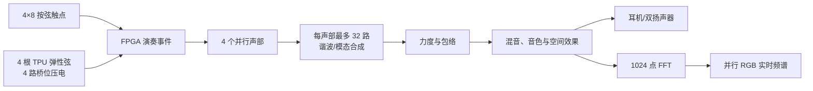

# 芯弦 FPGA 电子吉他

> 面向竞赛评委与答辩展示的作品说明

**作品阶段：设计与实施中。** 本文中的性能数值是最终验收目标；在测试报告和现场证据形成前，不作为已实现结果陈述。

## 一句话介绍

芯弦 FPGA 电子吉他是一把由 FPGA 直接理解演奏动作并逐样本生成声音的四弦电子乐器：左手选择品位，右手拨动弹性弦并控制力度，FPGA 同时合成最多四个音符、每个音符最多 32 个谐波／模态分量，再实时加入音色、空间效果和频谱显示。

## 为什么采用 FPGA

普通处理器通常按顺序执行传感、合成和效果算法；本作品将四根弦映射为四个并行硬件声部，并利用流水线和确定性调度，在每个 48 kHz 样本周期内完成最多 128 个逻辑分量的计算。

FPGA 在本作品中的价值不是“换一种芯片播放声音”，而是：

- 演奏动作直接进入硬件状态机，主链路不依赖操作系统或音频线程；
- 四根弦可以独立、并行起音和衰减；
- 每个谐波分量具有独立幅度和衰减，可重建拨弦后音色由明亮到柔和的变化；
- 延迟具有固定上界，可以通过硬件测试点直接测量；
- 同一份实时 PCM 同时驱动音频输出与频谱分析，听觉和视觉反馈保持一致。

## 核心结构



## 演奏交互

### 左手：4 弦 × 8 品

琴颈采用导电橡胶触点、PCB 电极和带二极管的矩阵。每根弦允许同时按下多个品位，系统按真实吉他逻辑选择最高品位；没有按品时演奏空弦。

标准调弦为：

| 第 4 弦 | 第 3 弦 | 第 2 弦 | 第 1 弦 |
| --- | --- | --- | --- |
| D3 / 146.83 Hz | G3 / 196.00 Hz | B3 / 246.94 Hz | E4 / 329.63 Hz |

持续音中改变品位时，FPGA 平滑改变频率而不重新触发起音，形成连续滑音；最后一个品位释放后，声音保持原音高进入释放衰减。

### 右手：四路独立拨弦和四级力度

四根 TPU 弹性条两端固定并轻微预张紧，每根弦通过独立桥码向压电弯曲梁传力。模拟前端将压电瞬态转换为包络／峰值，MCP3208 送入 FPGA。

FPGA 不处理原始压电音频，而是判断：

- 哪根弦被拨动；
- 多根弦的扫弦顺序；
- 轻到重共 4 级力度；
- 回弹是否属于重复触发；
- 相邻桥码的响应是否属于机械串扰。

力度不只改变音量：重拨会增强高阶谐波并略微延长衰减，轻拨则更柔和、衰减更快。

## 声音怎样产生

首版使用“基于弦振动模态思想的谐波加法合成”，不是预录采样，也不把它误称为 Karplus–Strong。

每个声部最多包含 32 个正弦谐波／模态分量。各分量具有不同的初始幅度和衰减速度：拨弦瞬间高频较强，随后高阶分量更快减弱，使声音从明亮锐利逐渐过渡到稳定衰减。至少一个现场验收单音将启用完整 32 个分量。

四个声部在硬件上并行；声部内部允许流水线和分时复用乘法器。这样既保留“每音最多 32 路、峰值 128 路”的合成功能，又不会把 118 个 DSP 全部耗尽，能给音效和 FFT 留出资源。

## 两种音色与空间效果

板载三个按键直接控制演奏效果：

| 按键 | 展示内容 |
| --- | --- |
| KEY1 | “经典／摇滚”音色切换 |
| KEY2 | 合唱效果开关 |
| KEY3 | 延音与轻量混响开关 |

“经典”音色偏尼龙弦，起音柔和、低阶谐波为主；“摇滚”音色偏钢弦亮音，起音更锐利，高阶和奇次谐波更强，并加入可控软削波。切换过程使用平滑或交叉渐变，避免爆音。

合唱使用受低频调制的短延迟；延音／轻混响通过延长释放时间和片上 B-SRAM 多抽头反馈延迟实现，不使用卷积混响或 DDR3 帧缓存。

## 音频与显示

- 内部音频：48 kHz、24-bit 或更宽定点处理；
- 板载输出：PT8211，48 kHz、16-bit 双声道 LSB-justified；
- 声道：同一单声道混音复制到左右声道；
- 输出：3.5 mm 耳机与 2×3 W 扬声器接口；
- 显示：5 寸 800×480 并行 RGB LCD；目标面板支持 RGB888，物理总线按 NEO Dock 实物版本在 RGB666／RGB888 间配置；
- 频谱：1024 点定点 FFT、Hann 窗、默认 32 柱、约 30 FPS；
- 图形：逐像素实时生成，不占用完整帧缓存。

板载 DAC 是 16-bit PT8211，因此“24-bit”只表示 FPGA 内部处理精度；输出前会进行饱和和舍入。这一分层避免夸大板载音频规格。

## 纯硬件边界

演奏运行期间，以下主链路全部由 FPGA 内部可综合 HDL 完成：

```text
按弦/拨弦 → 事件判断 → 音高/力度 → 声部
→ 谐波合成 → 包络 → 混音 → 音效 → DAC 输出
```

外部 ADC 和 DAC 只做信号转换。允许软件离线生成查表数据、下载比特流和进行一次性外设配置，但软件不参与运行时音符判断、音色生成或音效计算。

## 量化验收指标

| 指标 | 最终门槛 | 证明方式 |
| --- | --- | --- |
| 复音 | 4 根弦同时独立发声 | 四音和弦频谱、PCM 波形、现场演奏 |
| 合成规模 | 每声部最多 32 路；至少一个单音实际启用 32 路 | 配置、仿真调度、频谱和综合报告 |
| 样本吞吐 | 峰值 128 分量在 20.83 μs 内完成 | 周期计数、deadline 标志 |
| 力度 | 四根弦均稳定区分 4 级 | 标定数据和重复拨弦统计 |
| FPGA 内部延迟 | 最坏 ≤5 ms | 调试 GPIO、LRCK、逻辑分析仪 |
| 整机延迟 | 最坏 ≤10 ms | 压电前端与模拟音频同步示波器测量 |
| 音频协议 | PT8211 连续至少 10,000 帧无格式错误 | ModelSim 检查器和逻辑分析仪 |
| 显示 | 1024 点 FFT、默认 32 柱、约 30 FPS | 屏幕视频、帧计数和掉样计数 |
| 时序 | 所有目标时钟域 WNS ≥0 | Gowin 时序报告 |
| 资源 | LUT、DSP、B-SRAM 各自目标 ≤85% | Gowin 资源报告 |

延迟采用双层定义：内部指标排除模拟前端和 DAC，整机指标包含从有效传感信号到模拟声音出现的完整链路。至少重复测量 30 次并报告最大值，不只报告平均值。

## 现场演示脚本

1. 依次演奏 D3、G3、B3、E4 四根空弦；
2. 展示逐品选音及同弦多品“最高品位优先”；
3. 演奏四音和弦和快速扫弦，证明四声部独立；
4. 展示每根弦的四级力度响应；
5. 在持续音中移动品位，展示连续滑音；
6. 对比经典和摇滚两种音色；
7. 分别打开合唱、延音／轻混响；
8. 展示屏幕频谱与演奏同步变化；
9. 展示一个完整 32 分量单音的配置、调度和频谱证据；
10. 使用示波器现场展示内部 ≤5 ms、整机 ≤10 ms；
11. 连续演奏，确认无卡音、错误串音、明显爆音或系统复位。

## 硬件平台与资源策略

目标平台为 Sipeed Tang Mega 60K SOM 与官方 NEO Dock，FPGA 型号 `GW5AT-LV60PG484AC1/I0`。板卡拥有 59,904 LUT4、118 个 18×18 DSP 和 2,124 Kbit B-SRAM。

为保证最终功能，设计采用三项资源策略：

- 四声部并行，但声部内部复用乘法流水线；
- 延迟音效使用片上 B-SRAM，首版不引入 DDR3；
- 频谱图逐像素生成，默认显示 32 柱，不建立完整 RGB 帧缓存；内部保留 8-bit/色颜色，若底板只引出 18-bit RGB，则在接口边界转换为 RGB666。

## 开发状态与计划

| 阶段 | 日期 | 目标 |
| --- | --- | --- |
| 需求冻结 | 2026-09-04 | 规格、接口、风险和配置计划 |
| 仿真与硬件准备 | 2026-09-05～09-21 | 单元仿真、BOM、原理图和引脚审查 |
| 首次上板 | 2026-09-22 | 单声部最小音频闭环 |
| 基础闭环 | 截止 2026-10-04 | 琴颈、四声部、力度和基础包络 |
| 完整功能 | 截止 2026-10-18 | 32 分量、音色、音效、FFT 和 LCD |
| 整机优化 | 2026-10-19～10-25 | 串扰、延迟、资源、时序和稳定性 |
| 最终验收 | 2026-11-01 | 源码、证据、演示和答辩材料 |

当前尚未完成 RTL 与整机测试，因此答辩材料中的所有“已实现”表述，必须等到对应证据产生后再更新。

## 开源计划

项目计划采用 Apache License 2.0 开源。正式发布时将提供 Verilog-2001 源码、ModelSim 自检测试、配置生成方法、硬件接线资料和可追溯验收证据；Gowin 厂商 IP 与仿真库是否随仓库分发，以各自许可证为准。

## 参考资料

- [Tang Mega 60K 官方硬件资料](https://wiki.sipeed.com/hardware/en/tang/tang-mega-60k/mega-60k.html)
- [Tang Mega 60K 官方示例](https://github.com/sipeed/TangMega-60K-example)
- [Tang Mega 138K 官方示例（NEO Dock LCD 接口复核参考）](https://github.com/sipeed/TangMega-138K-example)
- [PT8211 官方说明](https://www.princeton.com.tw/%E7%94%A2%E5%93%81%E5%B0%88%E5%8D%80/Multi-Media-Audio/Digital-to-Analog-Converter/DTAC-PT8211)
- [MCP3208 官方说明](https://www.microchip.com/en-us/product/MCP3208)

---

文档基线日期：2026-09-04  
作品状态：待开发、待测量、待形成证据
