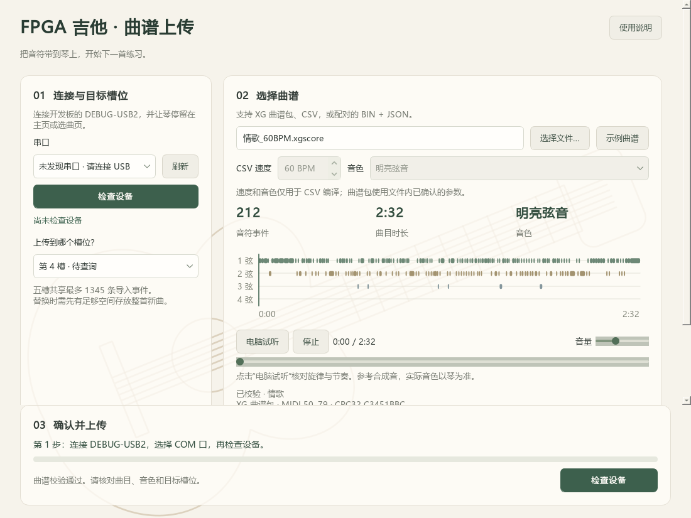

# Windows 曲谱上传器 1.2.0

从[便携版许可补充 ZIP](../releases/windows/FPGA_Guitar_Uploader_1.2.0_licensed.zip)解压，运行 `FPGA_Guitar_Uploader/FPGA_Guitar_Uploader.exe`，无需安装 Python。整目录保留，不能只复制 EXE。此包保留原 1.2.0 的程序与资源字节，增加许可及带许可的对应源码。

1. 开发板加载当前双接口 `.fs`，停留在主页或选曲页。
2. 连接开发板 **DEBUG-USB2**，刷新 COM，选择对应端口，点击“检查设备”。通信为 115200/8N1，无硬件流控。
3. 选择内置曲谱、`.xgscore`、CSV 或 `.bin + .json`。检查显示的音符数、时长、音色和目标槽位。
4. 可用“电脑试听”核对旋律与节奏；这是参考合成，最终音色以 FPGA 为准。
5. 点击上传，等待 FPGA 确认提交和目录核对，再在琴上选择 USER 槽试听。

五槽共享 1345 条运行时导入事件。替换新曲需要暂存空间，旧曲在提交前仍占用容量。导入曲断电后消失；出现“提交结果未知”时先核对琴上内容，避免直接重复上传。

源码位于 `tools/windows_score_uploader/`，启动入口 `tools/run_windows_score_uploader.py`。依赖、打包步骤见[构建指南](BUILDING.md)，协议与格式见[传谱说明](TRANSFER.md)。第三方依赖说明见 [THIRD_PARTY_NOTICES](../tools/windows_score_uploader/THIRD_PARTY_NOTICES.txt)。

原创客户端采用 GPL-3.0-only，完整正文在源码目录 LICENSE 和分发包 LICENSE.txt。共享协议模块保留 Apache-2.0；曲谱和第三方运行时按其各自权利处理。许可及对应源码范围见[项目授权说明](../LICENSING.md)。
