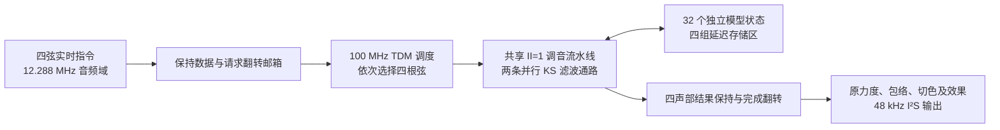

# 明亮弦音：KS 内核 + TDM 调度

本文记录此前成功版本，固定发布保留作回退。当前原impl已更新为用户确认的[KS 五度和声 V2](KS_FIFTH_AUDITION.md)；本页旧资源、Fmax 和位流哈希不作为新版本认证。

2026-11-01 已完成原工程构建、完整网表对照与全部时序检查。基线 `d5d8599`，主工程 `gowin/neo_guitar_touch_game/neo_guitar_touch_game.gprj`。所有正式音频由 FPGA 根据实时演奏事件逐音、逐样本生成；参数 ROM 是模型参数，不是预录音频。

## 最终架构

| 项目 | 口径 |
| --- | --- |
| 独立复音 | 四根弦对应四路独立音高、起音、力度和释放 |
| 每声部物理模型 | 8 个独立 KS 循环状态 |
| 总模型数 | 32 个；每个有独立延迟区、读写位置、低通及直流状态；起音年龄与随机激励按等价关系压缩保存 |
| 实际计算通路 | 一个共享 KS 核、两条并行流水通路，TDM 遍历四声部及其模型 |
| 音频输出 | 48 kHz；原 12.288 MHz 音频域及 I²S 分频保持 |
| 新计算时钟 | 50 MHz → GW5AT-60 PLLA → 100 MHz；MDIV=16、ODIV0=8 |
| 延迟存储 | 四块 DPX9B，四声部共 4096×18 位 |
| 上下文存储 | 一块 DPB16 保存 32×55 位有效循环上下文，每模型四字；另有四个声部年龄、五个 LFSR 基状态 |

32 指独立模型状态的并发发声数，不能称为 32 套同周期并行硬件。也不将一条弦的泛音、RAM 样本数、查表项或流水阶段计入振荡器数量。四路独立复音和 32 个模型状态分别报告。若评审要求 32 条完全并行的物理通路，本实现不满足该更强口径。

## 算法和存储

随机噪声初始化拨弦，反馈延迟线经过分数延迟插值、二点平均低通及损耗后写回。循环自然形成泛音和高频衰减，不播放波表或 PCM。采用 18 位反馈、对称舍入和输出直流抑制，避免 16 位反馈使高音尾部过早消失。

音高换算 `period=2^32/phase_inc`，扣除平均滤波器的 0.5 样本延迟。64 段规格化倒数表加插值取代逐位除法；运算流水拆开规格化/查表、地址偏移/回绕、插值符号/求和、损耗及直流滤波。PLL 提供时钟，不代替这些时序优化。

每声部八个循环分别分配容量 `[336,168,112,84,112,84,68,56]`，起始地址 `[0,336,504,616,700,812,896,964]`，共 1020 个字。每条弦按自己的容量环绕，互不重叠。普通频率比为 `[1,2,3,4,3,4,5,6]`；开启五度后后四个为 `[3,4.5,6,7.5]`（实际沿用已有校准五度比）。同频模型仍使用独立激励和循环状态，不能复制一个输出冒充多个单元。

容量按当前 D3～G5 音域设计。极低音或过高输入不属于这版保证范围；每模型检测超容量或超内部频率上限后静音。当前滑音、四档力度、尾音锁定、释放、强制退出和下游效果沿用。延音减小反馈损耗，音高和采样率不变。

一块双端口上下文 RAM 分别服务两条计算通路，每个端口负责 16 个模型，地址区互不重叠。每模型用四个 16 位字保存 55 位有效数据：指针 9、前次滤波值 18、直流状态 27、有效位 1；延迟线仍全部独占。复位只清有效位，首次使用再初始化；重拨通过年龄屏蔽旧延迟数据。

进一步删除重复但数值相关的状态：同一声部八个模型的起音年龄始终相等，改用四个声部计数器；LFSR 的移位/XOR 具有 GF(2) 线性，把原来 32 个随机状态用两个种子基及三个混合基重建。每帧固定遍历全部声部，包括静音声部，并在最后一个模型完成后推进五个基状态一次。既没有复用某个模型的音频输出，也没有改变原 32 条激励序列；4608000 次随机序列比较及 576000 个完整 KS PCM 逐值一致。

两个 KS 滤波通路原来各有一套周期倒数前端，现在共用一条 II=1 流水线，连续两个时钟输入两个模型的频率，连续输出两个独立周期。指数、分数及有效标志逐级随数据传递；滤波通路仍并行更新两条弦，模型的频率、指针及反馈状态各自独立。状态压缩、共享流水、上下文 RAM 及滑音距离重用合计减少 3075 个逻辑、2967 个寄存器及一个 DSP 单位，相对宽寄存器失败候选的综合结果统计；代价是多用一块 BSRAM。

当前每声部八模型最长占用 175 个计算时钟，四声部加调度约 750 个 100 MHz 时钟，即 KS 计算约 7.5 μs，低于每采样约 2083 个计算时钟的预算。32 个状态每秒完成 153.6 万次模型更新。整机演奏延迟还包含原采样、力度捕获、音效及串行输出流水；7.5 μs 不等于整机输入到声音的延迟。提高音频采样率会减少计算预算、增加延迟线容量，因此保留 48 kHz，独立提高运算时钟。

曾尝试 DPB16 上下文：节省寄存器但占满 118/118 块 BSRAM，精简后仍有 114 条网络未通；直接改为 96 位宽寄存器后 CLS 达 29629/29952，反而有 1591 条未通。因此当前同时精简存储和计算，而不是仅在 RAM 与寄存器之间搬移。实际 Device B 的工具不支持 RAM16S4（RP0007），已排除 SSRAM 路线。

额外重构了原滑音计算：先选择滑音步长，再用一次扩展减法同时得到方向和距离；饱和判断统一成“步长≥距离”，重用已有距离，除 15 保留精确移位加法。这一精确重构单独减少 1618 个逻辑，240000 个步骤与冻结基线逐值一致。曾尝试 DSP 倒数乘法，虽然逻辑用量下降，但实际布线仍剩 196 条网络未通，已撤销该 DSP 映射，释放 8 个 DSP 资源单位。保持原取整、步数、起音和重定向行为；没有修改频带显示模块、工程布线选项或原保护文件。

KS 写回选择与直流减法分成相邻流水阶段。进一步利用有界噪声和凸组合反馈的不变量，将直流状态从 32 位减为 27 位、差值减为 28 位；最大有效激励期不超过 335 个样本，年龄计数可在 511 饱和。随后将上下文改为整字并行存取，减少控制周期；本版用共享 II=1 调音前端换取面积下降，随后将压缩状态放回四字 DPB，并拆开实际 STA 报告中的“取绝对值→插值乘法”路径，最终单声部为 175 个计算时钟。精简后 576000 个原始 PCM 与精简前逐值一致；保持总线直到完成确认后才允许改写的邮箱协议，也省去了 269 位重复载荷寄存器。

## 跨时钟与复位

音频域在帧边界锁住四声部指令，翻转请求位；100 MHz 域同步请求后消费保持的数据。TDM 核写完四声部结果后才翻转完成位，音频域同步并一次性接收完整结果。一次请求未完成时禁止覆盖其载荷，重复请求置 overrun 并汇入 deadline_miss。PLL 锁定和原音频复位共同资格化计算域的同步释放复位。

主音源在 TIMBRE 阶段检查外部计算 busy，结果未到则等待，不能读取上一帧充数；若下一采样到来时仍忙，原 deadline_miss 会记录。钢琴/哇音模态仍在原时钟域运行，避免把所有既有音频逻辑直接切到 100 MHz。

## synth8 的参考范围

已核对 [synth8.v 原始源码](https://github.com/vdalex/tangmega-138k-fpga-projects/blob/fc943bac794548b72258abeca682822d786bf2eb/fractal_music/eda_proj/src/audio/synth8.v)，文件 Git blob `55ed11a1d36e6d02e6c60910f39118fc4abd382a`。参考其独立状态、选择/读取/计算/累加分段、共享昂贵计算资源的思路。没有复制波表合成作为 KS；原工程的 3072 时钟采样预算不能直接套用到本项目原 256 周期音频域。

算法依据：[Julius O. Smith, Virtual Musical Instruments](https://www.dsprelated.com/freebooks/pasp/Virtual_Musical_Instruments.html) 与 [Delay-Line and Signal Interpolation](https://www.dsprelated.com/freebooks/pasp/Delay_Line_Signal_Interpolation.html)。线性插值额外产生高频损耗，不声称与全通插值同等无幅度误差。

PLL 配置基于同器件官方 `TangMega-60K-example-official/sdram_neo/src/gowin_pll/SDRAM_PLL.v`，仅启用所需 100 MHz 输出；ROM 逻辑映射参考 [GowinSynthesis SUG550](https://cdn.gowinsemi.com.cn/SUG550E.pdf)。

## 验证与状态

- `tools/check_karplus_strong.py <新证据名>`：真实生产 RTL 四声部输出、FFT 调音、衰减、延音/和声/重拨/滑音、所有模型独立存储区及非零激励证明，生成 RTL WAV。
- `tools/check_ks_integration.py <新证据名>`：与 Git 最新提交冻结音源比较。钢琴/哇音 32000 个 PCM 一致；亮弦路径 40000 个 PCM 检查，四路分别错开起音/释放、不同音高及力度。
- `tools/check_ks_tdm.py <新证据名>`：实际 PLLA 仿真模型，检查输出为 100 MHz；共享 TDM 与四路独立 KS 计算逐样本比较，包含切音色渐变、延音、和声、滑音与强制释放。当前 `tdm_shared_ram_01` 为 13999 帧、55996 个声部 PCM 比较通过。
- `tools/check_ks_slide.py <新证据名>`：240000 个步骤与基线原滑音模块逐周期相同；21、22、27 位输入域穷举证明除 15 的精确性。
- `tools/check_ks_full_gate.py <新证据名>`：原工程实际综合网表与完整 RTL 对照，包含真实 PLL、I²S、矩阵输入、物理音色键及持续接触换品滑音；仅触摸/ADC 的已登记输出作为刺激，不强制音高、音源结果或音频 ROM。
- `tools/build_karplus_strong.py syn <新证据名>`：原工程综合、源码/约束哈希与保护文件检查；资源审查后再 `pnr`，不使用历史成功位流认证新源码。
- `tools/check_ks_result.py`：核对源码、实际网表、测试、保护文件和本次完整布线；要求系统/音频/计算时钟分别达到 50/12.288/100 MHz，setup、hold、锁存器和未布通全部为零。加 `--publish` 才创建独立本地发布目录。

早期 32 模型宏观复制版 `synth_32_01` 因 Logic62264>59904 被否决；寄存器上下文版曾无法完全布通；RAM 上下文版 `route_state_ram_02` 虽已布通，但系统/计算 Fmax 仅 47.794/89.941 MHz；DSP 滑音版 `route_timing_01` 剩余 196 条未布通网络，精简 DPB 版 `route_compact_01` 剩余 114 条。以上版本未发布，失败证据保留。

`route_shared_01` 已全部布通，但系统/计算 Fmax 为 48.903/94.882 MHz，37 个 setup 端点不满足要求，未发布。`synth_distance_01` 已完成综合：Logic50296、Register22808、逻辑 BSRAM113。`tdm_shared_ram_01`、`rtl_shared_ram_01` 与 `slide_distance_01` 已通过：55996 个声部 PCM 对照、32 个模型各 144000 次更新、最长 175 个计算时钟/声部、576000 个 PCM 与先前实现完全一致，滑音 240000 个步骤与基线一致。`route_distance_01` 已在原工程完成全部布局布线与 STA；新实际网表 `full_gate_distance_01` 也已通过 2502 帧、2501 个 PCM、1102851 次 LCD 时钟采样及五组起音事件。238 条厂商模型警告逐条按源位置核对，无应用错误。严格 `tools/check_ks_result.py` 已通过，不再重复构建或仿真。

`rtl_shared_ram_01` 检查全部 32 个存储区互不重叠、各完成 144000 次更新且有非零能量；D3/A4/G5 相对指令频率的 FFT 调音误差约在 ±0.051 音分内。该目录 WAV 是原始 KS RTL 输出参考，不是板上 DAC 录音，也不含整机后级效果。钢琴/哇音仅复用 `integration_final_01` 中已冻结且源字节未变的 32000 个 PCM 检查，不以旧 KS 内核哈希认证当前内核。

未推送、访问 COM 或代理烧录；其他六个工程仅补齐源文件依赖，完整综合/布局布线和实际网表验证范围为原触控游戏主工程。上板音色听感和真实器件启动仍需用户试听验证。

## 最终位流与验收数据

原工程可直接使用：`gowin/neo_guitar_touch_game/impl/pnr/neo_guitar_touch_game.fs`。固定本地归档：`build/releases/touch_game/ks_tdm_32_20261101/`，同名 ZIP；内有独立位流、本文、认证、资源/时序报告及两份原始 RTL 参考 WAV。接线、JDY-23 串口和手机 APK 沿用基线版本。

| 运行时钟 | 要求 | 布线后 Fmax |
| --- | --- | --- |
| 系统 | 50 MHz | 53.574 MHz |
| 音频 | 12.288 MHz | 19.993 MHz |
| KS 计算 | 100 MHz | 114.836 MHz |

最终资源：Logic50688/59904、Register22808/60780、CLS28426/29952、BSRAM118/118、DSP106.5/118。setup、hold、锁存器、未布通及已测 sample deadline 全部为 0。现有两条 PR1014 通用时钟布线提示保留，实际延迟/偏斜已计入本次 STA；未放宽 50/12.288/100 MHz 要求。

位流 SHA256：`2d4700d60754a51d8e4c5fe19ddc50fb233ca0848c410352b01dd92555913c41`。认证 `build/karplus_strong/verification.json` 绑定当前源码、工具、测试、实际 VG、报告与位流；本次没有 SDF 仿真，功能网表对照与完整布线后 STA 分别完成。上板试听尚待进行，未代理烧录或推送。
