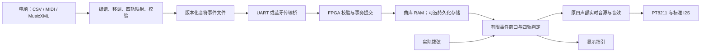

# 后续模块实施路线：显示复用、曲库导入、姿态交互与第四音色

> P5新授权（2026-10-19）：用户要求优先复用31005板载BL616、首版同时支持Android/iPhone。已从e0b2ff2创建 `experiment/p5-bluetooth-import`，详见[板载BLE调查与软件原型](P5_BL616_BLUETOOTH_IMPORT.md)。下文外接模块建议是历史研究，不作为本轮默认方案。生产RTL/P4位流保持；板级BLE固件、射频实装、二级启动与恢复尚未实物确认，软件/RTL测试不能替代无线验收。

日期：2026-10-14。状态：研究与设计，尚未实施本文件中的新增功能。

> 当前进度（2026-10-19）：P1/P2有用户下板反馈，P3可写曲库/DEBUG-USB2 UART数字交付完成并获用户总体正面反馈。P4姿态/节奏/UI/四档力度后，按用户后续要求保留CH0触发220与最低25%，第三弦CH2触发80→60，中间增益改50%/75%，形成25/50/75/100%自动力度档；其余音源/包络/音效/时钟保持。原工程完整P&R/STA、13项RTL和本批实际VG全部PASS：CLS95.65%、系统/音频Fmax53.171/14.051MHz，运行50/12.288；旧CLS≤95%/系统55余量目标未达。详见[第三弦与四等分力度](QUARTER_DYNAMICS.md)、[前一修正快照](DYNAMICS_TUNING.md)、[P4接线](P4_POSTURE_TIMBRE_BRINGUP.md)和[工程README](../gowin/neo_guitar_touch_game/README.md)。等待用户实物比较第三弦轻拨/误触与四档听感，不自动展开蓝牙/Flash/琵琶。下方顺序/资源为历史研究快照，不覆盖新授权与实际报告。

本轮只新增方案和交接文档，不修改 RTL、约束、工程配置、音源、曲谱资产或位流。MPU6050 原方案保留原样。

> 后续实物反馈修复补充：本方案研究完成后，用户反馈提示块丢失、试听节奏和背景闪点问题，已在同一实验分支提交 `a13fd79` 修复。当前谱面为 67 音符／33.75 s，CLS 29744/29952、BSRAM 95/118、DSP 115.5/118，系统／音频 Fmax 为 52.511／12.596 MHz，setup/hold=0/0。九项 RTL 检查、综合后首页及 364 帧移动布局通过；2026-10-15 用户确认修复版无已知问题、可提交，实物验收已记录。下文的 `2eef7f9` 和 53 音符资源数据保留为研究时快照；后续实施优先读取最新工程 README、verification.json 和实际 Git 状态。新的训练位流为 `build/releases/touch_game/neo_guitar_touch_game_j6_gamefix.fs`。音色及效果的 8192 样本对照保持一致。本次修复不代表 P1 资源优化目标已完成。用户目前先审核游戏界面美化示例，审核前不修改显示 RTL。

## 1. 推荐顺序及原因

2026-10-15 实施补充：用户先行审核了最初的全宽舞台四轨界面，已授权接入工程，并要求暂缓 4×9 矩阵及后续折线动效。显示与离线分弦现有实现见 [FULL_WIDTH_GAME_STAGE.md](FULL_WIDTH_GAME_STAGE.md)；后续 P1 应从包含这次更新的当前分支继续，不能回退到下方历史资源快照。原音源的完整数字对照仍保留；本次全宽舞台的下板验收需单独记录。

全宽舞台的数字验证发布已完成：源码 `246b146`＋`98ba437`，当前 CLS 29842/29952（99.63%），BSRAM 95/118、DSP 115.5/118；系统／音频 Fmax 54.636／13.441 MHz，未布通及 setup/hold 为 0。九项 RTL、六帧整机网表和全曲连续布局通过；位流 `neo_guitar_touch_game_full_width.fs` 及哈希见上述实现文档。用户随后认可当前效果并授权本次 push／merge，反馈已记录。本次只是小范围缓冲／数字格式化复用，不表示 P1 的总体面积和余量目标已经达成，后续仍应先优化再叠加模块。

推荐主线：**冻结当前基线 → 显示／游戏资源与时序优化 → 长曲及多曲目引擎 → UART 向 RAM 导入 → MPU6050 监测及空闲自动切音色 → 蓝牙导入 → 旧音尾声隔离 → 第四音色琵琶。**

“断电保存曲库”作为 UART 完成后的独立分支；如果比赛要求断电后仍有导入曲目，应在蓝牙之前完成。若只要求曲谱传完后拔掉电脑仍能演奏，RAM 已能满足，不需要先加入 Flash／SD。

| 阶段 | 本阶段交付 | 为什么在这里做 |
| --- | --- | --- |
| P0 基线 | 当前触控游戏实物检查、源码／位流／测试快照 | 先区分已有问题和新模块引入的问题 |
| P1 优化 | 保持音色和画面的资源优化版，恢复时序余量 | 目前 CLS 接近满载，不能直接叠加模块 |
| P2 曲库 | 有界事件窗口、长曲、五槽元数据、共享曲谱 RAM | 后续所有导入方式都写入同一曲库接口 |
| P3 UART | PC 编谱工具、可靠传输、完整验证后提交，拔电脑继续演奏 | 先验证最容易观测和定位的问题链路 |
| P3b 持久化，可选 | 独立安全存储分区、开机校验和恢复 | 与传输方式解耦；不能挤占或破坏配置存储 |
| P4 姿态验证版 | 六轴读取、校准、分类、手动优先、空闲自动换音色 | 已购 MPU6050 可以较早产生交互价值，不依赖第四音色 |
| P5 蓝牙 | 在相同曲谱协议上增加无线传输桥 | 不重写曲谱、判定和音源；无线故障定位更清楚 |
| P6a 尾声隔离 | 新起音采用新选择，其他旧声部维持原音色 | 是正式姿态联动和混合音色的音频架构前提 |
| P6b 琵琶 | 第四套实时合成参数／激励模型，听感和复音验收 | DSP 与采样周期最紧，放在控制／存储稳定后 |
| P6c 整机 | 演奏、游戏、导入、姿态、四音色的交叉验收 | 最终以实物和完整实现结果确认 |

MPU 的供电、安装方向和独立读取测试可以在 P1 后穿插进行；这是独立验证工程，不表示能提前放进满资源主工程。PC 的 CSV 转换器也可在 P2 的格式确定后独立开发。这里的并行是工程任务和硬件调度的安排，不要求同时合并多个尚未验收的分支。

## 2. 当前基线与实际限制

当前目录：`T:/Documents/AMD/xinxian-fpga-guitar`。

- 当前分支：`experiment/touch-rhythm-game`；HEAD：`2eef7f9`。
- 已验收音频／显示 master 基线：`655458f32ba4f7e06403fd6c5c4da0b6f0dad8a7`。
- 当前新增触控游戏分支已有 RTL、布局布线和部分网表验证，**尚没有用户确认的触控游戏实物验收记录**。原演奏版本的实物验收不能代替这一项。
- 当前工程：[neo_guitar_touch_game.gprj](T:/Documents/AMD/xinxian-fpga-guitar/gowin/neo_guitar_touch_game/neo_guitar_touch_game.gprj)。芯片 `GW5AT-LV60PG484AC1/I0`，Device B，Gowin V1.9.12.03。
- 当前 J6 位流：[neo_guitar_touch_game_j6.fs](T:/Documents/AMD/xinxian-fpga-guitar/build/releases/touch_game/neo_guitar_touch_game_j6.fs)，SHA256 `e5f923815c2dc8ef396ab291a757e8bcec7b99f0ee29a0c88192f28e885e0b83`。

完整实现数据来自 [verification.json](T:/Documents/AMD/xinxian-fpga-guitar/gowin/neo_guitar_touch_game/verification.json)：

| 项目 | 使用／容量，或当前结果 | 对下一阶段的意义 |
| --- | --- | --- |
| Logic | 57357 / 59904 | 不能按少量空余逻辑估计一整套外设可加入 |
| Register | 22339 / 60780 | 寄存器数量未满，但布局簇和布线已很紧 |
| CLS | 29648 / 29952，约 98.99% | 只剩 304 个 CLS，先腾出空间 |
| BSRAM | 95 / 118 | 名义剩余 23 块，可考虑用 RAM 换逻辑；仍要检查端口形状和实际映射 |
| DSP | 115.5 / 118 | 新控制／传输／姿态模块以新增 DSP=0 为目标 |
| 系统 Fmax | 50.010 MHz，要求 50 MHz | 约 0.02% 频率余量，继续叠加易导致失败 |
| 音频 Fmax | 13.247 MHz，要求 12.288 MHz | 不能把剩余 DSP 或周期直接当作可用扩展额度 |
| setup / hold | 0 / 0 违例 | 后续继续按真实约束检查 |

时序报告的紧路径经过 `u_display/u_palette` 的频谱峰值选择和颜色计算，另有 `u_display/u_bands` 路径；优化不能只盯新增游戏模块。固定时钟引脚仍有 PR1014 通用时钟路由提示，应结合真实 STA 审查，不通过放宽时钟或增加不成立的 false path 掩盖问题。

本分支已做两项压缩：消隐期单坐标缓存替代重复坐标缓存，以及只保存实际事件数的消费位。它们已累计减少 1047 个寄存器，但 CLS 仅下降 119 个。**这两项已完成，不应当成下一次的新优化重复开发；RTL 数量下降也不能替代布局布线证明。**

当前短谱是《茉莉花》教学单旋律一段，53 音符、27.5 s、96 BPM；五个 UI 槽位仅一个有谱。当前限制如下：

| 限制 | 代码依据 | 需要改变什么 |
| --- | --- | --- |
| 每采样扫描整首曲谱，生成器上限 120 事件 | `game_note_controller.v`、`generate_jasmine_score.py` | 改为有限窗口扫描，耗时与全曲长度无关 |
| 曲谱 ROM 固定 128×80 bit，音频／显示各一个读实例 | `game_score_rom.v` | 建立统一的可写曲库和受调度的读取接口 |
| 起音／时长／内部时间为 24 bit、48 kHz 单位 | `game_note_controller.v` | 全曲时间改为受检查的 32 bit 样本时间；24 bit 约 349.5 s，会限制长曲 |
| 命中、漏音、错误和连击为 8 bit | 同上 | 扩宽或明确饱和，禁止超过 255 后回卷 |
| 整曲消费位随总事件数增加 | 同上及 CDC | 消费状态仅覆盖活动窗口，已完成事件退休 |
| 显示四轨各最多 8 块 | `game_chart_layout.v`、`touch_game_renderer.v` | 保留第一阶段视觉上限，导入时校验局部密度 |
| 上板仍固定力度编码 2 | 当前演奏前端配置 | 四档力度另有待标定任务，不能把它记成已完成 |

较早的 [NEXT_VERSION_PERFORMANCE_TOUCH_GAME_PLAN.md](T:/Documents/AMD/xinxian-fpga-guitar/docs/NEXT_VERSION_PERFORMANCE_TOUCH_GAME_PLAN.md) 和 [MPU6050_POSTURE_TIMBRE_DESIGN_PLAN.md](T:/Documents/AMD/xinxian-fpga-guitar/docs/MPU6050_POSTURE_TIMBRE_DESIGN_PLAN.md) 中保留了历史资源快照。本路线以以上 J6 最新快照为起点；未来以新提交绑定的真实报告更新，不沿用历史“RAM 已满”等结论。

## 3. 固定边界：电脑编谱，FPGA 独立演奏

电脑不发送逐样本声音，不替 FPGA 生成音频，也不需要在演奏过程中持续发送音符。传完、校验并提交后拔掉电脑，FPGA 应能选曲、重玩、显示、判定并发声。蓝牙也仅用于导入，不作为实时拨弦闭环的必要链路。

曲库 RAM 在掉电或重新配置后不保留动态导入数据。内置默认曲目可以由位流初始化恢复；这不等于导入曲目已经持久化。Flash／SD 的保存、恢复和断电完整性另行验收。

## 4. P0／P1：先优化资源和时序

### 4.1 必须保持的行为

保留三音色主体、实时钢琴击弦模型、四声部、五度和声、合唱、延音／混响、松品转空弦续音、既有平滑和功放行为。保持 48 kHz 音频、两路输出同一最终 PCM，以及标准 I²S 32 bit 时隙／16 bit 有效数据／3.072 MHz BCLK。

显示保留 480×272、现有像素时钟约 8.333 MHz、约 53.745 Hz 帧率、原演奏布局、莉萨如渐暗、真实 FFT 频谱、菜单和游戏视觉。优化阶段不降低 FFT 点数、色彩精度、曲线尺寸或动画更新率。

### 4.2 候选优化的优先级

| 优先级 | 候选 | 预计收益来源 | 必须验证的边界 |
| --- | --- | --- | --- |
| 1 | 64 柱高度／峰值更新串行复用 | `guitar_radial_palette.v` 当前展开 64 份更新算术；更新速率远低于系统时钟 | 使用同一份旧状态和目标计算，舍入、峰值衰减相位、边界插值逐值一致；完成后统一提交 |
| 2 | 柱状态和频带工作数组评估小型 BSRAM | 减少寄存器阵列、宽选择器和扇出 | 同步读增加的拍数；同频带连续 FFT bin 的读改写冲突需要转发，不能漏 bin |
| 3 | 频谱选择到颜色输出的流水线／重定时 | 当前最紧系统路径实际落在这里 | RGB、曲线 mask、坐标和 DE 等对齐；在既有六系统时钟／像素节奏内结算 |
| 4 | 页面标签、坐标运算和比较器复用 | 减少 UI 并行大选择器及重复格式转换 | 页面优先关系和逐像素字模保持；不复制字库或完整帧缓存 |
| 5 | 游戏块坐标 RAM 和比较器分时的试验 | RAM 换 FF／多路选择逻辑 | 当前八块比较并行；若改双端口分时，必须逐拍证明同步读、比较、字模、混色能按像素截止时间完成 |
| 6 | CDC 载荷整理、窄位宽和高扇出控制复制 | 减少不必要宽总线和路由拥挤 | 多位数据仍用完整握手或异步 FIFO；不得逐位同步后拼接 |

第一项推荐先做，是因为改动集中在显示状态更新，容易做严格数字对照。旧的 64 项同拍更新不能直接改成有效显示期间逐项写入，否则可能出现撕裂。优先在消隐内执行；需要提前计算时使用小型待提交状态或明确读写所有权。只复制真正需要的少量状态。

`guitar_radial_palette.v` 还有逻辑存储风格属性，不能写成数组便假定工具会推断 BSRAM。每个 RAM 改造要看综合实际落点。小型缓冲占用一整块 RAM 仍可能划算，但不能让它隐式退化为大量 FF。

不把两个时钟域的音源乘法器与显示 FFT 硬做共享，不以减少钢琴模态、删混响或降低音频采样率换空间。音频计算时序和跨域成本使这些改动不适合作为第一阶段。

### 4.3 进入后续功能的门槛

建议规划目标：CLS 使用率降到 **≤95%**，系统报告 Fmax **≥55 MHz**，音频报告 Fmax **≥13.5 MHz**；实际运行时钟仍为 50／12.288 MHz。这是优化目标，不是已经达到的结果，也不是器件保证。

若达不到目标，应报告真实节省量、最差路径和下一模块估算，先调整方案。不能因为一次勉强布通就默认足够放下所有后续模块。每次加模块后重新检查硬门槛：无未布通网络、无 latch、真实 setup/hold 零违例、像素／采样 deadline 零违例。

验证分层：

1. 用冻结基线做 FFT 频带、柱高／峰值、曲线包络逐值对照；对齐合法流水线延迟后像素值一致。
2. 保留现有七项触控游戏检查和 8192 样本音频基线对照；新增测试集中覆盖变更的缓冲、并发、提交边界和 deadline。
3. 像素检查扩展到动画、拨弦渐暗、频谱更新及页面切换，不能只比一张静态首页。
4. 完整 P&R／STA，记录模块资源差值及源码、网表、位流哈希；网表验证覆盖改动的像素／RAM 路径。
5. 实物回归触摸四角、双击、四弦、三音色、松品续音和原显示效果。

## 5. P2：曲库、长曲与有界窗口

### 5.1 曲谱存储及容量

首个容量目标建议为 **五个逻辑槽、合计最多 2048 事件、最长 10 min 的测试曲**。这是实施目标，取决于 P1 实际余量及 RAM 映射，不是当前支持能力。五槽共享容量，不给每槽无条件分配 2048 事件。

建议运行时记录 96 bit：32 bit 起音样本时间、32 bit 时长、7 bit MIDI、2 bit 轨、2 bit 力度、5 bit 保留／已定义标志、16 bit 分组号。2048 记录原始数据为 24 KiB；仅按 18 Kbit 块容量计算下界约 11 块，实际端口宽度／深度可能需要更多。目录、窗口、传输缓冲和安全提交空间另计。

先用综合确认总 BSRAM 和 CLS；尽量留至少 4 块 BSRAM 作后续余量。如果预算不能满足，可先支持 1024 事件并保留参数化接口，明确容量限制；要支持更大曲库时增加可访问的外部存储，不裁剪音源／音效。几分钟曲目需要多少事件取决于音符密度，不能用曲目时长直接推定能装下五首。

曲目目录包含：槽号、ASCII 别名、固定中文字库可表示的标题编号、事件偏移／数量、总时长、CRC、格式版本及有效代号。未知标题字符用别名／编号，不动态扩展整套中文字库。

曲目数据发布后只读；第一版只在菜单／选曲空闲状态导入和提交，游戏期间返回 BUSY。这样可以先避免运行时存储读写竞争。后续如确有“边演奏边导入”需求，再增加独立调度和容量预算。

### 5.2 事件窗口替代全曲扫描

建议初版最多 **64 个活动事件，每轨最多 16 个**，涵盖显示前瞻、±150 ms 判定及必要的错弦反馈候选。音频域只扫描这个窗口，耗时与全曲 53、500 或 2048 事件无关。

- 50 MHz 域：曲库读取、前取、窗口补充、显示布局计算、目录和导入管理。
- 12.288 MHz 域：48 kHz 权威曲时、真实拨弦时间戳、事件消费／过期、判定、note_on/off 和正常音源。
- 窗口槽带全局事件 ID 和代号；只有音频域能确认命中／漏音。退休后才允许复用，避免环形槽里的旧消费位误伤新音符。
- 前取不足时必须在开局前等待或拒绝启动。运行期欠载给出故障并停止游戏流程，不伪造音符，也不把存储等待加入音频采样周期。
- 模式退出、重玩、换曲清理待处理队列及代号；晚到的 CDC 确认不能启动旧曲。

具体实现优先评估双时钟 RAM 小窗口及请求／确认控制。显示读取一份带代号的帧快照；相关描述符在消隐计算结束前不得被覆写。可以给这次读取一个短期保留权，计算后释放。不要把整曲或整个 64×96 bit 窗口展开成多份宽 CDC 寄存器。

64 事件同步 RAM 扫描约 128 拍加控制开销只是初步估计；取最坏实测周期证明小于 256 拍，并建议留到不超过 192 拍。正确拨弦发声延迟保持当前约一个采样周期的级别，不等下一帧显示。原音源与判定在各自硬件单元中并行运行，不能将二者周期简单相加或把音源 233/256 的剩余拍数重复分配。

显示仍最多八块／轨。编谱器和 FPGA 都校验活动事件密度；初版沿用 ≥250 ms 的同轨起音间隔，同时额外检查每个实际可见时间窗口是否超过八块。单靠起音间隔不能保证窗口不溢出。更密曲谱应明确拒绝；以后单独设计更快滚动或更多可见块，不能悄悄丢块但照常判分。

### 5.3 时间、复音与统计

- 单位统一为 48 kHz 样本。导入数据使用 32 bit 非负时间；内部计算用显式扩宽的中间值检查起音加时长和比较差，避免溢出。
- 首版限制总时长 ≤10 min，保留前后判定／尾声余量；计数在范围内，不依赖无符号回卷。倒计时使用独立有效标志和负显示时间，不与全曲非负时间混淆。
- 命中／漏音／错误／连击建议 16 bit，明确饱和到 65535；总分用 32 bit 饱和。总事件数和存储地址按配置容量推导，不保留固定七位地址。
- 同一时刻四轨可以组成和弦；一次拨弦每轨最多消费一个事件，仍选窗口内最接近事件。
- 每弦仍一个声部。同轨重拨会重触发该声部；旧的时长 note_off 不能截断后来的音，需带起音代号或等价防护。首版禁止同轨重叠持续音和同刻重复事件，电脑提供显式改编建议。
- 正确音由谱面决定，游戏不受品位影响；Wrong 沿用本轨未来一秒候选／空弦反馈，不消费候选。试听模式与游戏得分分离。

P2 先用静态初始化数据验收，不需要先写 UART。至少加入一首超 120 事件的曲目、一个超过旧 349.5 s 时间边界的 10 min 测试谱及五槽选择测试。完整五首实际曲目需要确定曲谱来源和编配，不能用五个占位按钮充当完成。

## 6. P3：电脑编谱与 UART 导入

### 6.1 统一编谱文件，先 CSV

电脑工具建议分开：`score_compile` 生成事件文件及清单，`score_upload` 负责传输和确认。开始用命令行和 CSV；图形导入工具以后加，不让 PC UI 阻塞 FPGA 验证。

CSV 至少包括起音时刻、时长、MIDI 音高、lane、可选力度和分组。没有 lane 时由电脑做固定相对音高映射，生成预览后供用户确认；不要让 FPGA 在运行时猜测如何改编多轨曲目。当前 MIDI 范围 D3～C5，即 50～72，先保持。

迁移后的推荐二进制 v2：16 字节小端事件。旧 v1 中的毫秒时间和任意 `phase_inc` 由电脑转换；FPGA 不直接接受 v1 且不解释成 v2。

| 偏移 | 字段 | 长度 | 校验 |
| --- | --- | --- | --- |
| 0 | `t_on_samples` | u32 | 排序、时长上限和加法范围 |
| 4 | `duration_samples` | u32 | 正数、不能使结束时间越界 |
| 8 | `midi_note` | u8 | 首版 50～72，FPGA 查表得到 DDS |
| 9 | `lane` | u8 | 0～3，与蓝绿橙红一致 |
| 10 | `velocity_hint` | u8 | 0～3；游戏实拨力度仍来自真实拨弦，试听才采用谱面提示 |
| 11 | `flags` | u8 | 首版为 0；以后按版本显式开放 |
| 12 | `group_id` | u16 | 分组诊断；实际同时性由起音时间定义 |
| 14 | `reserved` | u16 | 必须为 0 |

文件头包含魔数、版本、事件字节数、48 kHz、事件数、总时长、目录元数据和数据 CRC32；头部也受校验保护。不从网络数据直接接收任意 DDS、内存地址或音效寄存器写入。

当前《茉莉花》v1 继续保留作迁移对照：转换到 v2 后事件时刻、频率增量和游戏发声应该相同，只有格式和读取架构改变。

MIDI 在 CSV 验证后支持：处理 tempo map、绝对时刻、note_on/off、同音重叠策略和踏板，不能用单一 BPM 覆盖全曲。MusicXML 再处理连音、休止、重复、弱起和移调。超过四声部、超音域或同轨冲突要报错或让用户选择改编，禁止静默删除音符。图片五线谱识别和 MP3 转谱保留为后续电脑功能，不作为这一主线前提。

### 6.2 官方 UART 例程如何适配 Mega 60K

已只读核对用户指定的 [Sipeed UART 目录](https://github.com/sipeed/TangMega-138K-example/tree/06e7d8b118d345915ab6f257b7c22226f81575cd/ddr_memory/ddr_memory_test_uart/src/uart)，参考提交 `06e7d8b118d345915ab6f257b7c22226f81575cd`，2026-10-14 获取。

四个文件 `uart_rx.v`、`uart_tx.v`、`sync_fifo.v`、`uart_top.v` 是通用 Verilog 收发／FIFO／回显演示，默认 50 MHz、115200。**收发核心并非只能用于 138K，也无需引入例程 DDR 控制器。** 60K 适配重点是本工程的时钟、复位、管脚、电平、FIFO 推断和协议封装。

| 项目 | 适配工作 |
| --- | --- |
| 时钟 | 使用现有 50 MHz 系统域，不使用 12.288 MHz 音频域；首版 115200、8N1。整数分频为 434 拍，量化误差约 +0.0064% |
| RX 同步 | 官方文件虽有两级寄存器，边沿／采样仍引用第一级 `rx_d0`；适配时由完成同步的级做状态判断，增加历史级检测边沿，并重新验证位中心 |
| 物理接收与 backpressure | 官方 RX 在 `S_DATA` 等待 ready；实际串口不会因内部 ready 自动停发。加入 RX FIFO、溢出计数和分包 ACK，不能直接靠 ready 防丢字节 |
| TX | 保留 valid/ready 契约，数据在接受前保持稳定；检查忙时提交、复位和连续发送 |
| FIFO | 官方同步 FIFO 为异步读数组且深度需为二次幂。变成同步 BSRAM 读时重新设计读有效时序；同域用同步 FIFO，跨域才用合格异步 FIFO |
| 顶层 | 用曲谱协议替代回显和周期性 DDR 测试字符串，后者会污染二进制协议 |
| 管脚 | 不复制 138K CST 或外设复用分配。首选外接 3.3 V USB-UART，核对 60K 原理图后冻结 GPIO；PC TX→FPGA RX、PC RX←FPGA TX、共地 |

GPIO 候选可优先评估当前未占用的 J8-9/AB21 与 J8-10/AB22；依据历史连接矩阵均属 Bank 8，需要实施时重新对照原理图及当前 CST。不得与 SDRAM1／摄像头等驱动同时启用。MPU 独立测试候选是 J8-11/Y21、J8-12/Y22，两组不要混用；J9 的 I²S 和诊断 LED 保留。当前未冻结 UART CST，也未宣称板载 USB 一定提供可用串口。

不接 RS-232 电平；USB-UART 和蓝牙串口侧的电平必须兼容。后续提到 921600 等速率时另做误差和连续流测试，首版不以高速为验收前提。

### 6.3 可靠传输和提交

初版建议：同步头＋固定版本头＋有限长度 payload＋序号＋会话号＋CRC32。明确 CRC-32/ISO-HDLC，与 Python `zlib.crc32` 约定匹配；黄金向量 `123456789` 的 CRC 为 `CBF43926`。长度先检查再收 payload，限定最大帧长，并实现帧超时和重新同步。

推荐 payload 每包最多 256 字节、停等 ACK；RX FIFO 和帧缓冲按整个在途包及处理延迟预算。接收器必须能接住包内连续的 8N1 字节，不能要求每个字节都等 ACK。

基本命令：`HELLO/CAPS`、`LIST`、`BEGIN(slot,count,metadata,crc)`、`DATA(seq,offset,payload)`、`COMMIT`、`ABORT`、`STATUS`。首版错误码至少区分 BUSY、NO_SPACE、BAD_VERSION、BAD_LENGTH、CRC、ORDER、RANGE、DENSITY 和 TIMEOUT。

1. `BEGIN` 检查空闲模式、容量和版本，申请尚未发布的存储范围。
2. `DATA` 的会话、序号和偏移必须连续匹配；重复包返回相同 ACK，不重复写入／计数；越界和乱序拒绝。
3. `COMMIT` 检查整曲 CRC、排序、音域、时长、轨道冲突和可见／判定窗口密度。
4. 全部通过后原子更新槽目录及代号；失败、断线和超时只丢弃未发布数据。
5. PC 收到明确提交成功后才提示可拔线。FPGA 在后续演奏中完全使用自己的曲库和时钟。

**RAM 安全替换需要暂存空间。** 推荐在共享池的空闲范围写新曲，提交后释放旧范围；不复制两份完整曲库。若空闲空间装不下新曲，返回 NO_SPACE，保留旧曲。清理旧槽应是用户明确选择的操作，不偷偷覆盖旧数据后再补 CRC。第一版断线后可重新导入，断点续传不是必需；BLE 重连也必须重新核对会话。

2048×16=32768 字节，115200 8N1 原始上限 11520 字节／秒，纯事件数据约 2.84 s。文件头、ACK、校验和重传会更慢；此为计算估计，不是实测导入时间。

验收：连续流、发送端波特率偏差、坏停止位、断包、错 CRC、重复／乱序包、容量满、半曲断线、模式 BUSY、reset 中断；失败不能破坏旧槽。成功导入后拔 USB-UART，选曲、重玩和完整发声通过。

## 7. P3b：持久化存储独立评审

不要把“板上有 DDR／Flash／SD”理解为现有 RTL 已能访问。DDR 也不是断电存储。首版不为小型曲库添加 DDR 控制器、软核 CPU 或完整文件系统。

先核对可用 SPI Flash 的网络、访问权限、配置引脚复用和可安全划分区域；不确认前不写 FPGA 配置 Flash。若独立 SPI 存储接口更明确，可单独评估。SD 作为容量更大的后选，需要初始化、读写、分区／文件策略和失败恢复的资源预算。

持久化记录采用数据区和版本化提交记录，包含长度、CRC 和递增代号；新数据写完且校验后才发布提交记录。旧版本保留到新版本有效，开机选择最新完整版本。擦写中断、校验失败和坏槽不应影响 FPGA 启动或内置默认曲目。

优先“空闲状态保存、开局前载入 RAM”；若以后曲库超过片上容量，再做外部存储后台前取、低水位补充和读时延预算。Flash 擦写或 SD 延迟不能进入实时音频链。断电保持功能必须做写入中断／掉电恢复实物测试。

## 8. P4：MPU6050 方案的合理性与集成位置

原方案总体合理，稳定姿态分类可用定点算术和串行复用实现，适合本工程。它分清了手动优先、运动门控和旧音尾声限制，建议按原方案的两阶段音频策略实施。

初版读取约 100 Hz 六轴数据，采用加速度重力方向判断稳定姿态，陀螺仪拒绝运动，不积分绝对航向。MPU6050 是六轴器件；100 Hz 采样不能等同于 10 ms 自动切换，500 ms 稳定确认及低通会带来约 0.6～0.8 s 或更长的交互延迟。地址及寄存器配置依据 [TDK 官方寄存器说明](https://invensense.tdk.com/wp-content/uploads/2015/02/MPU-6000-Register-Map.pdf) 和 [TDK 产品规格书](https://product.tdk.com/system/files/dam/doc/product/sensor/mortion-inertial/imu/data_sheet/mpu-6000-datasheet1.pdf)，实际阈值需要到货数据校准。

### 8.1 先只监测，再集成

1. 独立工程确认到货 GY-521 的电源、上拉、ID、量程、轴／符号，采集平放、斜抱、竖抱和演奏运动数据。
2. 分类器用一套串行移位加法算术，新增 DSP=0；先显示姿态／健康状态，不驱动声音。
3. 校准完成后启用 AUTO；未校准、异常或离线保持 MANUAL，不生成 note_on/off、改变音高或关闭功放。
4. 验证版 AUTO 只在音源空闲且流水线排空后更新原共享音色控制；持续延音时可以长期显示待切换，不缩短尾音制造空闲。

平放默认钢琴；斜抱默认明亮拨弦，原音色键下一次短按切哇音；竖抱显示琵琶待开发并保持当前音色，直到真正的琵琶音源通过验收。不能把现有音色换个名字充当第四音色。

音色由一个状态所有者管理：原 `K_TONE` 去抖按下事件和姿态事件进入同一策略模块；手动按键从最终选择继续循环，不保留不同步的私有计数器。模式退出／停止优先，然后手动，再姿态；同时发生时不能下一拍补发姿态覆盖手动。

只在进入新的稳定姿态时自动选择一次。同一斜抱姿态下手动选哇音应一直保持。AUTO／MANUAL／LOCK_AUTO 由触控设置，不占用原效果键长按。游戏默认禁用 AUTO，仍保留手动音色键；菜单仅监测，不发声。

### 8.2 I²C 共享必须真正改造接口

集成版优先一个 I²C 主机服务 GT911 与 MPU；两者地址不冲突，但 MPU 使用一字节寄存器地址，现有主机固定两字节，**不能只换设备地址**。接口需明确 1／2 字节指针、突发读、超时及请求所有权，保留 GT911 读报告后清状态的流程。

GT911 复位地址选择期间独占自己的 RST／INT 逻辑。总线事务不在中途抢占；触控报告和清状态作为连续任务，MPU 保留每 10 ms 的读机会。数据就绪状态轮询也计入带宽，100 kHz 下按照原方案约 55～60% 总线使用的初始估算验证，不能将其称为实测结果。

MPU 若挂到 J6 的 SDA/SCL，同名网络并联，电源与上拉要兼容，RST／INT 不借用。共享总线不能隔离某个器件拉死 SDA/SCL 的电气故障；验收触控延迟和恢复，达不到要求则保留独立总线的资源方案。

姿态／健康状态尽量复用小型状态快照，进入事件用保持数据加请求／确认跨域。原方案提到的“消隐单坐标缓存”和“缩短消费掩码”已在当前 J6 版实现，应从实际结构继续优化。

### 8.3 需要实测修正的边界

原方案的姿态窗口是初始值，并非已证明所有持琴方式都适用。若要把琴面朝下作为 UNKNOWN，实施时应显式定义 z 的符号条件或倒置排除区；斜抱的平方比例条件本身不能区分 z 正负。轴方向、边界回差和过渡策略必须用安装后的数据冻结。

传感器故障保留手动选择与正在衰减的声音；恢复后等待有效数据和重新分类，不能用恢复首包抢音色。原音色键仍是 `USER_BUTTON1_n`／AA13 的低有效输入，与板上口头 KEY 编号区别开，不能把该 1.5 V Bank 按键球位当作新 3.3 V 外设端口。

P4 实物验收包括三姿态各 20 次、边界停留 60 s、连续拨弦 5 min、摇晃／倒置／碰桌、断包和拔传感器；手动选哇音不能被同姿态反复覆盖，姿态不能触发声音或截断尾声。

## 9. P5：蓝牙是传输桥

推荐使用外部蓝牙模块做 UART 或明确的数据服务桥接，FPGA 仍使用 P3 的会话、分包、CRC、提交和曲库格式。这里不在 FPGA 内实现射频、蓝牙协议栈或用无线连接持续供给演奏音符。

具体模块尚未选定。冻结前确认：Windows PC 如何连接、是 SPP 虚拟串口还是 BLE GATT、UART 电平、实际缓冲／流控、MTU／分片、重连和吞吐。不能把“支持蓝牙 MIDI”直接当作能透传本曲谱文件，也不默认板载无线芯片已有可用固件。

SPP 和 BLE 可共享曲谱语义；BLE 的电脑工具需要额外分片／重组及服务发现。物理 UART 路径可用模式选择切换 USB-UART 与蓝牙，不能让两个 TX 同时接到同一 FPGA RX；ACK 返回也要明确当前会话归属。

无线验收沿用 P3 故障矩阵，增加低信号、重连、分片丢失／重复、发送端休眠和配对；成功提交后关闭蓝牙或电脑，整首游戏继续独立运行。导入失败保留旧曲库。

## 10. P6：旧音尾声隔离与第四音色

### 10.1 先解决正式姿态联动的音色所有权

当前音源每帧读取共享音色／平滑控制，后混音软限幅也受共享音色影响。仅给每声部锁存一个 enum，不能证明旧音音色不变。

正式版需要：起音时锁存本声部音色；模态、激励、包络、音色混合路径都用该锁存选择；其他弦旧声部继续原音色。同弦重拨仍重用其声部，不额外增加尾音声部。

音色相关后处理需按原 [MPU6050 方案](T:/Documents/AMD/xinxian-fpga-guitar/docs/MPU6050_POSTURE_TIMBRE_DESIGN_PLAN.md) 评估分组处理及复用：不能把 `clip(sum)` 移成 `sum(clip)` 后声称原音色相同。所有声部同为某一旧音色且选择稳定时，应恢复原混音／限幅整数结果；混合音色时各组参数不能互相改写。公共合唱和混响保留缓冲与尾声。

测量完整音源、音效、PCM 转换和发送器的 valid 周期，不能把音源 233/256 的剩余 23 拍全部许给分组后处理。若整链预算不能满足，保留 P4 的空闲自动切换，不强行启用正式策略。

### 10.2 琵琶复用运算，独立音色参数

第四音色按原方案定为琵琶，先建立实时激励、弦振动／琴体模态、起音高频快速衰减及亮度控制；复用现有声部的 32 槽与乘法路径，不复制四套完整音源、不增加第五声部。

顺序：离线定点模型和参数试听 → FPGA 单声部独立测试 → 音区／力度／重拨 → 四声部及混合音色 → 主工程 P&R → 实物听感。

现有三音色和音效作为不可简化基线。功能关闭及稳定旧音色场景做逐样本对照；新增琵琶做主体、起音、自然衰减和复音听感验收。轮指／滚奏以后另定触发设计，姿态本身不合成额外音符。

不直接回放预录琵琶 PCM；参数拟合的方法和赛题允许范围对照原比赛条款记录。方案不以“片段短”或“FPGA 读取”作为合规理由。若 RAM 或周期不足，优先调整新增琵琶模型，保留三音色；任何需要改变旧音色的替代方案必须明确说明并单独听感验收。

## 11. 跨阶段接口与所有权

以下是拟新增／改造职责，名称不是已存在的 RTL 文件承诺：

| 接口／模块角色 | 权威状态 | 输入／输出边界 |
| --- | --- | --- |
| 曲库管理 | 50 MHz 域，目录和已提交代号 | 写入请求、容量、校验结果、原子提交；发布后只读 |
| 曲谱前取 | 50 MHz 域 | 按顺序读取事件，低水位补充，显式欠载状态 |
| 活动事件窗口 | 音频消费，受握手保护的 SYS 写入／读取 | ID／代号、稳定描述符、退休确认；禁止覆写被读槽 |
| 游戏调度／判定 | 12.288 MHz 域、48 kHz 时间 | 真实 pluck＋velocity → note 事件和统计 |
| 显示布局服务 | 50 MHz 域、消隐期 | 帧快照 → 坐标／有效块原子提交 |
| UART／蓝牙协议 | 50 MHz 域 | 字节流 → 已检查的曲库事务，不直写声音控制 |
| I²C 请求仲裁 | 50 MHz 域 | 完整 GT911／MPU 事务、超时、每设备错误 |
| 音色选择策略 | 音频域唯一所有者 | 手动事件／模式／姿态建议 → 最终选择和待切换 |
| 四声部及音效 | 音频域，原 sample valid 链 | 演奏／游戏共用音源，输出同一最终左右 PCM |

控制用请求／确认并保证数据保持，流数据用正确异步 FIFO／双口 RAM。复位的释放各域同步；旧会话、旧曲目和旧模式的晚到确认通过代号失效。不要把 UART／I²C 产生的单周期脉冲直接接到音频域。

## 12. 实施、分支及验收管理

下一轮推荐从 `2eef7f9` 或包含它的最新触控游戏提交开 `experiment/display-game-resource-opt`；不要从旧 master 开始丢掉触控功能。开始时重新读实际 Git 状态和本地说明，分支名称只是建议，本轮没有创建它。

后续每一阶段基于前一阶段验收提交建立小分支，单独提交和验证。合并／push 按用户当时的授权执行，不把本轮研究视为全部后续代码的发布授权。

| 阶段验收 | 必须展示的证据 |
| --- | --- |
| P0 | 当前 J6 触控、模式进入退出、游戏与四弦声音的实物结果 |
| P1 | 模块资源差值、真实 P&R／STA、像素／频谱整数一致、原音频一致 |
| P2 | >120 事件、>349.5 s、五槽、四音和弦、窗口环回、计数饱和、错弦不消费、note_off 代号 |
| P3 | CSV→BIN→RAM→游戏闭环、全部导入错误码、断线保护、拔电脑运行 |
| P3b | 配置区域安全、写入中断／掉电恢复、导入曲目重新上电仍存在 |
| P4 | 安装／校准实测、姿态回差、手动优先、触控共享总线延迟、故障保持尾音 |
| P5 | 实际 PC 连接与桥接、无线重连／分片、提交后断开独立演奏 |
| P6 | 整链最坏周期、旧三音色分层一致、混合音色隔离、琵琶听感、完整下板 |

已有脚本：[run_touch_game_checks.ps1](T:/Documents/AMD/xinxian-fpga-guitar/tools/run_touch_game_checks.ps1)、[run_gate_check.ps1](T:/Documents/AMD/xinxian-fpga-guitar/gowin/neo_guitar_touch_game/run_gate_check.ps1)、[check_result.py](T:/Documents/AMD/xinxian-fpga-guitar/gowin/neo_guitar_touch_game/check_result.py)。目前网表证据只覆盖首页等限定场景，不能当作全部游戏和传感器整机验证。

每阶段保留验证清单、实际工具版本、关键样本／像素数量、最差路径和哈希；未经测试的目标写“计划”，不记为完成。布局算法切换不是资源优化的替代证据，也不要无依据反复重跑同一失败构建。

## 13. 信息补齐及独立待办

实施到对应阶段时补齐，不阻塞当前路线设计：

- P0：J6 版实物触控与游戏反馈、位流是否为当前验收对象。
- P2：五首实际曲目和编配来源、目标最长时长／总事件数；首版容量先按共享池设计。
- P3：USB-UART 型号和电平、允许使用的新增排针、是否需要断电保存。
- P4：GY-521 稳压与上拉实测、固定轴方向、三种真实持琴数据。
- P5：蓝牙模块、电脑平台连接方式和所需导入速度。
- P6：琵琶参考听感、参数生成方法和比赛条款核对。

四档拨弦力度标定仍是独立待办：当前固定力度 2 不代表阈值已验证。可以在硬件采集时一起记录，之后单独增加短窗峰值和四档映射；同一拨弦力度用于声音响度及左彩条长度。它不应与 P1 资源优化混在一次修改中，也不作为 UART 接收协议的前置条件。

下一对话可直接使用 [NEXT_CHAT_RESOURCE_OPT_HANDOFF.md](T:/Documents/AMD/xinxian-fpga-guitar/docs/NEXT_CHAT_RESOURCE_OPT_HANDOFF.md)。其中第一项工作限定为 P0／P1，后续按验收推进。
